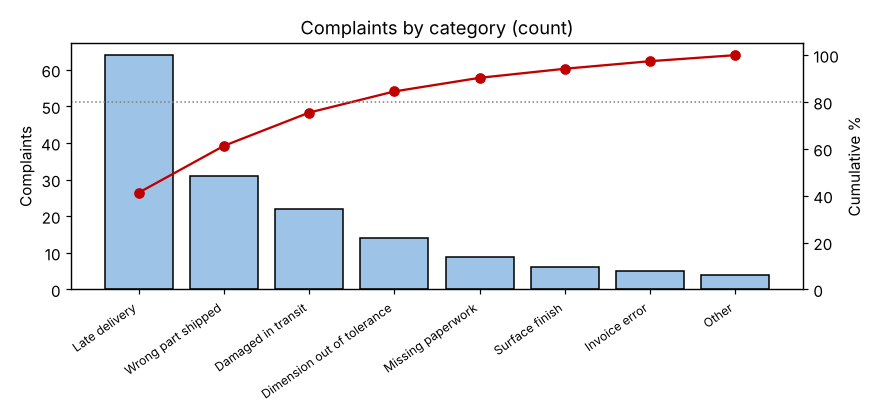
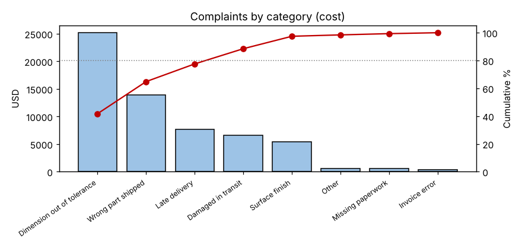

# Module 6 — Pareto Charts

**Time:** 35 min · **Data:** `data/complaints.csv`

## Learning objectives

1. Decide when a Pareto chart is the right tool.
2. Construct and interpret a Pareto chart.
3. Recognize that the "vital few" depend on what you measure.

## 1. The Pareto principle

Joseph Juran named the "vital few and trivial many" after economist Vilfredo Pareto, who observed that a small share of the population held most of the wealth. In quality: a few categories usually account for most of the problems. The 80/20 split is a rule of thumb, not a law — the point is to focus.

**Use a Pareto chart when:** you have count or cost data across categories and need to decide where to focus first.

## 2. How to build one

1. Choose categories (defect type, cause, product, location). Keep "Other" small (< ~10%) and last.
2. Choose the measure: **count, cost, time, or severity-weighted**. This choice matters (Section 4).
3. Total each category; sort descending.
4. Compute percentage and cumulative percentage.
5. Draw bars (descending) plus the cumulative line on a 0–100% secondary axis.

## 3. Worked example — complaints by count

155 complaints last quarter.

```bash
python tools/describe.py pareto data/complaints.csv category
```

| Category | Count | % | Cum % |
|---|---|---|---|
| Late delivery | 64 | 41.3 | 41.3 |
| Wrong part shipped | 31 | 20.0 | 61.3 |
| Damaged in transit | 22 | 14.2 | 75.5 |
| Dimension out of tolerance | 14 | 9.0 | 84.5 |
| Missing paperwork | 9 | 5.8 | 90.3 |
| Surface finish | 6 | 3.9 | 94.2 |
| Invoice error | 5 | 3.2 | 97.4 |
| Other | 4 | 2.6 | 100.0 |



By count, late delivery dominates; three categories make up ~76% of complaints.

## 4. Same data, by cost

Each complaint has an average handling + remedy cost (from `cost_usd`):

```bash
python tools/describe.py pareto data/complaints.csv category --weight cost_usd
```

| Category | Cost (USD) | % | Cum % |
|---|---|---|---|
| Dimension out of tolerance | 25,200 | 41.7 | 41.7 |
| Wrong part shipped | 13,950 | 23.1 | 64.9 |
| Late delivery | 7,680 | 12.7 | 77.6 |
| Damaged in transit | 6,600 | 10.9 | 88.5 |
| Surface finish | 5,400 | 8.9 | 97.4 |
| Other | 600 | 1.0 | 98.4 |
| Missing paperwork | 540 | 0.9 | 99.3 |
| Invoice error | 400 | 0.7 | 100.0 |



**The priority flips.** Dimensional complaints are only 9% of the count but 42% of the cost. Choose the measure that reflects the business impact — often cost or customer severity, not frequency.

## 5. Drill down

A big bar is a starting point. Break "Dimension out of tolerance" down by product, machine or feature in a second-level Pareto to find where to act.

## Pitfalls

- An "Other" bar bigger than the top categories → re-categorize.
- Comparing Pareto charts from periods of different length → use rates.
- Treating a Pareto as proof of cause — it shows *where*, not *why*.

## Check yourself

1. Why might the count Pareto lead a team to the wrong project?
2. What should you do if "Other" is the second-largest bar?

<details><summary>Answers</summary>

1. Frequency ignores impact; a rare but expensive problem may matter more.
2. Break it into meaningful categories and redraw.
</details>
