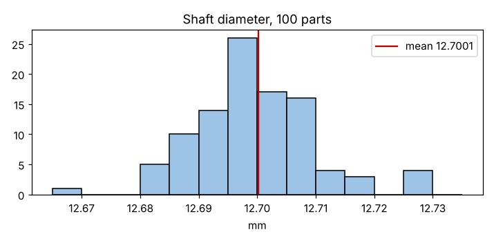
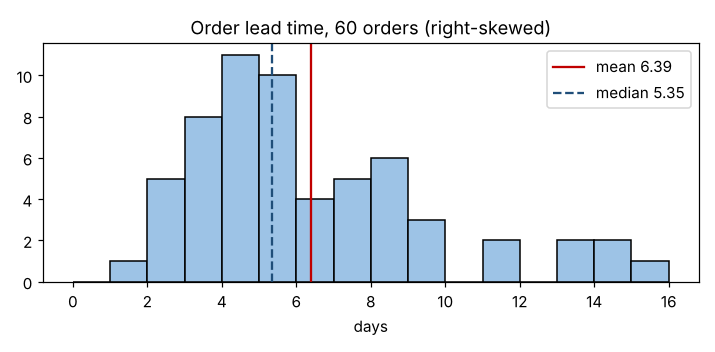
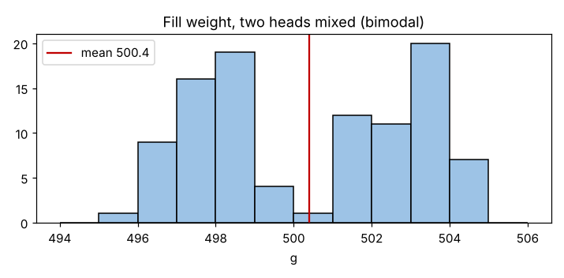

# Module 7 — Histograms

**Time:** 35 min · **Data:** `data/shaft_diameter.csv`, `data/lead_time.csv`, `data/fill_weight.csv`

## Learning objectives

1. Construct a histogram showing the relative frequency of observations in each category (bin).
2. Read shape, center and spread from a histogram.
3. Recognize shapes that signal mixed or distorted data.

## 1. Building one

1. Find min and max.
2. Choose the number of bins: start near √n, use 5–20, round the bin width to a sensible number.
3. Count observations per bin (frequency); divide by n for relative frequency.
4. Draw bars that touch (the scale is continuous). Add spec limits if relevant.

### Worked example — 100 shaft diameters

Min 12.668, max 12.730 mm → range 0.062. √100 = 10 bins → width ≈ 0.006; use 0.005 mm for round edges.

**Reading it:** centered near 12.700, roughly symmetric, mound-shaped, nearly all values within 12.67–12.73.

## 2. Shapes and what they tell you

| Shape | Example in this course | Likely meaning |
|---|---|---|
| Symmetric, single peak | Shaft diameter | Many small sources of variation |
| **Right-skewed** | Lead time (below) | Natural lower bound (time ≥ 0); a few long waits |
| **Bimodal** | Fill weight (below) | Two processes mixed — stratify! |
| Flat / plateau | — | Drifting mean mixed over time |
| Cliff at a spec limit | — | Parts sorted, or data "adjusted" |

### Right-skewed: lead time

Mean 6.39 days > median 5.35 days — the long right tail pulls the mean up (Module 9).

### Bimodal: fill weight

The overall mean (500.4 g) sits in the valley between two peaks — almost no bottle actually weighs the "average." Splitting by `head` shows head A ≈ 498 g and head B ≈ 503 g. The fix is to recenter the heads, which the overall average would never have revealed.

## 3. Limits of histograms

- They hide **time order** — a drifting process and a stable one can look the same. Pair with a run chart.
- With < ~30 points the shape depends heavily on bin choice — use a dot plot instead.

## Exercise 7.1

Build a histogram of `data/lead_time.csv` with bin widths of 1, 2 and 4 days. How does the apparent shape change?

## Check yourself

1. A histogram of hole diameters shows two peaks. What do you do next?
2. Why do bars in a histogram touch while bars in a Pareto chart don't?

Answers

1. Stratify by likely sources (machine, spindle, fixture, shift) and plot each.
2. A histogram's x-axis is a continuous scale; a Pareto's categories are separate.

