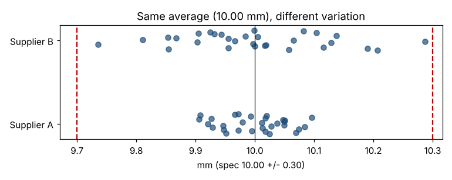

# Module 8 — Understanding Variation: Why Averages Mislead

**Time:** 35 min · **Data:** `data/supplier_thickness.csv`, `data/shift_output.csv`

## Learning objectives

1. Explain why every process varies.
2. Show how averages can hide important information.
3. Distinguish common-cause from special-cause variation.

## 1. Everything varies

No two parts, orders or days are identical. Variation comes from the 6Ms: Machine, Method, Material, Measurement, Man/people, Mother nature (environment). Customers feel the variation, not the average: they don't receive the average part, they receive *a* part.

## 2. Averages mislead — example 1: same mean, different spread

Two suppliers of a 10.00 ± 0.30 mm component, 30 parts each:

| | Supplier A | Supplier B |
|---|---|---|
| Mean | 10.000 | 10.000 |
| Std dev | 0.054 | 0.123 |
| Min – max | 9.906 – 10.096 | 9.735 – 10.287 |

Identical averages. But if each process continues to vary like this (and is roughly normal), A would produce essentially no parts outside the spec, while B would produce about **1.5%** — roughly 15,000 per million — even though none of B's 30 sampled parts was out. Judge suppliers on **center and spread**.

## 3. Averages mislead — example 2: the plant average hides a shift

Units produced per shift, one week:

| Day | Shift 1 | Shift 2 | Shift 3 |
|---|---|---|---|
| Mon | 418 | 405 | 276 |
| Tue | 408 | 408 | 348 |
| Wed | 426 | 407 | 333 |
| Thu | 396 | 405 | 329 |
| Fri | 388 | 406 | 361 |
| **Mean** | **407.2** | **406.2** | **329.4** |

The plant average is 380.9 per shift — "a bit below the 400 target." The truth: two shifts are on target, one is about 18% short and highly erratic (276 to 361). A single average would send the team after the wrong problem.

## 4. Other ways averages fool you

- **Flaw of averages:** plans built on average demand or average cycle time fail because things rarely happen at the average and delays compound.
- **Averages of averages:** averaging daily percentages with different volumes gives the wrong overall rate; sum numerators and denominators instead.
- **Bimodal data:** the average may describe no actual item (Module 7).

## 5. Two kinds of variation

| Common cause | Special cause |
|---|---|
| Always present, many small sources | Specific, identifiable event |
| Predictable within limits | Unpredictable, exceptional |
| Reduce by changing the system | Find and remove (or keep if beneficial) |

Treating common-cause variation as special (reacting to every high or low reading) makes things worse. Process behavior charts tell the two apart — see *Charting Process Behavior*.

## Check yourself

1. Two machines both average 50.0 mm. What else do you need to know before choosing one?
2. Day 1: 2% defective on 100 units; day 2: 6% on 900 units. Average of the percentages vs true overall rate?

Answers

1. The variation (SD or range), the shape, and whether each is stable over time.
2. Average of the percentages = 4%. True rate = (2 + 54)/1,000 = 5.6%.

