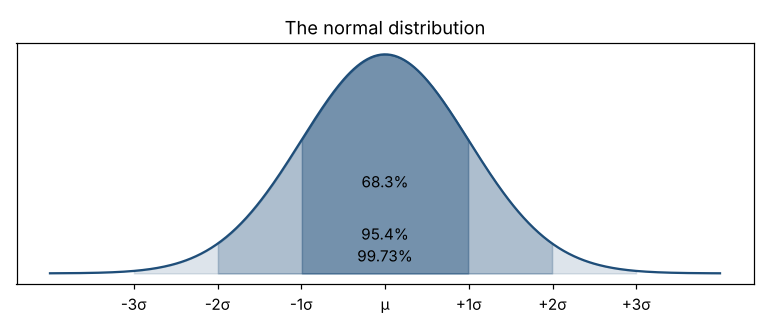

# Module 11 — The Normal Distribution

**Time:** 35 min · **Data:** `data/shaft_diameter.csv`

## Learning objectives

1. Describe the normal distribution and the empirical rule.
2. Compute and use z-scores.
3. Estimate the fraction of output beyond a specification limit — and know when not to trust it.

## 1. The bell curve

The normal distribution is symmetric, single-peaked, and fully described by its mean μ and standard deviation σ. It arises when many small, independent effects add up — which is why many dimensions and weights look roughly normal.



**Empirical rule:**

| Interval | Share inside |
|---|---|
| μ ± 1σ | 68.3% |
| μ ± 2σ | 95.4% |
| μ ± 3σ | 99.73% |

### Check against real data — 100 shaft diameters (x̄ = 12.7001, s = 0.0103)

| Interval | Normal predicts | Observed |
|---|---|---|
| ± 1s | 68% | 78% |
| ± 2s | 95% | 95% |
| ± 3s | 99.7% | 99% |

Close but not exact — real samples rarely match the model perfectly, and 100 points can't pin down the tails.

## 2. z-scores

  z = (x − μ) / σ

z says how many standard deviations a value is from the mean. The normal table (or `NORM.S.DIST` in a spreadsheet) converts z into a probability.

### Worked example — fraction out of spec

Shaft spec 12.67 to 12.73 mm.

- Upper: z = (12.73 − 12.7001) / 0.0103 = **2.89** → P(above) ≈ 0.19%
- Lower: z = (12.67 − 12.7001) / 0.0103 = **−2.92** → P(below) ≈ 0.18%
- Total predicted out of spec ≈ **0.37%** (about 3,700 per million)
- Observed: 1 of 100 parts (12.668)

```bash
python tools/describe.py zscore 12.73 12.70014 0.01033
```

## 3. When the normal model fails

- **Skewed data** (lead time, roughness, flatness): the normal model badly misstates the tail. For lead time, mean ± 2s covers 92% of orders, not 95%, and the "lower" limit is near zero days.
- **Mixed processes** (bimodal fill weight): no single normal curve fits.
- **Unstable processes:** a distribution only describes a process that's predictable over time.

Plot the histogram first (Module 7). The normal curve is a useful model, not a property of nature.

## Check yourself

1. μ = 50, σ = 2. What share of parts falls between 46 and 54?
2. A value has z = −1.5. Interpret.
3. Why might a normal-based estimate of "% over 10 days" for lead time be wrong?

<details><summary>Answers</summary>

1. ±2σ → about 95%.
2. It's 1.5 standard deviations below the mean.
3. Lead time is right-skewed; the normal model underestimates the long upper tail.
</details>
