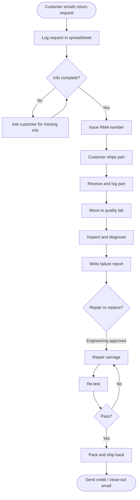
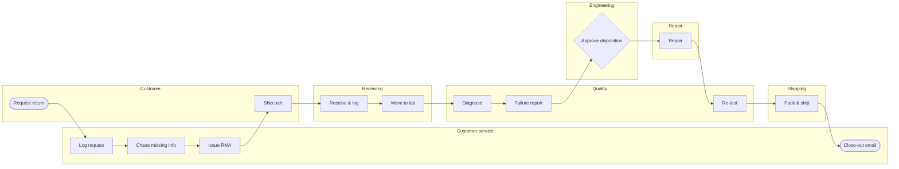

# Module 2 — Process Flow Charts and Swim Lanes

**Time:** 45 min

## Learning objectives

1. Draw a flow chart with decisions and loops.
2. Convert it into a swim-lane map to expose handoffs.

## 1. Flow chart symbols

| Symbol | Meaning |
|---|---|
| Rounded rectangle / oval | Start or end |
| Rectangle | Activity |
| Diamond | Decision (yes/no) |
| Arrow | Flow |
| Document shape | Form or report |
| D-shape / triangle | Delay / wait / storage |

## 2. RMA as-is flow chart



The loop at "Info complete?" runs for about 45% of requests (Module 5: 55% complete-and-accurate on the first pass).

## 3. Swim-lane map



```bash
python tools/pmap.py va      # includes the handoff count
```

**What the lanes show:** **9 handoffs** between 7 owners for one return. Every handoff is a queue: someone else's inbox or shelf. The longest waits sit at handoffs (Engineering approval: 40 h; Customer ships: 72 h; Customer service close-out: 24 h).

## 4. Reading a swim-lane map

- Count handoffs; ask which add value.
- Look for back-and-forth between two lanes (rework or clarification loops).
- Look for lanes that only "approve" or "pass on" — candidates to remove or automate.

## Check yourself

A step bounces between Quality and Engineering three times. What does it suggest?

<details><summary>Answer</summary>

Unclear requirements or decision rights between the two groups — a rework loop. Clarify criteria so one group can decide, or co-locate the decision.
</details>
