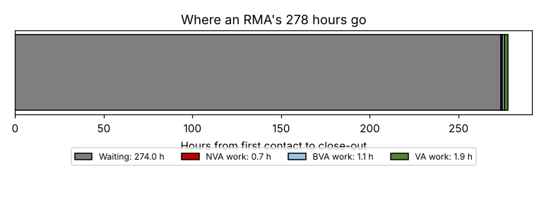

# Module 3 — Value-Added Flow Charts

**Time:** 45 min

## Learning objectives

1. Classify steps as value-added, business-value-added or non-value-added.
2. Build a value-added flow chart with times and communicate the findings.

## 1. Three classes

| Class | Test | RMA examples |
|---|---|---|
| **Value-added (VA)** | Customer would pay for it; it changes form, fit or function; done right the first time | Diagnose failure, repair, ship back |
| **Business-value-added (BVA)** — "necessary non-value-added" | Required today by regulation, contract, or current technology/knowledge — but the customer doesn't value it | Issue RMA number, failure report, re-test, engineering approval |
| **Non-value-added (NVA)** — waste | Neither; could be removed | Logging in a spreadsheet, chasing missing info, moving parts between buildings, close-out email the customer doesn't need |

Be strict: most steps are not VA. BVA steps are targets to reduce or automate; NVA steps are targets to eliminate.

## 2. RMA value-added flow chart

| # | Step | Owner | Work (min) | Wait before (h) | Class |
|---|---|---|---|---|---|
| 1 | Customer emails request | Customer | 5 | 0 | NVA |
| 2 | Log request in spreadsheet | Cust. service | 6 | 6 | NVA |
| 3 | Ask for missing info | Cust. service | 8 | 4 | NVA |
| 4 | Issue RMA number | Cust. service | 4 | 20 | BVA |
| 5 | Customer ships part | Customer | 15 | 72 | NVA |
| 6 | Receive and log | Receiving | 6 | 10 | BVA |
| 7 | Move to quality lab | Receiving | 4 | 16 | NVA |
| 8 | Inspect and diagnose | Quality | 45 | 30 | **VA** |
| 9 | Write failure report | Quality | 25 | 4 | BVA |
| 10 | Approve repair vs replace | Engineering | 10 | 40 | BVA |
| 11 | Repair carriage | Repair | 60 | 24 | **VA** |
| 12 | Re-test | Quality | 20 | 8 | BVA |
| 13 | Pack and ship back | Shipping | 12 | 16 | **VA** |
| 14 | Close-out email | Cust. service | 5 | 24 | NVA |

```bash
python tools/pmap.py va
```

| Summary | Value |
|---|---|
| Steps: VA / BVA / NVA | 3 / 5 / 6 |
| Work time: VA / BVA / NVA | 117 / 65 / 43 min (total 225 min = 3.75 h) |
| Waiting | **274 h** |
| Lead time | 277.8 h ≈ **11.6 calendar days** |
| VA share of **work** | 52% |
| VA time ÷ lead time | **0.70%** |



**The message for management:** the work itself is under 4 hours, and half of it is value-added. The customer's 11.6 days are **98.6% waiting**. Making people work faster would barely help; removing waits, handoffs and loops would.

## 3. Communicating findings

- Color-code steps on the map (green VA, yellow BVA, red NVA).
- Show the time bar (above) — one picture tells the story.
- Lead with the customer impact (11.6 days vs what they need — Module 10).

## Check yourself

Is "inspect incoming part" ever value-added?

<details><summary>Answer</summary>

Usually not — it adds no form, fit or function and exists because quality upstream isn't trusted (BVA at best). Diagnosis of a failed part in an RMA is different: the customer is paying to learn why it failed.
</details>
