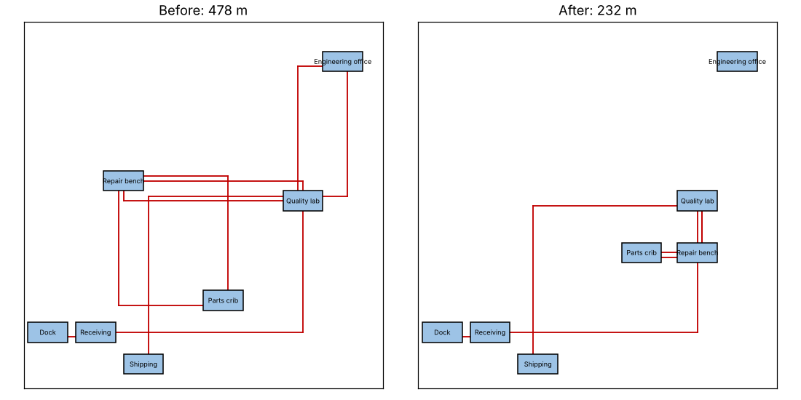

# Module 4 — Spaghetti Diagrams

**Time:** 35 min

## Learning objectives

1. Draw a spaghetti diagram of material, information or people flow.
2. Measure the path and quantify the improvement from a new layout.

## 1. How to draw one

1. Get a scaled floor plan (or sketch one and pace it out).
2. Follow one unit (part, document, person) through the process; draw a line for every move.
3. Number the moves; note why each happens.
4. Measure the total distance (rectilinear along aisles is more realistic than straight-line).
5. Count crossings and backtracks — each one is a question.

For information flow, the "floor plan" can be a map of systems or inboxes; the "distance" becomes handoffs or re-keying.

## 2. RMA returned part — before and after

Locations are coordinates in metres (`LOC` in `tools/pmap.py`); distance is measured along the aisles.

```bash
python tools/pmap.py spaghetti
```

| | Before | After |
|---|---|---|
| Path | Dock → Receiving → Quality lab → Engineering office → Quality lab → Repair bench → Parts crib → Repair bench → Quality lab → Shipping | Dock → Receiving → Quality lab → Repair bench → Parts crib → Repair bench → Quality lab → Shipping |
| Moves | 9 | 7 |
| Distance | **478 m** | **232 m** (−51%) |



**Changes:** engineering approval is done electronically from the failure report (no trip to the engineering office); the repair bench and its parts are moved next to the quality lab.

## 3. What to look for

- Long trips to shared resources (offices, cribs, printers).
- Backtracking (lab → bench → lab).
- Batching caused by distance: if the lab is far, people wait until there are "enough" parts to make the trip worthwhile — which turns distance into **waiting**, the larger cost.

## Check yourself

The new layout cuts distance by half. Why might the effect on lead time be bigger than the walking time saved?

<details><summary>Answer</summary>

Distance drives batching — parts wait to be moved in batches. Shorter distance allows single-piece moves, removing hours of waiting, not just minutes of walking.
</details>
