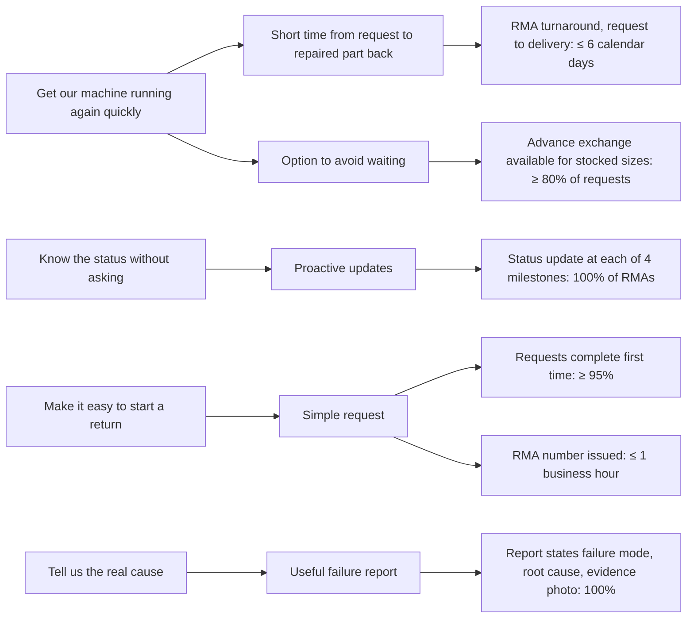

# Module 9 — CTQ Tree Diagram

**Time:** 35 min

## Learning objectives

1. Use a tree diagram to break a customer need into measurable CTQ characteristics.
2. Write operational definitions for CTQs.

## 1. From need to CTQ

```
Need (customer's words) → Drivers (what makes it true) → CTQs (measurable, with target and limit)
```

A CTQ must be **measurable**, **controllable by the process**, and **traceable** to a customer need.

## 2. RMA CTQ tree



## 3. Operational definitions

| CTQ | Operational definition |
|---|---|
| RMA turnaround | Calendar days from the timestamp of the customer's request in the RMA system to the carrier's proof of delivery of the repaired or replacement part |
| Requests complete first time | Share of RMA requests that need no clarification contact before the RMA number is issued, per month |
| Status updates | Automatic message sent at: RMA issued, part received, diagnosis complete, shipped |

Without the definition, "turnaround" could be measured from receipt of the part (hiding the customer's 3 days of shipping and the authorization delay) — which is how internal metrics end up looking fine while customers are unhappy.

## Check yourself

"Excellent customer communication" — is it a CTQ?

<details><summary>Answer</summary>

No — it's a need or driver. Break it down to something measurable (e.g., status message at each milestone, response to inquiries within 4 business hours).
</details>
