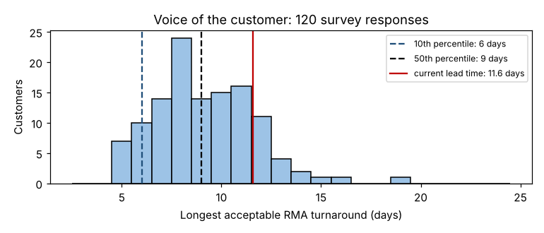

# Module 10 — Voice of the Customer as Specifications

**Time:** 35 min

## Learning objectives

1. Turn customer survey data into a target and specification limit.
2. Compare the current process against the specification.

## 1. From what customers say to a spec

A specification has a **target** and **limits**. When customers' tolerances differ, choose a limit that satisfies the share of customers you commit to — and say so.

## 2. Worked example — RMA turnaround

Survey question to 120 customers: *"What is the longest RMA turnaround, door to door, you would accept?"*

```bash
python tools/pmap.py spec
```



| Statistic | Days |
|---|---|
| Median acceptable | 9 |
| 25th percentile | 7 |
| 10th percentile | 6 |
| 5th percentile | 5 |
| **Current lead time** (Module 3) | **11.6** |

| Turnaround | Share of customers satisfied |
|---|---|
| Current, 11.6 days | **17%** |
| 7 days | 86% |
| 5 days | 100% |

**Reading:** the current process satisfies only about one customer in six. A 7-day upper limit satisfies ~86%; to satisfy ~90% you need about 6 days.

**Specification (proposal):** RMA turnaround, as defined in Module 9 — **target 5 days, upper limit 6 days** — plus an advance-exchange option for customers who can't wait at all.

## 3. Spec limits apply to every RMA, not the average

If the future process averages 5 days with a standard deviation of 1.5 days, a share of RMAs will still exceed 6 days. Track the **distribution** (e.g., percentage of RMAs within 6 days, plus a process behavior chart of turnaround) — a good average can hide many late returns. (See *Measurement & Basic Statistics*, Module 8.)

## 4. Closing the loop

The VOC-based spec now drives the future-state map (Module 5): it tells you how much waiting must be removed (from 274 h to under ~140 h) and where the biggest blocks are (customer shipping, engineering approval, receiving-to-lab).

## Check yourself

Why not simply set the spec at the median (9 days)?

<details><summary>Answer</summary>

Half of customers would find it unacceptable. The spec should satisfy the share of customers the business commits to, which means using a low percentile of their tolerance.
</details>
