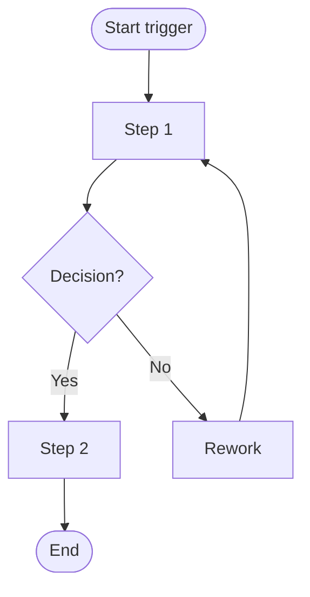
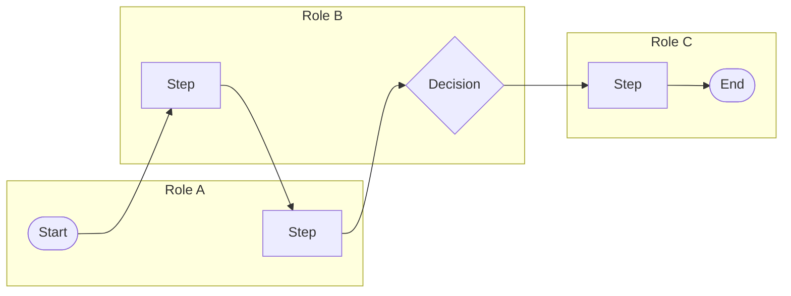
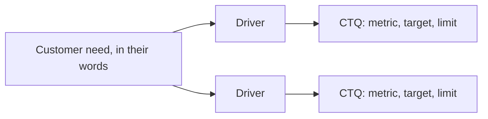

# Mapping Templates

Copy these into your own Markdown (GitHub renders Mermaid diagrams) or onto a whiteboard.

## SIPOC

| Suppliers | Inputs | Process (5–7 steps) | Outputs | Customers |
|---|---|---|---|---|
| | | Start trigger: | | |
| | | 1. | | |
| | | 2. | | |
| | | 3. | | |
| | | 4. | | |
| | | 5. | | |
| | | End point: | | |

## Flow chart

## Swim lanes

## Value-added flow chart worksheet

| # | Step | Owner | Work (min) | Wait before (h) | VA / BVA / NVA | Why this class? |
|---|---|---|---|---|---|---|
| 1 | | | | | | |

Totals: work by class; total wait; lead time; VA ÷ lead time; handoffs.

## Spaghetti worksheet

| Move # | From | To | Distance (m) | Why? |
|---|---|---|---|---|
| 1 | | | | |

## CTQ tree

| CTQ | Operational definition | Target | Limit | Data source |
|---|---|---|---|---|
| | | | | |
