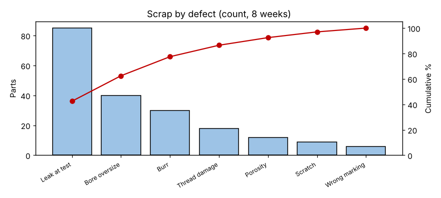
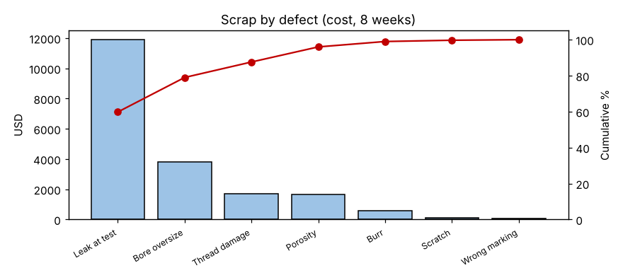

# Module 3 — Pareto Charts

**Time:** 40 min · **Data:** `data/scrap_log.csv`

## Learning objectives

1. Construct and interpret Pareto charts by count and by cost.
2. Use second-level Pareto charts to focus the investigation.

## 1. Build it

Total by category, sort descending, add percentage and cumulative percentage; bars plus a cumulative line. Keep "Other" small and last. (Full method: *Measurement & Basic Statistics*, Module 6.)

## 2. Worked example — 8 weeks of scrap

```bash
python tools/rca.py pareto
```

| Defect | Count | % | Cum % |
|---|---|---|---|
| Leak at test | 85 | 42.5 | 42.5 |
| Bore oversize | 40 | 20.0 | 62.5 |
| Burr | 30 | 15.0 | 77.5 |
| Thread damage | 18 | 9.0 | 86.5 |
| Porosity | 12 | 6.0 | 92.5 |
| Scratch | 9 | 4.5 | 97.0 |
| Wrong marking | 6 | 3.0 | 100.0 |



By cost (leak scrap includes test time and a finished part):

| Defect | Cost (USD) | % | Cum % |
|---|---|---|---|
| Leak at test | 11,900 | **59.8** | 59.8 |
| Bore oversize | 3,800 | 19.1 | 79.0 |
| Thread damage | 1,710 | 8.6 | 87.6 |
| Porosity | 1,680 | 8.4 | 96.0 |
| Burr | 600 | 3.0 | 99.0 |
| Scratch | 135 | 0.7 | 99.7 |
| Wrong marking | 60 | 0.3 | 100.0 |



**Reading:** leaks are the top problem either way, and by cost they are 60% of scrap. Burrs are third by count but fifth by cost. Focus: **leaks**.

## 3. Drill down

Next-level Pareto of leaks by machine and shift (Module 8) shows MC3 has 50 of 85 leaks. A Pareto tells you *where* to look, not *why*.

## Check yourself

Burrs are 15% of scrapped parts but 3% of cost. Should the team ignore them?

<details><summary>Answer</summary>

Not forever — but they are not the first project. They may matter for safety or customer perception; otherwise address them after leaks.
</details>
