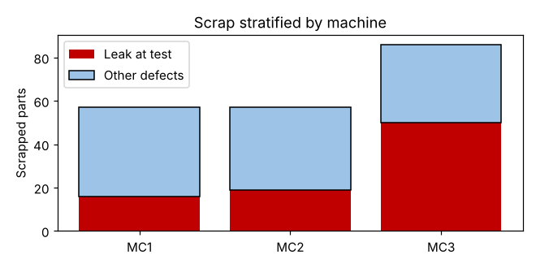

# Module 8 — Root Cause Stratification

**Time:** 45 min · **Data:** `data/scrap_log.csv`

## Learning objectives

1. Stratify problem data by potential sources to locate causes.
2. Test whether a difference between strata is real.

## 1. Stratify

Split the data by factors from the fishbone and Is/Is-Not: machine, shift, operator, material lot, time, product variant. If a problem is concentrated in one stratum, the cause lives in what is different about it.

## 2. Worked example — leaks by machine and shift

```bash
python tools/rca.py stratify
```

| Machine | Leak rejects | Other rejects | Leak share |
|---|---|---|---|
| MC1 | 16 | 41 | 28% |
| MC2 | 19 | 38 | 33% |
| MC3 | **50** | 36 | **58%** |



| Shift | Leak rejects |
|---|---|
| Day | 47 |
| Night | 38 |

- **Machine:** MC3 has 59% of all leak rejects (50 of 85), while other defects are spread evenly. Chi-square test of machine vs (leak / other): χ² = 15.4, df = 2, **p = 0.0004** — a real difference. (Test method: *Fundamentals of Hypothesis Testing*, Module 9.)
- **Shift:** no meaningful difference (day runs slightly more parts).

**Next question:** what's different about MC3? Candidates from the fishbone: tool life (MC3 runs the longest jobs between changes), spindle runout, coolant. Test with data (Modules 9–11).

## 3. Caution

Strata must be compared fairly: if MC3 makes more parts, compare **rates**, not counts. Here the comparison uses leak share of each machine's scrap; with production counts you'd compute leaks per 1,000 parts made.

## Check yourself

Leaks are 60% night shift, but night shift makes 60% of the parts. Is night shift the problem?

<details><summary>Answer</summary>

No evidence of that — the leak rate per part is the same on both shifts. Always normalize by volume.
</details>
