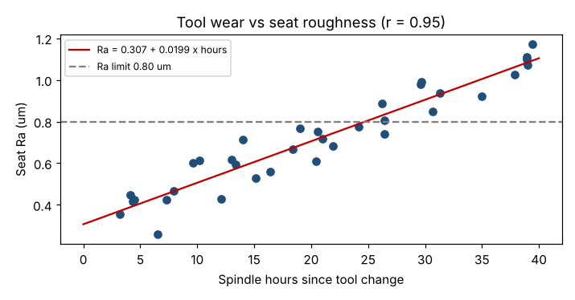

# Module 9 — Scatter Plots and Correlation

**Time:** 50 min · **Data:** `data/tool_wear.csv`

## Learning objectives

1. Use a scatter plot to examine the relationship between two variables.
2. Measure the strength of a linear relationship with the correlation coefficient.
3. Avoid the classic correlation traps.

## 1. Scatter plot

Put the suspected cause (X) on the horizontal axis and the effect (Y) on the vertical. Look for direction, form (straight or curved), strength, and unusual points.

## 2. Correlation coefficient

Pearson's r ranges from −1 to +1:

  r = Σ(x − x̄)(y − ȳ) / √[Σ(x − x̄)² Σ(y − ȳ)²]

| \|r\| | Rough description |
|---|---|
| < 0.3 | Weak |
| 0.3–0.7 | Moderate |
| > 0.7 | Strong |

r² = share of the variation in Y explained by a straight-line relationship with X. **Spearman's ρ** uses ranks and works for monotonic curved relationships and ordinal data.

## 3. Worked example — tool hours vs seat roughness

35 parts from MC3, with hours on the finishing insert when each was cut.

```bash
python tools/rca.py scatter
```

| Statistic | Value |
|---|---|
| Pearson r | **0.955** |
| r² | 0.91 |
| p-value (H₀: no correlation) | < 0.0001 |
| Spearman ρ | 0.953 |



A strong, positive, linear relationship: roughness rises steadily as the insert wears. Combined with the physical mechanism (a worn cutting edge leaves a rougher surface), this is strong evidence for tool wear as a direct cause.

## 4. Traps

| Trap | Example | Defense |
|---|---|---|
| **Correlation ≠ causation** | Scrap correlates with overtime hours — but both rise with order volume | Look for a mechanism; run an experiment; control for the lurking variable |
| **Nonlinear relationships** | r ≈ 0 for a U-shaped curve | Always plot |
| **Outliers** | One extreme point creates (or hides) a high r | Plot; check with Spearman; investigate the point |
| **Restricted range** | Testing only 0–5 tool hours shows little effect | Sample across the full range of X |
| **Mixed groups** | Combining machines with different relationships | Stratify, then plot |

## Check yourself

r = 0.10 between coolant concentration and roughness. Can you conclude coolant doesn't matter?

<details><summary>Answer</summary>

Not without plotting — the relationship could be curved, the range tested could be narrow, or another factor could mask it. A low r means no strong *linear* relationship in this data.
</details>
