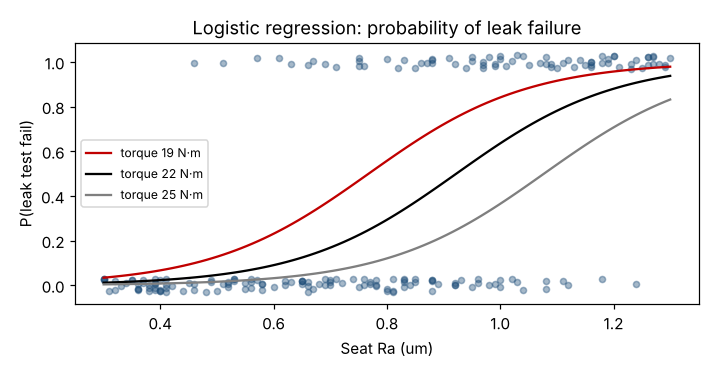

# Module 12 — Binary Logistic Regression

**Time:** 75 min · **Data:** `data/leak_test.csv`

## Learning objectives

1. Model a pass/fail output as a function of process inputs.
2. Interpret coefficients as odds ratios and predicted probabilities.
3. Use the model to set an input limit.

## 1. Why not ordinary regression?

When Y is binary (pass/fail, yes/no), a straight line predicts probabilities below 0 or above 1. Logistic regression models the **log-odds** of failure:

  ln[p / (1 − p)] = b₀ + b₁X₁ + b₂X₂

  p = 1 / (1 + e^−(b₀ + b₁X₁ + b₂X₂))

Coefficients are estimated by maximum likelihood. e^(b) is the **odds ratio** for a one-unit increase in that X.

## 2. Worked example — leak test pass/fail

200 valves with seat Ra, clamp torque and leak-test result; 76 failed.

```bash
python tools/rca.py logistic
```

| Term | Coefficient | p-value | Odds ratio |
|---|---|---|---|
| Constant | 1.52 | 0.43 | — |
| Seat Ra (µm) | **7.17** | < 0.001 | ×2.05 per +0.1 µm |
| Torque (N·m) | **−0.37** | < 0.001 | ×0.69 per +1 N·m |

McFadden pseudo-R² = 0.40; 84% of valves correctly classified with a 0.5 cutoff.



**Predicted failure probability at 22 N·m:**

| Seat Ra | P(fail) |
|---|---|
| 0.4 µm | 2.3% |
| 0.8 µm | 29% |
| 1.2 µm | 88% |

**Reading:** every 0.1 µm of extra roughness roughly **doubles** the odds of failure; each extra N·m of torque cuts the odds by about 30%.

## 3. Using it — set a roughness limit

For P(fail) ≤ 5% at the nominal 22 N·m: solve b₀ + b₁·Ra + b₂·22 = ln(0.05/0.95) → **Ra ≤ 0.51 µm**.

That is tighter than the 0.80 µm drawing limit — the drawing limit isn't protecting the leak function. Feed this back to design (Module 14 decision) and to the tool-life limit (Module 10: a 16 h change gives mean Ra ≈ 0.63 µm, so the interval may need shortening to about 10 h, or the finishing process improved).

The two analyses agree: the continuous leak-rate model (Module 11) and the pass/fail model both identify roughness and torque as the drivers.

## Check yourself

1. An odds ratio of 0.69 per N·m: does more torque increase or decrease failures?
2. Why is a continuous Y (leak rate) preferable when available?

<details><summary>Answers</summary>

1. Decreases (odds ratio below 1).
2. It carries more information per part, needs fewer samples, and shows how close good parts are to failing.
</details>
