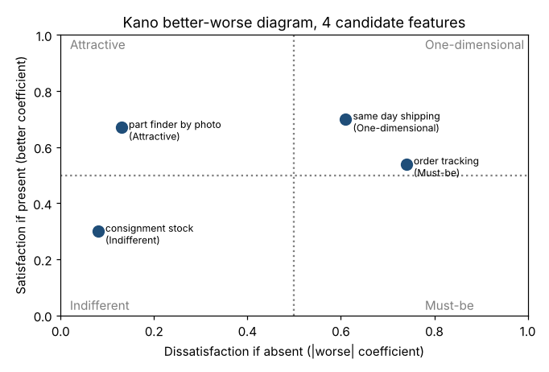

# Module 3 — Understanding Customer Requirements: Two Types, Kano, and Changing Expectations

**Time:** 60 min · **Data:** `data/survey.csv`

## Learning objectives

1. Distinguish output requirements from service requirements, and stated from unstated needs.
2. Classify requirements with the Kano model using survey data.
3. Explain how expectations change over time and drive the process.

## 1. Two types of customer requirements

| Type | About | Spare-parts examples |
|---|---|---|
| **Output requirements** | The product or service delivered | Right part; delivered in ≤ 3 days; undamaged; correct paperwork |
| **Service requirements** | How the customer is treated while getting it | Easy to order; status without asking; knowledgeable help; problems fixed without arguing |

Both matter: a correct, on-time part delivered after three chasing phone calls still creates a dissatisfied customer. Process maps usually capture output requirements and miss service ones.

A second, overlapping distinction: **stated** needs (what customers say) vs **unstated** needs (assumed — so obvious they're never said — or not yet imagined). Kano's model makes this measurable.

## 2. The Kano model

Noriaki Kano and colleagues (1984) showed that satisfaction isn't linear in performance:

| Category | If present | If absent | Usually stated? |
|---|---|---|---|
| **Must-be** (basic) | Taken for granted | Very dissatisfied | No — assumed |
| **One-dimensional** (performance) | More satisfied | More dissatisfied | Yes |
| **Attractive** (delighter) | Delighted | Not missed | No — not imagined |
| Indifferent | — | — | — |
| Reverse | Dissatisfied | Satisfied | — |

### Measuring it — the Kano questionnaire

For each feature ask two questions, each with answers *1 I like it · 2 I expect it · 3 I'm neutral · 4 I can live with it · 5 I dislike it*:

- **Functional:** "If the order could be tracked online, how would you feel?"
- **Dysfunctional:** "If the order could **not** be tracked online, how would you feel?"

Classify each respondent's answer pair with the evaluation table:

| Functional ↓ / Dysfunctional → | Like | Expect | Neutral | Live with | Dislike |
|---|---|---|---|---|---|
| **Like** | Q | A | A | A | **O** |
| **Expect** | R | I | I | I | M |
| **Neutral** | R | I | I | I | M |
| **Live with** | R | I | I | I | M |
| **Dislike** | R | R | R | R | Q |

(A attractive, O one-dimensional, M must-be, I indifferent, R reverse, Q questionable.)

### Case results (300 respondents)

```bash
python tools/voc.py kano
```

| Feature | Most common category | Better | Worse |
|---|---|---|---|
| Order tracking | **Must-be** (41%; one-dimensional 34%) | 0.54 | −0.74 |
| Same-day shipping | **One-dimensional** (42%) | 0.70 | −0.61 |
| Part finder by photo | **Attractive** (57%) | 0.67 | −0.13 |
| Consignment stock | **Indifferent** (66%) | 0.30 | −0.08 |

**Better** = (A + O)/(A + O + M + I): how much satisfaction rises if present. **Worse** = −(O + M)/(A + O + M + I): how much it falls if absent (Berger et al., 1993).



**Design implications:** order tracking is now an entry ticket — not having it hurts (worse −0.74) more than having it helps. Same-day shipping pays back in both directions. A photo part-finder would delight with little risk if left out — a differentiator. Consignment stock interests few customers.

## 3. Expectations change over time

Delighters become performance needs, then basics. Online order tracking was once a novelty in industrial parts; this survey shows it is now a must-be for the largest group of customers. Implications:

- VOC must be refreshed — what delights today is expected tomorrow.
- Today's delighters (photo part-finder) are tomorrow's competitive necessity: plan the roadmap.
- The process must be designed to deliver must-bes flawlessly; they earn no credit but cause defections.

## Check yourself

Order tracking scores "Must-be." A manager says, "Customers rarely mention tracking in interviews, so it's low priority." Respond.

<details><summary>Answer</summary>

Must-be needs are rarely stated precisely because they're assumed. The Kano data show its absence strongly dissatisfies (worse −0.74); it's a high priority.
</details>
