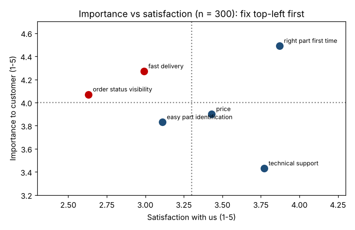

# Module 5 — Surveys: Design and Execution

**Time:** 60 min

## Learning objectives

1. Design a survey that produces unbiased, usable data.
2. Plan sampling, distribution and follow-up.
3. Analyze importance and satisfaction together.

## 1. Design steps

1. **Objective:** which decisions will the results inform? Every question must earn its place.
2. **Population and sampling frame:** who exactly; what list you'll draw from (Module 6 for how many).
3. **Questions:** from the interviews and affinity themes — survey only what you already know matters.
4. **Scales:** consistent 5-point (or 7-point) labeled scales; same direction throughout.
5. **Pilot** with 5–10 customers; fix confusing items.
6. **Distribute** (email, web, phone), with reminders.
7. **Analyze** by segment.

## 2. Writing good questions

| Problem | Bad | Better |
|---|---|---|
| Double-barreled | "How satisfied are you with our delivery speed and accuracy?" | Two questions |
| Leading | "How much do you like our new, faster ordering portal?" | "How easy is it to place an order with us?" |
| Vague | "Do you order often?" | "How many orders did you place with us in the last 3 months?" |
| Jargon | "Rate our OTIF performance." | "How often does your order arrive complete and on the promised day?" |
| Unbalanced scale | Excellent / Very good / Good / Fair | Very dissatisfied … Very satisfied (with a midpoint) |
| Solution-led | "Would you use a mobile app?" | "Describe how you identify a replacement part today." |

## 3. Bias to manage

- **Non-response bias:** respondents differ from non-respondents. Compare respondents' profile to the population; send reminders; keep it short (≤ 10 minutes).
- **Selection bias:** surveying only active web users misses customers who order by phone.
- **Order effects:** put general questions before specific ones; randomize item order where possible.
- **Acquiescence:** some people agree with everything — mix item wording.

## 4. Importance vs satisfaction

Ask both for the same needs and plot them:

```bash
python tools/voc.py importance
```

| Need | Importance | Satisfaction | Gap |
|---|---|---|---|
| Order status visibility | 4.07 | **2.63** | **1.44** |
| Fast delivery | **4.27** | 2.99 | **1.28** |
| Easy part identification | 3.83 | 3.11 | 0.72 |
| Right part first time | **4.49** | 3.87 | 0.62 |
| Price | 3.90 | 3.43 | 0.48 |
| Technical support | 3.43 | 3.77 | −0.34 |



**Reading:** status visibility and delivery speed are important and poorly delivered — fix first. Right part first time is most important and fairly well delivered — protect it. Technical support exceeds its importance — don't add resources there.

**Net promoter score** ("How likely are you to recommend us?", 0–10): promoters (9–10) 22.7%, detractors (0–6) 46.7% → **NPS = −24**. Useful as a headline trend; the importance–satisfaction gaps tell you what to do about it.

## Check yourself

Rewrite: "How satisfied are you with our helpful and knowledgeable support team?"

<details><summary>Answer</summary>

Split and de-bias: "How satisfied are you with how quickly support answered your question?" and "How satisfied are you that support solved your problem?" (neutral wording, one idea each).
</details>
