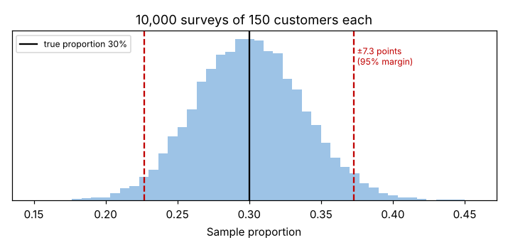

# Module 6 — The Degree of Uncertainty in Sampling; Calculating Margin of Error

**Time:** 50 min · **Data:** `data/survey.csv`

## Learning objectives

1. Explain why survey results vary from sample to sample.
2. Calculate the margin of error for a proportion.
3. Calculate the sample size needed for a target margin of error.

## 1. Sampling uncertainty

A survey of 150 customers gives one estimate. Another 150 would give a slightly different one. The **margin of error (MOE)** says how far a sample result is likely to be from the true value for the whole population.

**Simulation:** suppose exactly 30% of all customers are satisfied. Run 10,000 surveys of 150 customers each:

```bash
python tools/voc.py sim
```

| | Value |
|---|---|
| Standard deviation of the 10,000 sample results | 0.0373 |
| Theory: √[p(1 − p)/n] = √(0.3 × 0.7 / 150) | 0.0374 |
| Middle 95% of sample results | 22.7% to 37.3% |
| 95% MOE = 1.96 × 0.0374 | **±7.3 points** |
| Share of 95% intervals that contained the true 30% | 95.1% |



## 2. Margin of error for a proportion

  MOE = z × √[p̂(1 − p̂)/n]  (z = 1.96 for 95%)

Finite-population correction when sampling a large share of a small population: multiply by √[(N − n)/(N − 1)].

### Case — satisfied with order status visibility (rating 4–5)

```bash
python tools/voc.py moe
```

| Group | n | Satisfied | 95% MOE | Plausible range |
|---|---|---|---|---|
| All customers | 300 | 16.3% | ±4.2 | 12–21% |
| MRO plants | 150 | 16.0% | ±5.9 | 10–22% |
| Distributors | 90 | 16.7% | ±7.7 | 9–24% |
| OEMs | 60 | 16.7% | ±9.4 | 7–26% |

**Reading:** whichever segment you look at, a large majority is not satisfied with status visibility. Segment results are much less precise than the total — don't over-interpret small differences between segments.

## 3. How many responses do you need?

  n = z² p(1 − p) / MOE²  (use p = 0.5 if unknown — the worst case)

| Target | Responses needed |
|---|---|
| ±10 points, 95% | 97 |
| ±5 points, 95% | 385 |
| ±5 points, 95%, from a customer base of 1,200 | 292 |

Plan for responses **per segment** if you need segment-level conclusions, and divide by the expected response rate to get the number of invitations.

**MOE covers sampling error only.** It doesn't fix a biased sample, leading questions, or non-response bias — a precise answer to the wrong question is still wrong.

## Check yourself

A survey of 100 customers shows 60% want same-day shipping. 95% MOE?

<details><summary>Answer</summary>

1.96 × √(0.6 × 0.4 / 100) = 1.96 × 0.049 ≈ ±9.6 points → roughly 50% to 70%.
</details>
