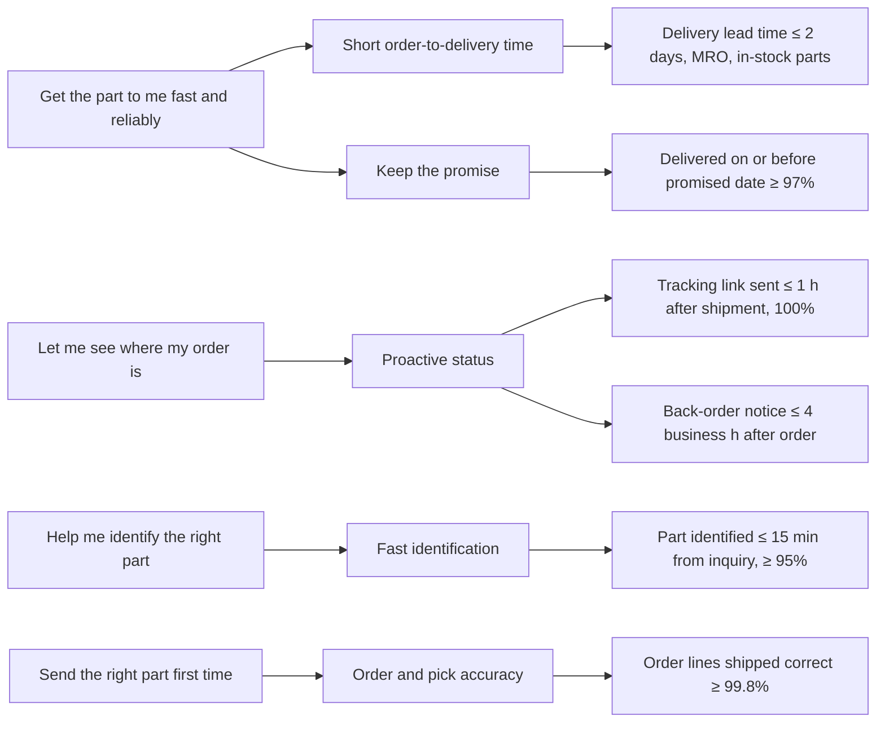

# Module 8 — CTQ Tree Diagram and Operational Definitions

**Time:** 50 min

## Learning objectives

1. Use a tree diagram to translate needs into critical-to-quality (CTQ) characteristics.
2. Write an effective operational definition.

## 1. CTQ tree

A CTQ must be measurable, traceable to a need, and within the process's control. The tree also shows **drivers** (intermediate) — useful when one need has several measurable aspects.

## 2. Operational definitions

W. Edwards Deming: there is no true value of anything — only the result of a stated method. An operational definition states:

| Element | Delivery lead time (example) |
|---|---|
| **Characteristic** | Delivery lead time for in-stock spare parts to MRO customers |
| **Measurement method** | Calendar days (to 0.1 day) from order timestamp in ERP to carrier proof-of-delivery timestamp |
| **Sampling** | All orders; reported weekly |
| **Decision criteria** | "Met" if ≤ 2.0 days; orders placed after 15:00 start the clock at 08:00 next business day; customer-requested later dates excluded and counted separately |
| **Data source and owner** | ERP order table + carrier API; owner: customer service manager |

### The test

Give the definition to two people and the same 50 orders. Do they get the same answers? If not, the definition isn't operational. Typical failures: "order received" (email arrival? entry in ERP?), "delivered" (left at the dock? signed for by stores?), exclusions decided case by case.

**Why it matters (illustrative):** an internal on-time metric measured from "order released to warehouse" to "shipped" can read 94% while the same orders, measured from the customer's order timestamp to proof of delivery, are on time only 71% of the time. Same process, different definitions.

## Check yourself

Write an operational definition for "right part first time."

Answer (one version)

Share of shipped order lines, per week, for which the customer does not report a wrong part, wrong quantity or wrong revision within 30 days of delivery, as recorded in the CRM return/complaint codes WP, WQ, WR; denominator = all order lines shipped that week; owner: quality.

