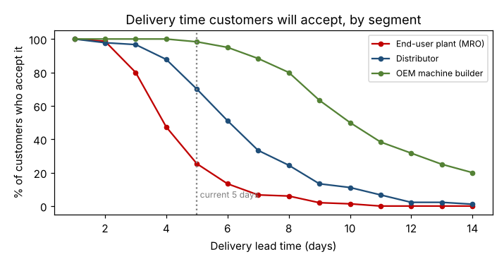

# Module 9 — VOC as Specifications and Targets

**Time:** 45 min · **Data:** `data/survey.csv`

## Learning objectives

1. Turn customer data into specification limits and targets.
2. Set different targets for different segments when the data justify it.

## 1. From VOC to spec

| Term | Meaning |
|---|---|
| **Target** | The ideal value the process aims for |
| **Specification limit** | The boundary beyond which the customer is dissatisfied (a defect) |
| **Objective** | Business goal for performance against the spec (e.g., 95% of orders within spec by Q4) |

## 2. Case — delivery lead time by segment

Survey question: *"For an in-stock spare part, what is the longest delivery time you would accept?"*

```bash
python tools/voc.py spec
```

| Segment | Median acceptable | 10th percentile | Satisfied by today's 5 days | by 3 days | by 2 days |
|---|---|---|---|---|---|
| MRO plants | 3 days | 2 days | **25%** | 80% | 99% |
| Distributors | 6 days | 3 days | 70% | 97% | 98% |
| OEMs | 9.5 days | 6 days | 98% | 100% | 100% |



**Reading:** today's 5-day delivery is fine for OEMs, marginal for distributors, and unacceptable for three-quarters of MRO plants — the target segment (Module 2).

**Specifications (proposal):**

| Segment | Target | Upper spec limit | Basis |
|---|---|---|---|
| MRO plants | 1 day | **2 days** | Satisfies ~99% of MRO respondents |
| Distributors | 2 days | **3 days** | Satisfies ~97% |
| OEMs | Standard | 5 days | Already satisfies 98% |

**Objective:** ≥ 95% of MRO orders delivered within 2 days by end of next year (current: measure with the operational definition from Module 8).

## 3. Cautions

- A spec applies to **each order**, not the average. A 1.5-day average with wide spread can still put many orders over 2 days.
- Customers' stated tolerances are an input, not the final answer: cost and feasibility (VOB, VOP) must be weighed.
- Survey results have uncertainty (Module 6); the 10th percentile from 150 responses is an estimate.

## Check yourself

Why not set one delivery spec for all customers?

<details><summary>Answer</summary>

Segments have very different tolerances; one spec would either over-serve OEMs at high cost or under-serve MRO plants, the target segment.
</details>
