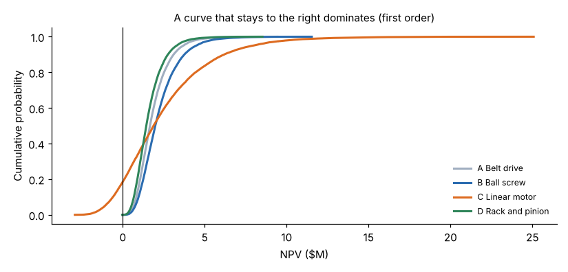
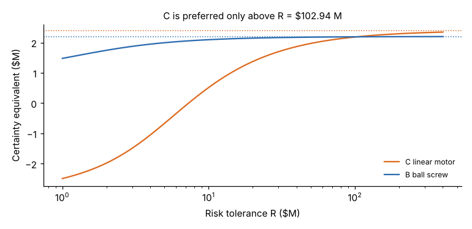

# Module 04 — Decision Making under Uncertainty

Outline items: Stochastic dominance · Decision trees · Modeling risk aversion · Expected utility

## Objectives

- Screen alternatives with stochastic dominance before asking anyone about their risk attitude.
- Build and roll back a decision tree.
- Model risk aversion with a utility function, and choose by expected utility.

## Stochastic dominance

Using the demand distribution from Module 03, Corran simulated each design's 5-year NPV (20,000 runs; price, cost, investment and market share per design):



| Design | Mean NPV | P10 | P90 | P(loss) |
|---|---|---|---|---|
| A Belt | $1.85 M | 0.83 | 3.10 | 0 % |
| B Ball screw | $2.22 M | 0.96 | 3.76 | 0 % |
| C Linear motor | $2.45 M | **−0.60** | 6.19 | **18.6 %** |
| D Rack and pinion | $1.61 M | 0.68 | 2.75 | 0 % |

- **First-order stochastic dominance (FSD):** X dominates Y if X's cumulative distribution is never above Y's. Then X is at least as likely as Y to exceed any value. **Everyone who prefers more money to less** prefers X.
- **Second-order (SSD):** the area under X's cumulative curve, accumulated from the left, is never larger than Y's. Then **every risk-averse** decision maker prefers X.

Results:

- **B dominates A and D** (first order), and **A dominates D**.
- A and D can be **dropped**, without anyone having to state a risk attitude.
- **B vs C:** no dominance either way. C has the higher mean but a fat downside. The choice depends on risk attitude, which the rest of this module models.

## Decision trees

To keep the arithmetic visible, simplify the market to two states:

```
                      ┌─ strong (0.40) ── NPV 10.5
         ┌─ Launch C ─┤
         │            └─ weak   (0.60) ── NPV −3.0        EMV(C) = 0.4 × 10.5 + 0.6 × (−3.0) = 2.40
Decide ──┤
         │            ┌─ strong (0.40) ── NPV  4.0
         └─ Launch B ─┤
                      └─ weak   (0.60) ── NPV  1.0        EMV(B) = 0.4 × 4.0 + 0.6 × 1.0 = 2.20
```

**Roll back** from right to left:

- At chance nodes, take the probability-weighted average (expected monetary value, EMV).
- At decision nodes, take the best branch.

By EMV, choose **C** (2.40 vs 2.20). Module 07 adds a market study before the decision.

## Modeling risk aversion

A company may not want a 60 % chance of losing $3 M, even for a slightly higher EMV. Exponential utility models this:

u(x) = 1 − e^(−x/R)

Here R is the **risk tolerance** in $M. A rough guide is about the largest gamble you would take at 50/50 to win R or lose R/2. Smaller R means more risk aversion.

**Certainty equivalent** (CE) = the sure amount with the same utility as the gamble = −R ln(1 − E[u]). **Risk premium** = EMV − CE.

| R ($M) | CE of C | CE of B | Choice | Risk premium of C |
|---|---|---|---|---|
| 2 | −1.98 | 1.74 | B | 4.38 |
| 5 | −0.67 | 2.00 | B | 3.07 |
| 10 | 0.51 | 2.09 | B | 1.89 |
| 50 | 1.97 | 2.18 | B | 0.43 |
| 200 | 2.29 | 2.20 | C | 0.11 |



C is preferred only if R exceeds about **$103 M**, which is far more risk tolerance than a firm of Corran's size can sensibly have. **B is the rational choice for any realistic risk attitude.**

## Expected utility

Choosing by **expected utility** is rational if your preferences satisfy a few consistency axioms (von Neumann–Morgenstern):

- **Completeness:** you can compare any two options.
- **Transitivity:** preferences don't go round in a circle.
- **Continuity:** a mixture of a better and a worse option can be made equal to a middle one.
- **Independence:** mixing two options with the same third one doesn't change their order.

In practice:

1. Assess the utility function: risk tolerance R, or a few certainty-equivalent questions.
2. Compute expected utility for each alternative and choose the highest.
3. Report the CE, which is easier to communicate than utils.
4. Check whether the choice changes over a plausible range of R.

## Run it

```bash
python tools/edmkit.py dominance
python tools/edmkit.py tree
python tools/edmkit.py utility
```

## Check yourself

1. Compute C's certainty equivalent at R = $10 M.
2. Why can stochastic dominance remove A and D without any utility assessment?

<details><summary>Answers</summary>

1. u(10.5) = 1 − e^(−1.05) = 0.650; u(−3) = 1 − e^(0.3) = −0.350. E[u] = 0.4 × 0.650 + 0.6 × (−0.350) = 0.050. CE = −10 ln(0.950) = **$0.51 M**.
2. B first-order dominates them, so every decision maker who prefers more money to less prefers B, whatever their risk attitude.

</details>
