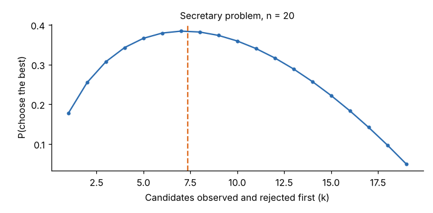

# Module 06 — Decision-Making Processes

Outline items: The incremental decision-making process · The contingency decision-making framework · Search · The secretary problem

## Objectives

- Choose a decision process that suits the context.
- Decide how long to search for alternatives, with a search cost or with no going back.

## The incremental decision-making process

When goals are disputed and consequences hard to predict, organizations often decide **incrementally**:

- small steps from the current state
- comparing a few options at a time
- learning from feedback
- adjusting as they go

This is the "muddling through" described by Lindblom (1959, cited from general knowledge).

| Strengths | Weaknesses |
|---|---|
| Low risk per step; reversible; politically feasible | Can miss bold options; drifts without a direction; slow when change must be large |

Use it with a clear **direction** (the fundamental objectives) and explicit **review points**.

## The contingency decision-making framework

Match the process to how much is agreed and known. A classic framing, based on agreement about **goals** and certainty about **cause and effect** (stated from general knowledge, not verified against the original source):

| | Agreement on goals | Disagreement on goals |
|---|---|---|
| **Cause and effect known** | Computation: analysis and optimization (e.g. MAUT with agreed weights) | Bargaining and compromise: negotiation, voting rules (Module 02) |
| **Cause and effect uncertain** | Judgment: expert assessment, decision trees, value of information (Modules 03–04, 07) | Inspiration and incremental steps: experiments, pilots, small reversible moves |

Also weigh time pressure, how reversible the decision is, and how much commitment you need from the people who must carry it out.

## Search

Alternatives must be found, and finding them costs time and money. **Optimal stopping with a search cost:**

- Supplier quotes for the linear guide are equally likely to fall anywhere from $80k to $120k.
- Each extra quote costs $1.5k (engineering review, samples).
- Keep searching while the expected saving from one more quote exceeds its cost.
- For quotes spread evenly between a and b, that gives a **reservation price** r = a + √(2c(b − a)) = 80 + √(2 × 1.5 × 40) = **$90.95k**. Accept the first quote at or below it.

| Result | Value |
|---|---|
| P(a quote is acceptable) | 0.274 |
| Expected number of quotes | 3.65 |
| Expected price paid | $85.48k |
| Expected total (price + search) | **$90.95k**, equal to the reservation price, a known property of this rule |

## The secretary problem

Now suppose candidates (for example, contract manufacturers offered for evaluation) arrive **one at a time**, you must accept or reject each **immediately**, and you want the **single best**.

- **Rule:** reject the first k ≈ n/e (about 37 %), then accept the first one better than all seen so far.
- For n = 20, k = 7, P(choose the best) = 0.384 exactly; simulation gives 0.379. As n grows, the limit is 1/e ≈ 0.368.



Real searches rarely meet the assumptions:

- you can often go back
- you care about "good enough", not only "the best"
- the number of candidates isn't known

Still, the lesson holds: **explore first, set a benchmark, then commit.**

## Run it

```bash
python tools/edmkit.py search
python tools/edmkit.py secretary
```

## Check yourself

1. If each quote cost $4k instead of $1.5k, what would the reservation price be?
2. With n = 50 candidates, how many should you observe before committing?

<details><summary>Answers</summary>

1. r = 80 + √(2 × 4 × 40) = 80 + 17.9 = **$97.9k**. Searching costs more, so accept a higher price.
2. 50 / e ≈ **18**.

</details>
