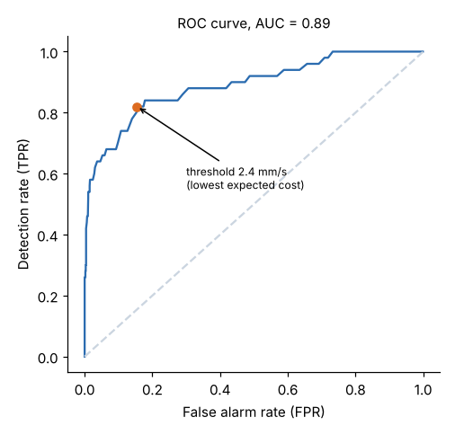

# Module 08 — Risk Management

Outline items: Risk treatment strategies · Potential problem analysis · Precursors, warnings · Receiver operating characteristic (ROC) curves · Risk communication

## Objectives

- Choose risk treatments, and plan with potential problem analysis.
- Design warning systems using precursors and ROC curves, with explicit costs.
- Communicate risk clearly.

## Risk treatment strategies

| Strategy | Meaning | Corran example |
|---|---|---|
| **Avoid** | Remove the activity or cause | Don't launch C until the market is clearer |
| **Reduce** | Lower probability or impact | Second source for the linear guide; burn-in testing |
| **Transfer / share** | Contracts, insurance, partners | Warranty insurance; supplier-funded tooling |
| **Accept / retain** | Bear it knowingly, with a contingency | Budget a reserve for minor field fixes |
| **Exploit** (opportunities) | Increase the chance of upside | Early-adopter program for the premium product |

**Insurance and risk aversion:** for a risk-averse company, paying more than the expected loss can be rational. The certainty equivalent of the uninsured loss is worse than its expected value (Module 04).

## Potential problem analysis

A structured look ahead at a **plan**, applied here to the launch plan (`templates/potential-problem-analysis.csv`):

| Step | Question | Launch example |
|---|---|---|
| 1 | What could go wrong? | Ball-screw supplier late |
| 2 | Likely causes? | Supplier capacity; new grinding process |
| 3 | Preventive actions (reduce probability) | Capacity check visit; qualify a second source |
| 4 | Contingent actions (reduce impact) | Air-freight buffer stock; staged launch by region |
| 5 | Trigger for the contingency | Supplier's weekly output < 80 % of plan for 2 weeks |

Rank by probability × seriousness, and act on the top items.

## Precursors, warnings

Many failures send **precursors**: near-misses, rising vibration, more warranty calls, a supplier quietly missing dates. A **warning system** needs:

1. a measurable precursor
2. a threshold
3. a pre-agreed response
4. someone who owns it

Too sensitive and people ignore the alarms; not sensitive enough and the failures come anyway.

## Receiver operating characteristic (ROC) curves

Field actuators report vibration RMS. Of 1,000 units, 50 are developing a bearing failure (`data/vibration.csv`). An alarm fires above a threshold. Each threshold gives a detection rate (TPR) and a false-alarm rate (FPR). The **ROC curve** plots all of them:



- **AUC = 0.89**: the signal separates failing from healthy units well.
- Choose the threshold by **expected cost**: false alarm (an unnecessary service visit) $800; missed failure (unplanned downtime claim) $20,000.

| Threshold (mm/s) | Detected | Missed | False alarms | Expected cost |
|---|---|---|---|---|
| **2.4 (best)** | 41 of 50 | 9 | 147 | **$297,600** |
| 2.5 | | | | $375,200 |

The best threshold accepts many false alarms (FPR 15 %), because a miss costs 25 times as much.

## Risk communication

Of the units that alarm at 2.4 mm/s, only **22 %** are actually failing: 41 of 188, because failures are rare (5 %). Say it with **natural frequencies**:

> "Out of 1,000 actuators, about 50 are developing a fault. The alarm will catch about 41 of them, and will also flag about 147 healthy ones. So when an alarm fires, about 1 in 5 is a real fault, but acting on every alarm costs far less than waiting for failures."

Principles for risk communication:

- Use **frequencies** and absolute risks, not only percentages or relative risks.
- Show **ranges**, and say what is uncertain.
- Explain the **trade-off**, here false alarms vs misses, and who bears each.
- Match the message to the audience's decision. State what they should **do**.

## Run it

```bash
python tools/edmkit.py roc
```

## Check yourself

1. If missed failures cost $5,000 instead of $20,000, would the best threshold go up or down?
2. Rewrite "the alarm has 82 % sensitivity and 85 % specificity" for a plant manager.

<details><summary>Answers</summary>

1. **Up** (a less sensitive alarm). Misses are cheaper, so it pays to avoid false alarms.
2. "Out of every 1,000 actuators, about 50 will develop a fault. The alarm will catch about 41 of them, and also flag about 147 healthy units. Roughly 1 alarm in 5 is a real fault."

</details>
