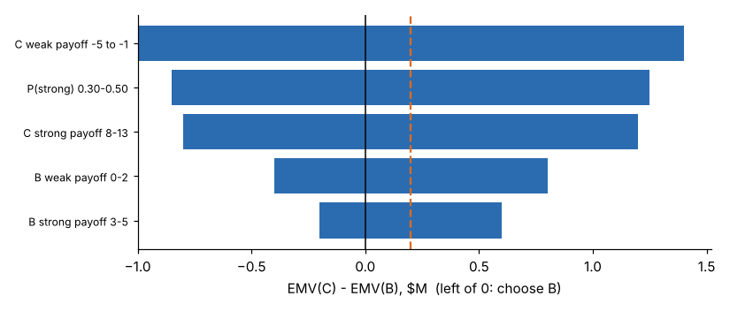

# Module 09 — Learning from Failures

Outline items: Types of failures · Transforming failure information into knowledge · Sensitivity analysis

> The source outline lists the last two items as one line: "Transforming failure information into knowledge sensitivity analysis". They are treated here as two topics.

## Objectives

- Classify failures in order to learn the right lesson from each.
- Turn failure information into organizational knowledge.
- Use sensitivity analysis to find which assumptions a decision depends on.

## Types of failures

Two complementary classifications:

| By **what failed** | Example |
|---|---|
| Wrong problem (framing) | Optimized cost when time to market was the real objective |
| Wrong alternatives | Never considered the hybrid "B now, C later" |
| Wrong information or model | Overconfident demand range (Module 03) |
| Wrong preferences or trade-offs | Weights set by importance, not by swing (Module 02) |
| Wrong process | Plurality vote let a polarizing option win (Module 02) |
| Wrong execution | Good decision, poorly implemented |
| Bad luck | Good decision, unfavourable outcome. **Not a decision failure** |

| By **how culpable / how preventable** | Response |
|---|---|
| Preventable (deviation from a known process) | Training, checklists, error-proofing |
| Complex or systemic (many factors interacting) | System redesign; better warnings (Module 08) |
| Intelligent (small, deliberate experiments at the frontier) | Encourage; capture the learning quickly |

The second classification follows a widely cited management framing, stated from general knowledge and not verified.

**Judge decisions by their quality, not their outcomes.** Good process, good information and coherent preferences can still meet bad luck.

## Transforming failure information into knowledge

1. **Capture** facts quickly and without blame: the decision record (objectives, alternatives, information, preferences, rationale, date).
2. **Analyse:** compare what was assumed with what happened. Which assumption failed, and could it have been known?
3. **Classify** using the tables above.
4. **Codify:** update checklists, models, priors and warning thresholds.
5. **Share:** in a searchable lessons library, design reviews and training.
6. **Check:** did the change prevent a recurrence?

Keep a **decision journal**. Without a record of the original reasoning, hindsight bias rewrites history.

## Sensitivity analysis

Which assumptions could **change** the C vs B choice? Vary each one over its plausible range and watch EMV(C) − EMV(B), which is +0.20 in the base case:



| Input (range) | EMV(C) − EMV(B) low | high | Changes the decision? |
|---|---|---|---|
| C weak-market payoff (−5 to −1) | −1.00 | +1.40 | **Yes** |
| P(strong) (0.30–0.50) | −0.85 | +1.25 | **Yes** |
| C strong-market payoff (8–13) | −0.80 | +1.20 | **Yes** |
| B weak-market payoff (2 to 0) | −0.40 | +0.80 | **Yes** |
| B strong-market payoff (5 to 3) | −0.20 | +0.60 | **Yes** |

**Break-even P(strong) = 0.381**, very close to the 0.40 assumed. The EMV choice is **fragile**. That is why information (Module 07) and risk attitude (Module 04) dominate this decision, and why the post-launch review should first check the market-strength assumption.

## Run it

```bash
python tools/edmkit.py sensitivity
```

## Check yourself

1. Derive the break-even P(strong).
2. Corran chose B and the market turned out strong: C would have earned $6.5 M more. Was the decision a failure?

<details><summary>Answers</summary>

1. Set p × 10.5 + (1 − p)(−3) = p × 4 + (1 − p) × 1, so 13.5p − 3 = 3p + 1, so 10.5p = 4, so **p = 0.381**.
2. Not necessarily. Given the information and a realistic risk tolerance, B was the better choice (and the study, if done, might have pointed to C). Judge the process. Record whether the market assumption was well-founded and update the priors.

</details>
