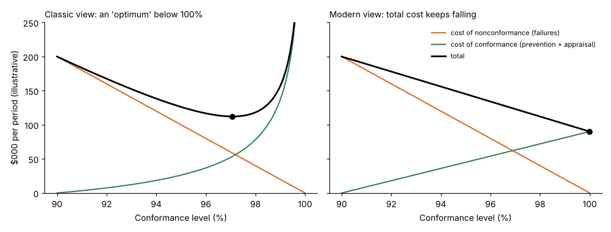

# Module 01 — Cost Models

## Objectives

- Describe the prevention–appraisal–failure (PAF) model.
- Compare it with the conformance/nonconformance (process cost) and activity-based views.
- Explain the "classic" and "modern" views of the optimum level of quality.

## The PAF model

The most widely used model (associated with Feigenbaum and Juran, and later formalized in quality-cost guides) groups quality costs into four categories:

| Category | Definition | Example at Ellison |
|---|---|---|
| **Prevention** | activities that stop defects from occurring | quality planning, FMEA, training, supplier development |
| **Appraisal** (detection) | measuring and checking conformance | incoming, in-process and final inspection; calibration; audits |
| **Internal failure** | defects found before delivery | scrap, rework, re-test, MRB |
| **External failure** | defects found after delivery | warranty, returns, field service, complaints, concessions |

Its strength is simplicity and a clear improvement logic: **invest in prevention, reduce appraisal as processes become capable, and drive failure costs down.**

## Other models

**Process cost model (cost of conformance vs nonconformance).** For each process, the **cost of conformance** (doing the job right, including necessary checks) and the **cost of nonconformance** (waste from doing it wrong). Associated with Crosby's "price of conformance / price of nonconformance." Useful in service and office processes where "prevention" and "appraisal" are hard to separate.

**Activity-based CoQ.** Uses activity-based costing to trace the cost of quality-related activities (inspecting, reworking, handling complaints) to products and customers. More accurate allocation, more effort.

**Opportunity / hidden-cost extensions.** Add lost sales, lost capacity and other costs that never appear in accounts (Module 07).

All models aim at the same thing: make the cost of poor quality visible and actionable. Choose the one your organization can sustain.

## What is the "optimum" quality level?



**Classic view (left).** Conformance costs rise steeply as you approach perfection, so total cost has a minimum below 100 % conformance — in this illustrative model at **97.1 %**. This view was used to argue that some defects are "economic."

**Modern view (right).** Prevention gets cheaper as processes are designed and error-proofed rather than inspected; technology lowers the cost of control. Total cost keeps falling toward zero defects — in the illustrative model the minimum is at the right-hand edge (**99.99 %**).

Which is right? It depends on the technology and on how improvement is done. Inspection-based quality behaves like the classic curve; prevention by design behaves like the modern one. The practical lesson for most organizations: **they are far from any optimum, on the side where failure costs dominate** — so the direction is clear.

(Both curves here are illustrative shapes, not data.)

## Run it

```bash
python tools/coqkit.py model
```

## Check yourself

1. Classify: (a) gauge calibration, (b) design FMEA, (c) re-testing after a repair, (d) a customer credit for late, defective parts.
2. In which situations is the process cost model easier to apply than PAF?
3. Why is the classic "optimum" a risky management message?

<details><summary>Answers</summary>

1. (a) appraisal, (b) prevention, (c) internal failure, (d) external failure.
2. Service and administrative processes, where activities don't separate neatly into prevention and appraisal, and teams think in terms of process steps.
3. It can legitimize a "acceptable defect level" and stop improvement long before the real economic limit — especially since hidden costs (Module 07) are left out of the curve.

</details>
