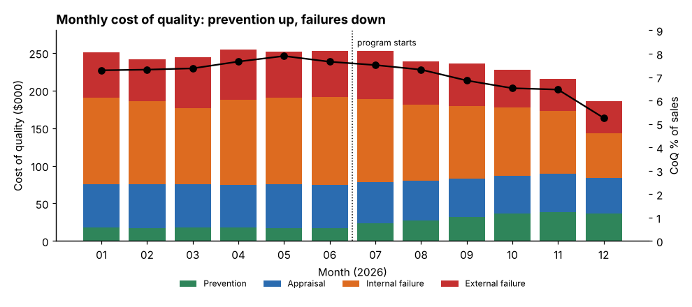

# Module 02 — Cost Categories

## Objectives

- Assign cost elements to the four categories consistently.
- Handle the gray areas.
- Read a categorized CoQ ledger and its first summary.

## Category rules

| Question | If yes → |
|---|---|
| Does the activity stop a defect from being created? | Prevention |
| Does it check whether work conforms (whether or not a defect is found)? | Appraisal |
| Is it caused by a defect found **before** the product/service reaches the customer? | Internal failure |
| Is it caused by a defect found **after** delivery? | External failure |

## Ellison's element list

| Category | Elements |
|---|---|
| Prevention | quality planning & engineering; training in quality methods; supplier quality development; design & process FMEA / reviews; preventive maintenance of quality-critical equipment |
| Appraisal | incoming inspection; in-process inspection; final test & inspection; calibration & gauge maintenance; quality audits |
| Internal failure | scrap; rework & repair; re-inspection & re-test; failure investigation & MRB; supplier-reject handling |
| External failure | warranty claims; returns processing & replacement; field service visits; complaint handling; customer concessions & credits |

A starter list for other organizations is in `templates/coq-element-checklist.md`.

## Gray areas — decide once, document, apply consistently

| Item | Common treatment | Reason |
|---|---|---|
| Re-inspection after rework | internal failure | wouldn't exist without the defect |
| First-article inspection | appraisal | checking conformance |
| Preventive maintenance | prevention **only** for equipment whose condition affects quality; otherwise not CoQ | avoid inflating CoQ with normal operating costs |
| Quality department salaries | split by activity (planning → prevention, inspection → appraisal, MRB → internal failure) | categorize the activity, not the department |
| Supplier-caused scrap recovered from supplier | record gross cost, show recovery separately | keeps the problem visible |
| Downtime caused by defects | internal failure if booked; otherwise hidden (Module 07) | |

**Consistency beats perfection.** Changing definitions mid-year destroys trends.

## First summary

Annual CoQ, Ellison Hydraulics (`python tools/coqkit.py summary`):

| Category | $ | % of CoQ |
|---|---|---|
| Prevention | 299,450 | 10.5 |
| Appraisal | 653,920 | 22.9 |
| Internal failure | 1,211,860 | 42.5 |
| External failure | 687,700 | 24.1 |
| **Total** | **2,852,930** | **7.08 % of $40.29M sales** |

Two-thirds of CoQ is failure. The **cost of poor quality** ($1.90M) is about twice the **cost of good quality** ($0.95M) — the typical profile of an organization early in its quality journey.

## Check yourself

1. A technician spends 60 % of her time inspecting and 40 % sorting suspect lots. How do you categorize her wages?
2. Should the cost of an ISO 9001 certification audit be in CoQ?
3. Why categorize the activity rather than the department?

Answers

1. 60 % appraisal; 40 % internal failure (sorting exists only because of defects).
2. Usually yes, as appraisal (it checks conformance of the system); some organizations classify system development and maintenance as prevention. Decide and document.
3. Departments do many kinds of work; the category reflects why the cost exists. Engineers in production who spend time on firefighting create failure cost too.

