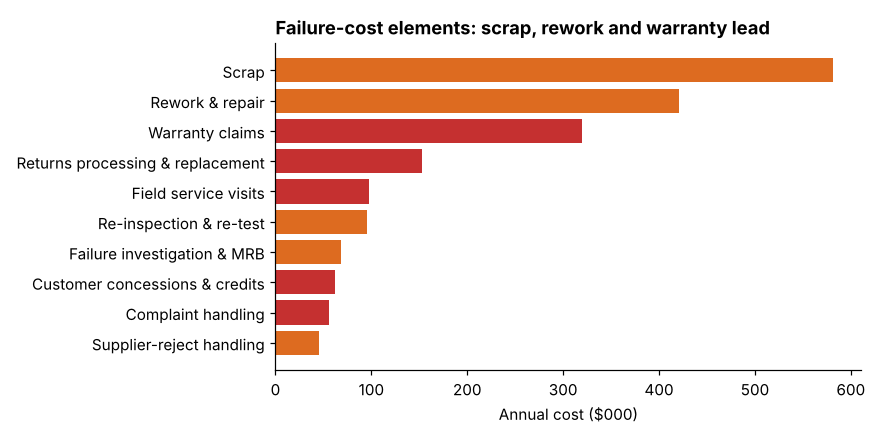

# Module 05 — Internal Failure Costs

## Objectives

- Identify internal failure costs and how to value them.
- Analyze internal failure elements with a Pareto.
- Avoid common valuation mistakes.

## What counts as internal failure

Costs caused by defects found **before** the product or service reaches the customer:

- **Scrap** — material, labor and overhead in the scrapped item.
- **Rework and repair** — labor, materials, extra machine time.
- **Re-inspection and re-test** after rework.
- **Failure investigation, MRB** (material review board) and disposition time.
- **Supplier-reject handling** — returning, sorting, replacing supplier parts.
- **Downgrading** — selling as seconds at a lower price.
- **Downtime** caused by quality problems (if booked; otherwise hidden — Module 07).

## Valuing internal failures

| Item | Value at |
|---|---|
| Scrap | accumulated cost at the point of scrap (material + labor + overhead to that step), minus any salvage value |
| Rework | actual labor and materials, plus extra machine time |
| Downgrade | lost selling price (full price − downgrade price) |
| Lost capacity on a bottleneck | lost contribution margin (often hidden — Module 07) |

Common mistakes: valuing scrap at material cost only; ignoring rework done "in-line" by operators; missing supplier rejects because they are "charged back."

## Ellison: failure-cost elements

Internal failure (annual):

| Element | $ |
|---|---|
| Scrap | 581,880 |
| Rework & repair | 421,300 |
| Re-inspection & re-test | 95,350 |
| Failure investigation & MRB | 68,230 |
| Supplier-reject handling | 45,100 |
| **Total** | **1,211,860** |

Scrap and rework alone are **83 %** of internal failure and **53 %** of all failure cost. But this is a list of **cost types**, not **causes** — it tells you *what* is spent, not *why*. Module 09 connects failure costs to their drivers (weld porosity, bore tolerance, seal leaks).

## Check yourself

1. A cylinder is scrapped at final test after welding, machining and assembly. Material $180, accumulated labor and overhead $240, salvage $25. Scrap cost?
2. Why can "rework done by the operator at the machine" be invisible?

Answers

1. 180 + 240 − 25 = $395.
2. It isn't recorded as a separate activity — it's absorbed into the standard labor time, showing up only as lower productivity. Time studies or work sampling can reveal it.

