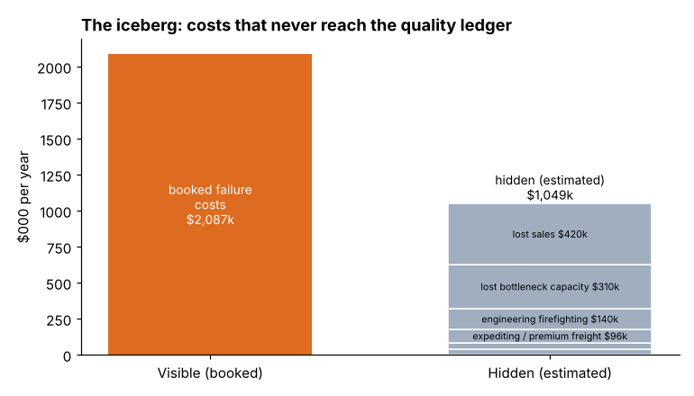
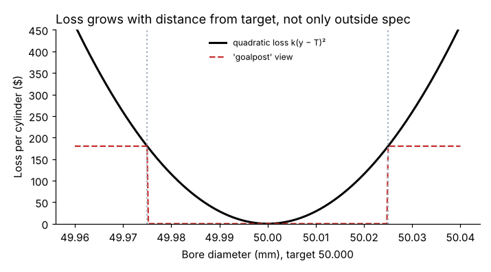

# Module 07 — Hidden Costs of Quality

## Objectives

- Identify hidden (indirect) costs of poor quality.
- Estimate them with defensible methods.
- Use the quadratic loss idea to see costs inside the specification.

## The iceberg

Booked quality costs are the visible tip. Below the waterline:

| Hidden cost | How to estimate |
|---|---|
| Lost sales and lost customers | sales records of customers who reduced orders × contribution margin; customer surveys |
| Lost capacity on bottlenecks | quality-caused downtime hours × contribution per bottleneck hour |
| Engineering and management firefighting | time sampling, calendar review |
| Expediting, premium freight | invoices flagged to quality causes |
| Extra inventory held as protection against yield loss | carrying cost of the buffer |
| Excess process capacity / overtime | hours worked to make up for losses |
| Lower morale, turnover | difficult; usually described, not estimated |

## Ellison's estimate (annual)

| Hidden cost | Estimate | Basis |
|---|---|---|
| Sales lost from two customers who reduced orders | $420,000 | sales manager estimate (contribution margin) |
| Lost capacity on the bottleneck | $310,000 | downtime coded "quality" × $1,150/h |
| Engineering time on firefighting | $140,000 | time sampling of 6 engineers over 4 weeks |
| Expediting and premium freight | $96,000 | freight invoices flagged "quality" |
| Excess safety stock for yield loss | $45,000 | carrying cost of buffer |
| Management time in escalations | $38,000 | calendar review |
| **Total** | **$1,049,000** | |



Compared with booked failure costs (annualized from months 1–6: $2,087,380), hidden costs add about **50 %**, for a "true" failure cost of about **$3.14M/yr**. Many sources describe hidden costs as several times the visible ones; Ellison's ratio is lower — **use your own estimate, not a rule of thumb**.

**Report hidden costs separately**, labeled as estimates with their basis and uncertainty. Mixing them into booked totals undermines credibility with finance.

## Costs inside the specification: the quality loss function

The "goalpost" view treats any part inside the specification as free of cost. The **quadratic loss function** (associated with Taguchi) says loss grows with distance from target even within the spec, because parts near the limits cause more assembly problems, wear and variation downstream:

L(y) = k (y − T)²; for a process with mean μ and standard deviation σ, expected loss per unit = k [σ² + (μ − T)²]

Ellison cylinder bore: target 50.000 mm, spec ±0.025 mm, loss at the limit $180 (rework) → k = 180 / 0.025² = **$288,000 per mm²**.

| Process | Expected loss per cylinder | Annual (24,000 cylinders) |
|---|---|---|
| Mean +0.010 off target, σ 0.008 | $47.23 | about $1.13M |
| Centred, σ 0.008 | $18.43 | |
| Centred, σ 0.004 | $4.61 | about $0.11M |



The loss function is a model; k is hard to know precisely. Its lesson is robust: **centering and reducing variation saves money even when everything is "in spec."**

## Run it

```bash
python tools/coqkit.py hidden
python tools/coqkit.py loss
```

## Check yourself

1. Why is lost capacity valued at contribution margin only on a bottleneck?
2. Finance challenges the $420,000 lost-sales estimate. How do you respond?
3. Using the loss function, how much does centering alone (offset 0.010 → 0, σ 0.008) save per cylinder?

<details><summary>Answers</summary>

1. On a non-bottleneck, lost time can usually be recovered with spare capacity (cost: overtime at most); on a bottleneck, lost output is lost sales.
2. Show the basis (which customers, order history, stated reasons), present it as an estimate with a range, keep it separate from booked costs, and don't make the project case depend on it alone.
3. $47.23 − $18.43 = $28.80 per cylinder (about $691,000 a year at 24,000 cylinders).

</details>
