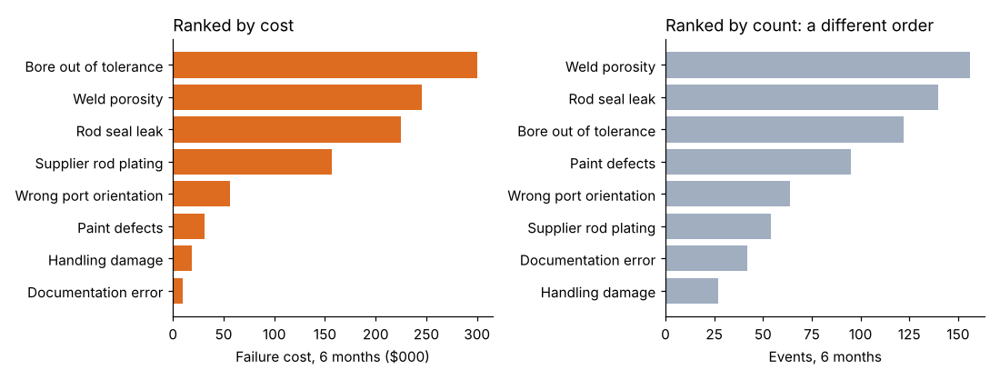

# Module 09 — Cost Drivers

## Objectives

- Link failure costs to the failure types and processes that drive them.
- Rank drivers by cost, not just frequency.
- Prepare driver data for root cause analysis and project selection.

## From cost types to cost drivers

The ledger tells you **what kind** of cost (scrap, warranty). Improvement needs **why**: which defect, in which process, caused it. A **cost driver** is a failure type (or root cause) whose occurrence creates quality cost.

## Ellison: drivers of failure cost (months 1–6)

700 failure events, $1,043,700 (`python tools/coqkit.py drivers`):

| Driver | Events | Cost | % | Cum % | Avg per event | % reaching customer |
|---|---|---|---|---|---|---|
| Bore out of tolerance | 122 | $300,270 | 28.8 | 28.8 | $2,461 | 6.6 |
| Weld porosity | 156 | $245,230 | 23.5 | 52.3 | $1,572 | 7.1 |
| Rod seal leak | 140 | $225,250 | 21.6 | 73.8 | $1,609 | 23.6 |
| Supplier rod plating | 54 | $156,700 | 15.0 | 88.9 | $2,902 | 18.5 |
| Wrong port orientation | 64 | $56,600 | 5.4 | 94.3 | $884 | 15.6 |
| Paint defects | 95 | $31,320 | 3.0 | 97.3 | $330 | 5.3 |
| Handling damage | 27 | $18,350 | 1.8 | 99.0 | $680 | 11.1 |
| Documentation error | 42 | $9,980 | 1.0 | 100.0 | $238 | 2.4 |

**Ranking by count misleads.** By count, weld porosity is first; by cost, bore tolerance is first. Paint defects are the 4th most frequent but only 3 % of cost. Supplier rod plating — only 54 events — is 15 % of cost because each event is expensive and many reach the customer.

**By process area:** machining $300k, assembly $282k, welding $245k, supplier $157k — four areas carry 94 %.

## Using drivers

1. **Pareto by cost** to choose where to dig.
2. **Root cause analysis** on the top drivers (see the Root Cause Analysis course): why does the bore go out of tolerance? Why does weld porosity occur?
3. **Estimate the prize** for each driver: annual cost × achievable reduction (Module 10).
4. **Track driver cost** monthly to show the effect of projects.

## Check yourself

1. Why does supplier rod plating deserve attention despite few events?
2. A team wants to start with paint defects because "they're everywhere." What do you say?
3. What extra field in the failure records would let you rank drivers by root cause rather than symptom?

Answers

1. High cost per event ($2,902) and a high escape rate to customers (18.5 %) — each event is expensive and damages customer relationships.
2. They're frequent but cheap ($31k in 6 months, 3 % of failure cost); the same effort on bore tolerance or weld porosity is worth roughly 8–10 times more.
3. A verified cause code (e.g. "worn hone stones," "gas flow low") filled in after investigation — linking the symptom to its root cause.

