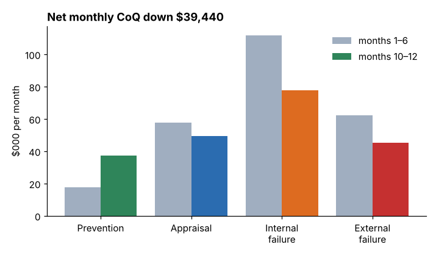

# Module 11 — Cost of Quality Reports

## Objectives

- Prepare a cost of quality summary report.
- Choose measurement bases (ratios) so trends are meaningful.
- Present CoQ to management to drive action.

## Measurement bases

Absolute dollars move with volume. Report CoQ against a base:

| Base | Use |
|---|---|
| % of sales | the most common headline; affected by price changes |
| per unit shipped | good for stable product mixes |
| per direct labor hour | for labor-intensive operations |
| % of manufacturing cost | reflects the cost structure |
| mix ratios — failure % of CoQ, prevention % of CoQ | show whether the program is shifting the balance |

Ellison, monthly (`python tools/coqkit.py ratios`):

| Month | CoQ % sales | CoQ per unit | Failure % of CoQ | Prevention % of CoQ |
|---|---|---|---|---|
| Jan | 7.29 % | $120.34 | 69.8 % | 7.2 % |
| Nov | 6.47 % | $106.74 | 58.4 % | 18.0 % |
| Dec | 5.26 % | $86.75 | 55.0 % | 19.8 % |

The mix ratios tell the story: prevention up from 7 % to 20 % of CoQ, failure down from 70 % to 55 %.

## Before vs after

| Category ($/month) | Months 1–6 | Months 10–12 | Change |
|---|---|---|---|
| Prevention | 17,545 | 37,363 | +19,818 |
| Appraisal | 57,737 | 49,457 | −8,280 |
| Internal failure | 111,693 | 77,773 | −33,920 |
| External failure | 62,255 | 45,197 | −17,058 |
| **Total** | **249,230** | **209,790** | **−39,440** |
| CoQ % of sales | 7.53 % | 6.07 % | |

Net saving **$39,440/month**, about **$473,000/yr** at the current run rate — **after** paying for the extra prevention. This is the number management cares about.

## The summary report

A one- to two-page report (generated example: `solutions/coq-summary-report.md`; build your own with `python tools/coqkit.py report` or the template `templates/coq-report-template.md`):

1. **Headline** — total CoQ, % of sales, trend, net saving.
2. **By category** — table and trend chart.
3. **Top drivers** — Pareto by cost.
4. **Projects** — status, savings achieved vs planned.
5. **Hidden costs** — separately, as estimates.
6. **Actions and decisions requested.**

## Presenting CoQ to management

- Lead with money and the ask: "Failure costs fell $51,000 a month; we propose funding the bore-gauging project to capture another $360,000 a year."
- Show trends, not snapshots; use a consistent base.
- Separate booked from estimated costs.
- Avoid blame — CoQ reveals system problems, not individual failings.
- Keep it regular (monthly or quarterly) so it becomes part of management review.

## The tracker

`templates/coq-tracker.xlsx` produces the category totals and ratios automatically. Its formulas were checked by recalculating the workbook in a spreadsheet engine: the year totals (prevention $299,450; total $2,852,930; 7.08 % of sales) match the Python results.

## Check yourself

1. Sales rose 10 % and CoQ dollars rose 5 %. Did quality improve?
2. Why report the prevention share of CoQ?
3. Write the one-sentence headline for Ellison's year-end report.

Answers

1. On a % of sales basis, yes (CoQ fell from x to about 0.955x as a percentage) — but check mix and price effects, and the failure share.
2. It shows whether the organization is shifting from detecting and fixing to preventing — a leading indicator for future failure costs.
3. Example: "Cost of quality fell from 7.5 % to 6.1 % of sales — a net $473,000 a year — as prevention doubled and failure costs fell by nearly 30 %; four projects in the pipeline target another $1.1M."

