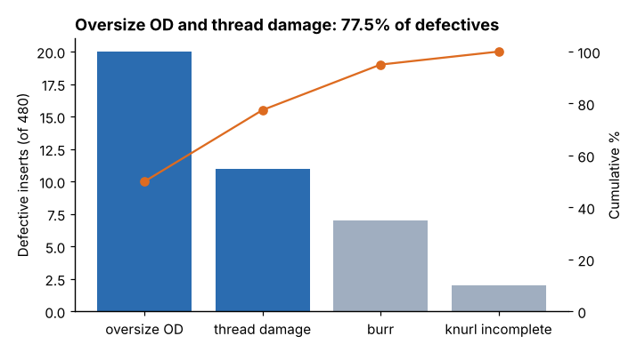
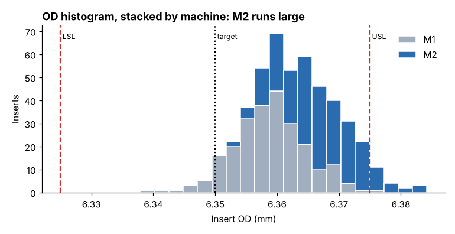
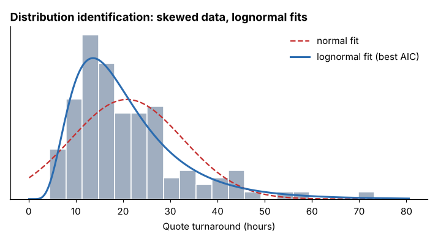

# Module 02 — Measurement and Basic Statistics

**Time:** 6 h (about half of it with the data)

## Objectives

- Use basic statistical terms; distinguish descriptive from inferential statistics.
- Choose good measurements: data types, discrete vs continuous.
- Summarize data graphically (Pareto, histogram) and numerically (center, spread).
- Identify a distribution and clean data before analysis.

## Terms

A **population** is everything you care about (every insert Bayline will make this year). A **sample** is the part of it you actually measured (480 inserts over 20 days). A **parameter** describes the population and is usually unknown: the population mean μ (mu) and standard deviation σ (sigma). A **statistic** is the same quantity computed from the sample: the sample mean x̄ (x-bar) and sample standard deviation s. Plain example: the mean OD of all 480 measured inserts is a statistic. The mean OD of every insert the lathes will ever make is a parameter, and the statistic is our estimate of it.

**Descriptive statistics** summarize the data you have. **Inferential statistics** draw conclusions about the population from the sample, with a stated uncertainty. A confidence interval (CI) says how far the parameter is likely to be from the statistic. A hypothesis test says whether a difference is bigger than chance would explain (Module 06).

## Measurement and data types

| Type | Example at Bayline | Information per measurement |
|---|---|---|
| Continuous (variable) | OD in mm; turnaround hours | high, it shows how close to the limit |
| Discrete count | defects per insert | medium |
| Attribute (pass/fail) | thread go/no-go | low, it needs large samples |
| Ordinal | burr severity 1 to 3 | low to medium |

**Select the best measurement:** prefer continuous data when you can get it; make sure it relates to what the customer cares about; define it operationally (how, where, with what gauge, at what temperature).

## Worked example 1: what goes wrong most often

**Data:** `data/production_sample.csv`, one row per insert: part number, day, machine, shift, tool age in parts since the last tool change, coolant temperature in °C, OD in mm, and the defect call from final inspection (blank when the insert passed). 480 rows: 20 days, 2 machines, 3 shifts, 4 inserts per machine-shift.

**Steps:** count the defect calls, sort them from most to least frequent, and add a cumulative percentage. Command: `python tools/qekit.py pareto`.

**Result:**

| Defect | Count | % | Cumulative % |
|---|---|---|---|
| Oversize OD | 20 | 50.0 | 50.0 |
| Thread damage | 11 | 27.5 | 77.5 |
| Burr | 7 | 17.5 | 95.0 |
| Knurl incomplete | 2 | 5.0 | 100.0 |

40 defective inserts out of 480 = **8.33 %**.



**What it means:** two defect types account for over three quarters of the problem. Oversize OD is the first target, and thread damage is the second; the rest can wait. This is the Pareto principle in use: fix the vital few before the trivial many.

## Worked example 2: shape, center and spread of OD

**Data:** the same file, the `od_mm` column. The specification is 6.350 ± 0.025 mm, so the lower specification limit (LSL) is 6.325 and the upper specification limit (USL) is 6.375.

**Steps:** draw a histogram with the specification limits marked, then compute the summary statistics. Command: `python tools/qekit.py describe`.

**Result:**



| Statistic | OD, all 480 inserts | Meaning |
|---|---|---|
| Mean x̄ | 6.36273 mm (target 6.350) | the center |
| Median | 6.3623 mm | the middle value; close to the mean, so the shape is roughly symmetric |
| Standard deviation s | 0.00709 mm | the typical distance of an insert from the mean |
| Range | 0.0463 mm (6.3379 to 6.3842) | smallest to largest |
| Q1 / Q3 | 6.3580 / 6.3674 mm | the quartiles: a quarter of inserts are below Q1, a quarter above Q3 |
| 95 % CI for the mean | 6.36210 to 6.36337 mm | where the population mean most likely is |

**What it means:** the distribution sits **above target** and its upper tail crosses the USL, which is why oversize inserts appear. The confidence interval is the inferential step: we are 95 % confident the process mean is between 6.3621 and 6.3634 mm, clearly above 6.350, so this is not sampling noise. Stacking the histogram by machine shows M2's parts are the larger ones, a first clue that Module 05 will follow.

## Worked example 3: identifying a distribution

Many measurements are approximately **normal**: symmetric and bell-shaped, with about 68 % of values within one standard deviation of the mean, 95 % within two and 99.7 % within three. Not all are, and the wrong assumption gives wrong limits.

**Data:** `data/quote_turnaround.csv`, 120 rows: a quote number and the hours it took the sales office to return the quote. This is a service process, not a machining one.

**Steps:**

1. Look at the shape: mean 20.8 h, median 17.8 h, skewness 1.54. Skewness measures asymmetry: 0 for a symmetric shape, positive when the long tail is to the right, negative when it is to the left. A mean well above the median and a positive skewness mean a long tail to the right, a few slow quotes.
2. Fit four candidate distributions to the data (normal, lognormal, gamma, Weibull).
3. Compare them with the Akaike information criterion (AIC). It is computed from how closely each distribution fits the data (its log-likelihood), with a penalty added for every parameter the distribution needs; lower is better.
4. Read the Kolmogorov–Smirnov (KS) value as a rough check only. The KS statistic is the largest gap between the data's cumulative distribution and the fitted one, and the value printed is its p-value. That p-value is computed after the distribution's parameters were fitted to the same data, which flatters it, so it is a guide to the ranking, not a formal test.
5. Check what the choice does to a practical number: the 95th percentile, the turnaround time that only 1 quote in 20 exceeds.

Command: `python tools/qekit.py distribution`.

**Result:**

| Distribution | AIC (lower = better) | KS check (rough) |
|---|---|---|
| Normal | 935.9 | 0.048 |
| **Lognormal** | **887.3** | 0.984 |
| Gamma | 893.1 | 0.684 |
| Weibull | 905.9 | 0.387 |



| 95th percentile of turnaround | Hours |
|---|---|
| Assuming a normal distribution | 40.2 |
| From the lognormal fit | 43.5 |
| Straight from the data | 43.4 |

**What it means:** the lognormal fits best and its 95th percentile matches the data; the normal assumption understates how long the slow quotes take by over three hours. That error carries into capability and control limits (Module 04), so identify the distribution before computing either.

## Worked example 4: cleansing data

**Data:** `data/dirty_export.csv`, 41 rows exported from a shop-floor system with the usual problems planted in it.

**Steps:** check for duplicate rows, missing values, placeholder zeros, decimal slips and inconsistent labels; fix each only with a stated rule. Command: `python tools/qekit.py cleanse`.

**Result:**

| Issue | Count | Fix |
|---|---|---|
| Exact duplicate row | 1 | remove |
| Missing OD | 1 | find the source record or exclude |
| Zero used as a placeholder | 1 | convert to missing |
| Decimal slip (63.52 instead of 6.352) | 1 | correct only after checking the source record |
| Inconsistent labels ("m2 ", "b") | 2 | standardize to M2, B |

After cleansing: 40 rows, 38 usable OD values.

**What it means:** every change is documented, nothing is silently deleted as an "outlier", and the data-entry process that caused the errors gets fixed too. Cleansing is part of measurement, not a chore before it.

## Run it

```bash
python tools/qekit.py describe
python tools/qekit.py pareto
python tools/qekit.py distribution
python tools/qekit.py cleanse
```

## Exercise 2.1

Using `data/production_sample.csv`:

1. Compute the mean and standard deviation of OD for machine M1 and for machine M2 separately. Which machine is further from the 6.350 target, and by how much?
2. Build a Pareto of defects for M2 only. Does the ranking change compared with the whole sample?
3. State, in one sentence each, what the 95 % confidence interval for M2's mean tells you and what it does not.

Answers in `solutions/README.md`.

## Check yourself

1. Why is "% defective" a weaker measure than OD for this project?
2. Mean 20.8 h and median 17.8 h. What does that tell you about the shape?
3. An analyst deletes all OD values outside 6.33 to 6.38 "to remove outliers." What's wrong?

<details><summary>Answers</summary>

1. It's attribute data: it only flags parts already out of spec, needs large samples, and says nothing about how close good parts are to the limit. OD shows drift before defects occur.
2. Right-skewed (a long tail of slow quotes pulls the mean above the median).
3. Out-of-spec parts are exactly what the project is about; deleting them hides the problem. Remove only values proven to be errors, and document it.

</details>
