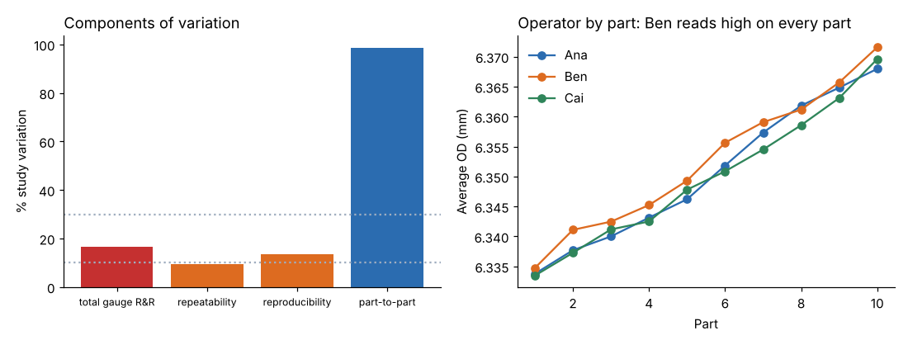

# Module 03 — Measurement System Analysis

**Time:** 6 h (about half of it with the data)

## Objectives

- Treat measurement as a process with its own variation.
- Use a cause-and-effect matrix to focus data collection.
- Run and interpret a variable gauge R&R and an attribute agreement analysis.
- Plan data collection and sampling, and establish baseline performance.

## Measurement is a process

Observed variation = true part-to-part variation + measurement variation. If the gauge varies too much, you can't see the process, can't trust SPC, and may scrap good parts or ship bad ones.

**Properties of a measurement system:**

| Property | Meaning | How assessed |
|---|---|---|
| Resolution | smallest readable increment (aim for at most 1/10 of the tolerance or of the process spread) | gauge spec |
| Accuracy / bias | average reading vs a reference value | calibration, bias study |
| Linearity | bias across the range | linearity study |
| Stability | bias over time | control chart of a reference part |
| Repeatability | same operator, same part, repeated | gauge R&R |
| Reproducibility | different operators (or setups) | gauge R&R |

**Calibration** ensures accuracy against traceable standards at set intervals; it does **not** prove the gauge is precise enough for the job. That is what gauge R&R does.

## Cause-and-effect matrix: what should we measure?

Score each input (X) by how strongly it affects each output (Y), weighted by the Y's importance (for example 0 / 1 / 3 / 9). The top-scoring X's get measured. At Bayline, the team rated tool wear, coolant temperature, machine offset and insert bar stock hardness against OD, thread quality and burr. Tool wear and coolant temperature scored highest, so both are recorded alongside every OD in the production sample. A template is in `templates/ce-matrix.csv`.

## Worked example 1: variable gauge R&R (crossed ANOVA method)

**Data:** `data/gauge_rr.csv`, 90 rows: part (1 to 10, chosen to span the process range), operator (Ana, Ben, Cai), trial (1 to 3), and the OD reading. Every operator measured every part three times, in random order, without seeing earlier readings.

**Steps:**

1. Fit a two-way analysis of variance (ANOVA) with part, operator and their interaction.
2. Convert the mean squares into variance components: repeatability (the gauge), operator, operator-by-part interaction, and part-to-part. Formulas and symbols are in `reference/formulas.md`.
3. Express each component as a percentage of the total study variation, and gauge R&R as a percentage of the tolerance.
4. Compute the number of distinct categories (ndc), how many groups of parts the gauge can reliably tell apart.
5. Compare the operator means to see whether one reads differently.

Command: `python tools/qekit.py grr`.

**Result:**

| Source | % study variation |
|---|---|
| Repeatability (equipment) | 9.5 % |
| Reproducibility (operators + operator × part) | 13.5 % |
| **Total gauge R&R** | **16.5 %** |
| Part-to-part | 98.6 % |

- % tolerance (6 σ_GRR / 0.050 mm): **23.7 %**
- Number of distinct categories (ndc): **8**
- Operator means: Ana 6.35046, **Ben 6.35260**, Cai 6.34988 mm
- The operator-by-part interaction was significant (p = 0.003), so it stays in the model.



**The industry baseline** (aiag-msa-4, the automotive MSA reference manual that most customers cite): gauge R&R under 10 % of tolerance is acceptable. 10 to 30 % may be acceptable, depending on the application, the cost of the gauge and the cost of a wrong decision. Over 30 % is unacceptable. The number of distinct categories (ndc) should be 5 or more. Always check your customer's own requirements, which can be tighter.

**What it means:** the gauge is marginal. It is usable for SPC (ndc 8, well above 5) but it consumes almost a quarter of the tolerance, so a part measured at 6.370 could really be anywhere from about 6.364 to 6.376. **Reproducibility dominates**, and the operator-by-part plot shows Ben reads about 0.002 mm high on every part. The likely cause is measuring force or micrometer technique rather than the instrument. Actions: a standard measuring method, a short retraining, then repeat the study (Module 06 puts the repeat into the control plan).

## Worked example 2: attribute agreement analysis

**Data:** `data/attribute_msa.csv`, 180 rows: part (1 to 30), inspector (Dee, Eli, Fay), trial (1 or 2), the inspector's call (Pass or Fail) and the expert's reference call. Thread damage is judged visually, pass or fail. About a quarter of the 30 inserts (9 of them) were set up as borderline cases in the simulation, so the study tests the hard calls as well as the easy ones.

**Steps:**

1. For each inspector, compare trial 1 with trial 2: within-inspector agreement (consistency with themselves).
2. Compare each call with the expert standard, both trials: agreement with the standard.
3. Compute Cohen's kappa (κ) against the standard, agreement beyond what chance would give (see `reference/formulas.md`).
4. Count the parts on which all three inspectors agree with the standard.

Command: `python tools/qekit.py attribute`.

**Result:**

| Inspector | Within-inspector agreement | Agrees with standard (both trials) | Kappa vs standard |
|---|---|---|---|
| Dee | 83.3 % | 80.0 % | 0.71 |
| Eli | 73.3 % | 70.0 % | 0.61 |
| Fay | 66.7 % | 60.0 % | 0.46 |

All three inspectors agreed with the standard on only **40 %** of parts.

**The industry baseline** (aiag-msa-4): kappa above 0.75 indicates good agreement and below 0.40 poor agreement; between the two, the measurement system may be acceptable depending on the use. Landis and Koch (landis-koch-1977), the paper most kappa bands trace back to, call 0.61 to 0.80 "substantial" and 0.81 to 1.00 "almost perfect".

**The bar this course trains to:** kappa of 0.9 or more is excellent, 0.7 to 0.9 is acceptable, below 0.7 needs improvement. Why stricter than the baseline: this inspection decides whether a customer-critical defect ships, and the data show why the baseline is not enough here. Dee's kappa of 0.71 sits in AIAG's conditional band (above 0.40, below the 0.75 that counts as good), close to the top of it, and even so Dee disagreed with the expert on one part in five. For a visual check that is the only control on thread damage, that miss rate is not acceptable, so the course sets the target at the level where disagreement with the standard becomes rare.

**What it means:** this inspection is not reliable. Thread-damage counts from it cannot be trusted, and customers may be receiving damaged threads that "passed". Actions: a go/no-go thread gauge for the borderline cases, a defect photo standard for the visual check, retraining against it, and repeating the study (Module 06).

## Data collection and sampling plan

Before collecting baseline data, write a plan (`templates/data-collection-plan.md`): what to measure, operational definition, gauge, who, when, how many, how recorded, and which stratification factors (machine, shift, tool age, coolant temperature) to capture alongside.

**How many?** The formulas and symbols are in `reference/formulas.md`; the standard deviation used is the 0.00709 mm from Module 02. Command: `python tools/qekit.py sample_size`.

| Goal | Formula | Bayline result |
|---|---|---|
| Estimate mean OD within ±0.002 mm (95 %) | n = (1.96 σ / E)² | 49 inserts |
| … within ±0.001 mm | | 193 |
| Estimate a defect rate near 5 % within ±2 percentage points | n = 1.96² p(1 − p) / E² | 457 |
| … within ±1 point | | 1,825 |

Attribute data need far larger samples, another reason to measure OD.

## Worked example 3: baseline performance

**Data:** `data/production_sample.csv`, the same 480 inserts as Module 02, measured with the production micrometer before the measurement-system fixes above. Ben's bias of about +0.002 mm is small against the 0.050 mm tolerance. If anything it makes the sample read slightly high, so it does not change the conclusions below. The gauge study is repeated after the method change (Module 06 control plan) and the baseline is re-stated then.

**Steps:** count defective units; compute defects per unit (DPU), defects per million opportunities (DPMO) with five opportunities per insert (OD, thread, burr, knurl, length), first-pass yield, the conventional sigma level, and the overall capability index Ppk for OD. Command: `python tools/qekit.py baseline`.

**Result:**

| Metric | Baseline |
|---|---|
| % defective | 8.33 % |
| Defects per unit (DPU) | 0.0833 |
| DPMO (5 opportunities per insert) | 16,667 |
| First-pass yield | 91.67 % |
| Sigma level (short-term convention, adding a 1.5σ shift) | 3.63 |
| OD Ppk (overall) | 0.577 |

**What it means:** one insert in twelve is defective and the OD process is not capable (a Ppk of 0.577 means the mean sits less than two standard deviations from the upper limit). These are the numbers the project will be judged against. The "1.5 sigma shift" in sigma-level tables is a convention, not a law; report DPMO and Ppk directly as well.

## Run it

```bash
python tools/qekit.py grr
python tools/qekit.py attribute
python tools/qekit.py sample_size
python tools/qekit.py baseline
```

## Exercise 3.1

1. Using `data/gauge_rr.csv`, compute each operator's mean reading for part 1 and for part 10. Is Ben's offset the same at both ends of the range? What would it mean for the fix if it were not?
2. Using `data/attribute_msa.csv`, find the parts on which Dee's two trials disagree. Are they the borderline parts? (The expert standard is in the file; borderline parts are the ones where inspectors disagree most.)
3. Bayline wants to estimate M2's mean OD within ±0.0015 mm at 95 % confidence. Using the Module 02 standard deviation, how many inserts are needed?

Answers in `solutions/README.md`.

## Check yourself

1. A gauge is calibrated monthly. Does that mean it's adequate for SPC?
2. Gauge R&R is 45 % of tolerance, with repeatability 42 %. Where do you look?
3. Why choose parts spanning the process range for a gauge study?

<details><summary>Answers</summary>

1. No. Calibration addresses accuracy (bias); gauge R&R addresses precision (repeatability and reproducibility) relative to the tolerance and process variation.
2. The gauge itself or the fixture and part setup: equipment variation (wear, resolution, clamping, part form error at the measuring point, temperature).
3. To assess whether the system can distinguish parts across the range it will see; a narrow set of parts makes % study variation look worse and ndc lower, and hides linearity problems.

</details>
