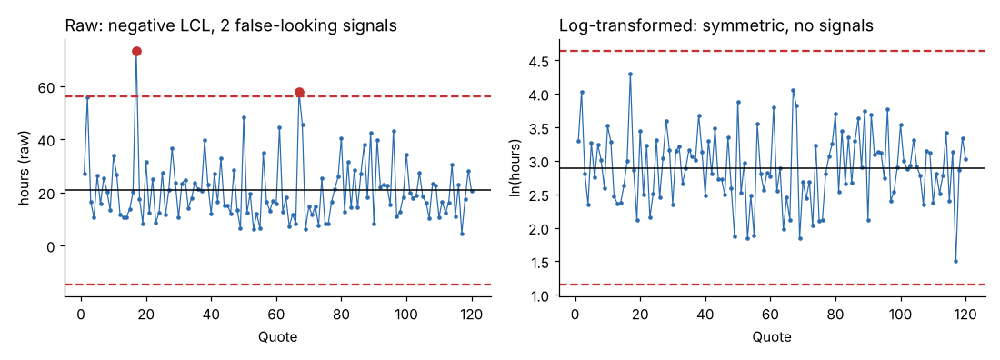
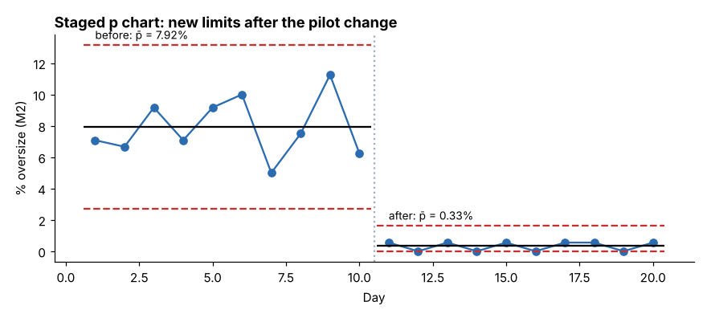

# Module 04 — Charting Process Behavior and Capability Analysis

**Time:** 6 h (about half of it with the data)

## Objectives

- Use trend charts and control charts to understand process behavior.
- Select the right control chart; apply rational subgrouping.
- Handle skewed data with a transformation, know the case against transforming, and use stage variables for before/after limits.
- Assess process capability.

This module covers the essentials. For more depth, see [Statistical Quality Control](../../../quality-operational-excellence/statistical-quality-control/README.md) and [Charting Process Behavior](../../../lean-six-sigma/charting-process-behavior/README.md).

## Trend charts and control charts

A **trend (run) chart** plots data in time order with a median line. It is the minimum for seeing shifts, trends and cycles.

A **control chart** adds limits so you can tell signals from noise. The limits sit at the center ± 3σ, where σ is estimated from short-term variation (the variation between consecutive points or within a small subgroup). Two kinds of variation, in Shewhart's terms (shewhart-1931):

- **Common-cause variation** is the routine, built-in variation of a stable process: dozens of small influences nobody can point at. The only way to reduce it is to change the process.
- **Special-cause variation** is a signal that something specific changed: a worn tool, a new batch of bar stock, a hot afternoon. Find it and remove it.

A chart signals a special cause when a point falls outside a limit. It also signals when 8 points in a row sit on one side of the center, when a run trends steadily up or down, and under similar run rules. Do not adjust a stable process in response to noise; that is tampering (Module 00).

## Chart selection

| Data | Subgroup | Chart | What is plotted |
|---|---|---|---|
| Continuous | 1 value per period | **I–MR** (individuals and moving range) | each value, and the difference between consecutive values |
| Continuous | 2 to 9 values | **X̄–R** | the subgroup mean, and the subgroup range |
| Continuous | 10 or more | X̄–S | the subgroup mean, and the subgroup standard deviation |
| Defectives (pass/fail) | any size n | **p** (np if n is constant) | the fraction (or number) of defective units |
| Defects (counts per unit) | equal area or opportunity | c; unequal: **u** | the count (or rate) of defects |

Reading the table: X̄ (x-bar) is the subgroup mean, R the subgroup range and S the subgroup standard deviation; p is the fraction defective and np the number defective; c is the count of defects and u the defects per unit. Every chart has a center line and an upper and lower control limit (UCL, LCL), three standard errors either side of the center; p̄ (p-bar) is the average fraction defective that sets the p chart's center.

**Rational subgrouping:** a subgroup should contain only common-cause variation (for example 5 consecutive inserts from one machine), so that differences **between** subgroups reveal special causes. Don't mix M1 and M2 in one subgroup.

## Worked example 1: individuals chart with and without a transformation

**Data:** `data/quote_turnaround.csv`, the 120 quote turnaround times from Module 02, which were found to be lognormal (a long right tail).

**Steps:** chart the raw hours as an individuals chart (one value per quote, limits from the mean moving range); then take the natural logarithm of each value, ln(hours), chart that, and convert the limits back to hours. Command: `python tools/qekit.py spc`.

**Result:**

| | Center | UCL | LCL | Points outside |
|---|---|---|---|---|
| Raw hours | 20.8 h | 56.3 h | −14.7 h (impossible) | 2 |
| ln(hours) | 2.894 | 4.634 | 1.154 | 0 |

Back-transformed, the log-scale limits are **3.2 to 102.9 hours**.



**What it means:** on the raw scale the chart flags two slow quotes that are only the normal long tail of a skewed process, so they are false alarms. It also shows a lower limit below zero, which a time cannot reach. On the log scale the process is stable.

**Two schools, and where this course stands.** Transforming is one answer to skewed data, and it is the one most software offers. Wheeler and other practitioners argue the opposite. The individuals chart's limits are robust enough that transforming is rarely needed. Transformations hide the original units from the people who must act on the chart. And a few extra signals are a cheaper error than a chart nobody understands. Both views agree on two things. X̄ charts of subgroup averages are much less sensitive to skewness than individuals charts. Limits computed from a distribution that fits the data (Module 02) are better than either. The course transforms here because the raw-scale lower limit is physically impossible, which is the clearest sign the raw chart is wrong. Where the raw chart's limits are merely a little wide, leave the data in its own units.

## X̄–R on OD

For OD, Bayline charts 5 consecutive inserts per hour **per machine**. The limits use tabulated constants that depend only on the subgroup size. For n = 5, A₂ = 0.577 sets the width of the X̄ limits around the grand mean. D₃ = 0 and D₄ = 2.114 set the limits of the range chart. Formulas and symbols are in `reference/formulas.md`; the Statistical Quality Control course builds the charts in depth. Because OD grows with tool wear and resets at each tool change (Module 05), expect a saw-tooth pattern: a slow climb, then a drop. That pattern is a special cause with a known reason, and the fix is in Module 06, not in the chart.

## Worked example 2: stage variables, before and after a change

When a process is deliberately changed, compute **separate limits for each stage** instead of one set across the change; one set would be too wide for both.

**Data:** `data/pilot_daily.csv`, 20 rows: day, stage (before or after), inserts inspected that day, and the number oversize. The first 10 days are the two weeks before the M2 corrective action, with 240 inserts inspected per day; the last 10 are the two weeks of the pilot, 180 per day. The before counts are drawn at random from the before-pilot defect rate; the after counts (6 oversize in 10 days) were set by hand for the teaching case.

**Steps:** for each stage, compute the fraction oversize p̄ and the p-chart limits p̄ ± 3√[p̄(1 − p̄)/n]; plot each day against its own stage's limits. Command: `python tools/qekit.py staged`.

**Result:**

| Stage | p̄ | UCL | LCL | Points outside |
|---|---|---|---|---|
| Before (n = 240/day) | 7.92 % | 13.15 % | 2.69 % | 0 |
| After (n = 180/day) | 0.33 % | 1.62 % | 0 | 0 |



**What it means:** each stage is stable at its own level, and the levels differ by a factor of 24. The chart is the picture of the change holding. The **proof** that the change is real is the two-proportion test in Module 06 (z = 11.5, p < 0.001), not the chart. The reason is worth knowing: in the after stage the expected number of oversize inserts per day is about 0.6. With counts that small the p-chart's limits, which assume a normal approximation, are not reliable. With rare events use the test for the comparison and the chart for monitoring, or use exact limits.

## Worked example 3: process capability

A process is **capable** when its natural spread fits inside the specification with room to spare, and it is **centered** when its mean sits near the target. Capability indices put numbers on both. They compare the voice of the process (what it produces) with the voice of the customer (the specification limits).

- **Cp** = (USL − LSL) / 6σ_within, where σ_within is the standard deviation estimated from within the subgroups (from R̄/d₂): how many times the process spread fits in the tolerance. It ignores where the process is centered, so it is *potential* capability.
- **Cpk** = distance from the mean to the nearest limit / 3σ_within: the same idea, penalized for running off-center. It is *actual* capability.
- **Pp and Ppk** use the overall standard deviation of all the data instead of the short-term σ, so they describe performance over the whole period, drift included.

A value of 1.33 is a common minimum customer requirement; below 1.0 the process produces out-of-spec parts even when centered. Both indices assume a stable process and roughly normal data.

**Data:** `data/production_sample.csv`, OD by machine, against the specification 6.325 to 6.375 mm.

**Steps:** compute the mean and overall standard deviation for each machine, then Pp and Ppk and the expected fraction out of specification. Command: `python tools/qekit.py capability`.

**Result:**

| | Mean | SD | Pp | Ppk | Expected out of spec |
|---|---|---|---|---|---|
| M1 | 6.35882 | 0.00586 | 1.42 | 0.92 | 0.29 % |
| M2 | 6.36664 | 0.00597 | 1.40 | **0.47** | **8.09 %** |

**What it means:** both machines have similar spread, and a Pp near 1.4 says that spread would fit the tolerance. The problem is **centering**: M2 runs 0.017 mm above target and M1 0.009 mm. Centering the machines and controlling the drift (Module 05) is the opportunity. A new machine would not help, because the spread is not the problem.

## Run it

```bash
python tools/qekit.py spc
python tools/qekit.py staged
python tools/qekit.py capability
```

## Exercise 4.1

1. From the capability table, compute M1's Ppk by hand using the overall standard deviation (the formula is in `reference/formulas.md`) and confirm it matches. Then compute what it would be if M1's mean were moved to the 6.350 target with the same spread; that is its Pp.
2. In the after stage of the pilot, how many oversize inserts are expected per day at p̄ = 0.33 % and n = 180? Explain in one sentence why that makes the p-chart limits for that stage unreliable.
3. Bayline will check thread fit with a go/no-go gauge on 1 insert in 25. Which chart should monitor the result, and what is plotted?

Answers in `solutions/README.md`.

## Check yourself

1. Why chart M1 and M2 separately?
2. Why is a negative LCL a warning sign on an individuals chart of times?
3. M2's Pp is 1.40 but Ppk is 0.47. What single action would have the biggest effect?

<details><summary>Answers</summary>

1. They're different process streams with different centers; mixing them inflates variation, widens limits and hides machine-specific signals.
2. Times can't be negative; it indicates skewed data being treated as symmetric, so limits (and signals) are unreliable. Consider a transformation or a distribution-specific chart.
3. Re-center M2 (and control what drives it high: offset, tool wear, coolant temperature); spread is already adequate.

</details>
