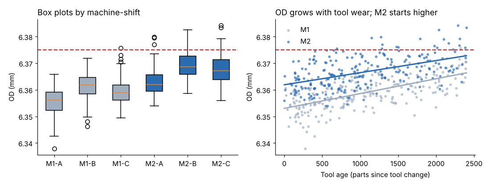

# Module 05 — Analyzing Potential Root Causes

**Time:** 6 h (about half of it with the data)

## Objectives

- Write an effective problem statement and follow a disciplined path to root cause.
- Use cause-and-effect diagrams, 5-Why/1-How and root cause trees.
- Verify causes with stratification, box plots, scatter plots and simple regression.
- Assess risk with FMEA and basic reliability calculations.

## The path to root cause

1. **Describe** the problem precisely (what, where, when, how big, not why).
2. **Generate** possible causes broadly (fishbone, root cause tree).
3. **Narrow** with logic and process knowledge (5-Why).
4. **Verify** with data (stratification, graphs, regression, tests).
5. **Confirm** by turning the cause on and off where safe (pilot, Module 06).

Jumping from step 1 to a solution is the most common failure.

## Effective problem statements

| Weak | Strong |
|---|---|
| "Quality is bad on the lathes." | "8.3 % of inserts sampled from M1/M2 over 20 days were defective; 50 % of defectives were OD oversize (> 6.375 mm), concentrated on M2 (19 of 20)." |

Is/is-not thinking helps: oversize **is** on M2 (19 of 20) and worst on shift B; it **is not** on M1 shift A. Those contrasts point at causes.

## Generating causes

**Cause-and-effect (fishbone) diagram** for "OD oversize," by category:

- **Machine:** M2 thermal growth; spindle bearing play; offset not updated
- **Method:** tool change interval too long; no offset rule after tool change
- **Material:** bar stock diameter or hardness variation
- **Measurement:** micrometer technique (reproducibility, Module 03)
- **Environment:** coolant temperature higher on shift C; shop temperature
- **People:** offset adjustment habits differ by shift

**5-Why, 1-How**: drive one branch to a controllable cause, then ask how to fix it:

1. Why oversize? The tool cuts less as it wears.
2. Why does wear reach oversize? Tools run up to about 2,400 parts with no offset compensation.
3. Why no compensation? No rule for when or how much to adjust.
4. Why no rule? The standard work only says "check hourly."
5. Why? Wear rate was never measured.
→ **How:** measure the wear rate, set a tool-change interval and an offset-compensation rule.

**Root cause tree**: a hierarchical version of the fishbone that keeps asking "what could cause this?" level by level, with each branch marked verified, ruled out or open (`templates/root-cause-tree.md`).

## Worked example: verifying causes with data

**Data:** `data/production_sample.csv`, the 480 inserts with, for each one, the machine, the shift, the tool age in parts since the last change, the coolant temperature in °C, the OD and the defect call. The columns for tool age and coolant temperature are there because the cause-and-effect matrix in Module 03 said to record them.

**Steps:**

1. **Stratify:** split the inserts by machine and shift and compare the mean OD and the share oversize in each group; test whether oversize is spread evenly across machines with a chi-square test. Command: `python tools/qekit.py stratify`.
2. **Look:** box plots of OD by machine and shift, and a scatter plot of OD against tool age (figure below).
3. **Regress:** fit OD against tool age alone, then against tool age, coolant temperature and machine together, and read the coefficients and R² (the share of OD variation the model explains). Command: `python tools/qekit.py regression`.

**Result, stratification:**

| Machine–shift | Mean OD | % oversize |
|---|---|---|
| M1-A | 6.35556 | 0.0 |
| M1-B | 6.36134 | 0.0 |
| M1-C | 6.35957 | 1.2 |
| M2-A | 6.36319 | 3.8 |
| M2-B | 6.36926 | 13.8 |
| M2-C | 6.36747 | 6.2 |

19 of 20 oversize parts are from M2 (chi-square p = 0.0001).

**Result, graphs:**



M2 runs higher on every shift; OD rises with tool age on both machines.

**Result, regression:**

- OD vs tool age alone: slope **0.0051 mm per 1,000 parts**, R² 0.23.
- OD vs tool age + coolant temperature + machine: R² **0.64**.
  - Tool age: +0.0145 mm over a 2,400-part tool life
  - Coolant: +0.0038 mm per +3 °C
  - M2 vs M1: +0.0078 mm

**What it means.** Three causes are verified, and the data say which shift each one hits:

- **M2's offset**, about +0.008 mm on every insert regardless of shift.
- **Tool wear without compensation**: OD climbs 0.0145 mm across a tool's life. Shift B is the worst for oversize because its tools are the oldest; the mean tool age in the sample is about 1,700 parts on shift B against about 720 on shifts A and C, since the morning change happens on A and the counter runs through B.
- **Coolant temperature on shift C**: the coolant runs about 3 °C warmer on shift C (27 °C against 24 °C on A and B in the data), worth about +0.004 mm, which is why C is second-worst even with fresh tools.

Together the three explain about two-thirds of the OD variation (R² 0.64). Regression shows association; the pilot in Module 06 confirms cause by changing the factors and measuring the result.

## FMEA

Failure mode and effects analysis rates each failure mode for **severity (S)** of its effect, **occurrence (O)**, how likely it is, and **detection (D)**, how likely current controls are to miss it, each on a 1 to 10 scale where 10 is worst. The classic priority number is RPN = S × O × D. Command: `python tools/qekit.py fmea`; template in `templates/fmea.csv`.

| Step | Failure mode | S | O | D | RPN |
|---|---|---|---|---|---|
| Turn OD | OD oversize | 7 | 6 | 5 | 210 |
| Thread | Thread damage | 8 | 4 | 6 | 192 |
| Turn OD | OD undersize | 9 | 3 | 5 | 135 |
| Deburr | Burr | 4 | 4 | 4 | 64 |
| Knurl | Knurl incomplete | 8 | 2 | 4 | 64 |

Act on the highest RPNs, **and** review any severity of 9 or more regardless of RPN (undersize inserts pull out in service). Thread damage's D = 6 reflects the unreliable visual inspection found in Module 03.

**RPN and its replacement.** RPN has a known weakness: it treats S, O and D as interchangeable, so a 9 × 3 × 5 and a 5 × 9 × 3 score the same although a severe, undetectable failure deserves more attention than a frequent trivial one. The AIAG-VDA FMEA Handbook (aiag-vda-fmea) therefore replaced RPN with an **Action Priority** table that looks up S first, then O, then D, and returns high, medium or low. Many customers now require the AP method. This course teaches RPN because it is simple and still widespread, and shows the S ≥ 9 override as the minimum correction; use the AP table when your customer or industry asks for it.

## Product and process reliability

Some causes are equipment failures. The coolant chiller that controls coolant temperature is part of a series system (every component must work). The exponential model, R(t) = e^(−t/MTBF), assumes a constant failure rate; the MTBFs here are illustrative. Command: `python tools/qekit.py reliability`.

| Component | MTBF | R(720 h, one month) |
|---|---|---|
| Chiller | 3,000 h | 0.787 |
| Coolant pump | 5,000 h | 0.866 |
| Controller | 20,000 h | 0.965 |
| **Series system** | **1,714 h** | **0.657** |
| With a redundant chiller | | 0.797 |

A one-in-three chance of losing temperature control each month means coolant temperature, a verified cause of oversize, needs either redundancy or monitoring with an alarm.

## Run it

```bash
python tools/qekit.py stratify
python tools/qekit.py regression
python tools/qekit.py fmea
python tools/qekit.py reliability
```

## Exercise 5.1

Using `data/production_sample.csv`:

1. Compute the mean coolant temperature and the mean tool age for each shift. Which cause does each shift's oversize rate point to?
2. Among M2's inserts only, what share of oversize inserts were made with a tool older than 1,600 parts? What does that suggest about the tool-change interval the fix should use?
3. Write a two-level "why" chain for thread damage that ends in a cause you could verify with the attribute MSA data from Module 03.

Answers in `solutions/README.md`.

## Check yourself

1. Why does a regression with R² = 0.64 not prove that coolant temperature causes oversize?
2. What does the is/is-not contrast "M2-B worst, M1-A best" suggest?
3. Compute the system MTBF of three series components with MTBFs 3,000, 5,000 and 20,000 h.

<details><summary>Answers</summary>

1. Correlation can arise from a lurking variable (for example, a shift can have both hotter coolant and older tools). Confirm by changing the factor (a pilot or experiment).
2. Factors that differ between M2 and M1 (machine offset, thermal behavior) and between shift A and B (tool age accumulated since the morning change).
3. Failure rates add: 1/3,000 + 1/5,000 + 1/20,000 = 0.000583 per hour, so MTBF ≈ 1,714 h.

</details>
