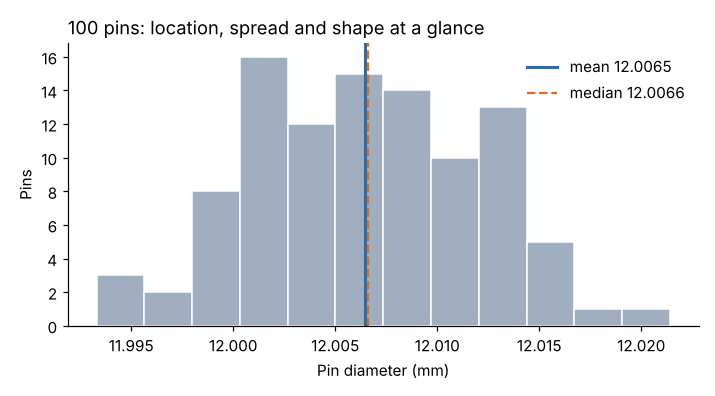

# Module 01 — Descriptive Statistics: Location, Spread and Shape

## Objectives

- Calculate measures of location (mean, median, mode) and spread (range, variance, standard deviation, IQR).
- Describe distribution shape (skewness, kurtosis) and check normality.
- Build and read a histogram.

## Measures

| Measure | Formula / definition | Notes |
|---|---|---|
| Mean x̄ | Σx / n | sensitive to outliers |
| Median | middle value of the sorted data | robust to outliers |
| Mode | most frequent value | useful for discrete or rounded data |
| Range R | max − min | simple; used in control charts for small subgroups |
| Variance s² | Σ(x − x̄)² / (n − 1) | units squared |
| Standard deviation s | √s² | same units as data |
| IQR | Q3 − Q1 | spread of the middle half; robust |
| Skewness | asymmetry; 0 for symmetric | > 0: long right tail |
| Excess kurtosis | tail weight relative to normal; 0 for normal | |

## Worked example: 100 pins

From `data/capability_study.csv`:

| Measure | Value |
|---|---|
| n | 100 |
| Mean | 12.00647 mm |
| Median | 12.0066 mm |
| Mode (to 0.001 mm) | 12.007 mm |
| Range | 0.0281 mm |
| Standard deviation | 0.00564 mm |
| Variance | 3.187 × 10⁻⁵ mm² |
| IQR | 0.0089 mm |
| Skewness | 0.027 |
| Excess kurtosis | −0.283 |
| Shapiro–Wilk p | 0.891 (no evidence against normality) |



Reading it: mean ≈ median ≈ mode and skewness near zero → symmetric. The center sits about **0.006 mm above the 12.000 target** — an important fact for capability (Module 07). Range ≈ 5 standard deviations, typical for n = 100.

## Histograms

- Choose about √n to 2√n bins (here 10–20); too few hides shape, too many shows noise.
- Mark the specification limits and target.
- Look for: center vs target, spread vs tolerance, shape (skewed, two peaks = mixed streams, cliff = sorted or truncated data), outliers.

**A histogram ignores time order.** A process can drift and still produce a bell-shaped histogram. Always also plot the data in time order (Module 02).

## In a spreadsheet

`AVERAGE`, `MEDIAN`, `MODE.SNGL`, `MAX−MIN`, `STDEV.S`, `VAR.S`, `QUARTILE.INC`, `SKEW`, `KURT`; histogram via the chart type or the Analysis ToolPak.

## Run it

```bash
python tools/sqckit.py describe
```

## Check yourself

1. Five pins measure 12.004, 12.010, 12.001, 12.007, 12.003. Compute the mean, range and standard deviation.
2. A histogram shows two peaks. What would you investigate?
3. Why use n − 1 in the sample variance?

<details><summary>Answers</summary>

1. Mean 12.0050; range 0.009; s = 0.00354 mm.
2. Two sources mixed together — two machines, cavities, operators, shifts or material lots. Stratify the data by each.
3. The sample mean is fitted to the same data, using up one degree of freedom; dividing by n − 1 gives an unbiased estimate of the population variance.

</details>
