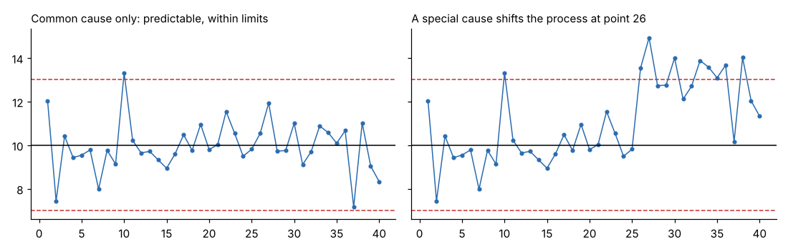

# Module 02 — Variation: Common Causes and Special Causes

## Objectives

- Distinguish common-cause from special-cause variation.
- Explain the two mistakes of process management (over-adjusting and under-reacting).
- Describe how a control chart separates the two, and the role of rational subgrouping.

## Two kinds of variation

| Common-cause variation | Special-cause (assignable-cause) variation |
|---|---|
| many small, ever-present sources | a specific, identifiable cause |
| built into the process (material, method, machine, environment) | something changed (worn tool, new lot, wrong setting) |
| predictable within limits | unpredictable; appears as a signal |
| reduce by **changing the system** (usually management's job) | remove by **finding and fixing the cause** (often local action) |

A process with only common-cause variation is **stable** ("in statistical control"): its future output is predictable within limits. Stable is not the same as good — it may be stable and still out of spec.

## Two costly mistakes

1. **Treating common cause as special (over-reacting / tampering):** adjusting the machine after every slightly high or low part. This adds variation — compensating for noise makes the process worse.
2. **Treating special cause as common (under-reacting):** ignoring a real shift because "it's within spec" or "parts always vary." Defects follow later.

Control charts balance the two: limits at ±3 standard deviations make false alarms rare (about 0.27 % per point for a stable normal process) while catching meaningful shifts.

## How control charts work

1. Collect data in time order, in **rational subgroups**.
2. Estimate **common-cause** variation from **within-subgroup** (or point-to-point) variation.
3. Set limits at center ± 3 × that variation.
4. Points outside the limits, or non-random patterns (run rules), signal special causes.

**Rational subgrouping:** form subgroups so that variation **within** a subgroup is only common cause (consecutive parts from one machine, one setup), and changes happen **between** subgroups. Mixing two spindles in one subgroup inflates the limits and hides problems.

## Run rules

The classic Western Electric rules (one common set — your plant may use others):

1. One point beyond 3σ.
2. Two of three consecutive points beyond 2σ on the same side.
3. Four of five consecutive points beyond 1σ on the same side.
4. Eight consecutive points on one side of the center line.

More rules catch small shifts sooner but raise the false-alarm rate.

## Limits are not specifications

| Control limits | Specification limits |
|---|---|
| voice of the process | voice of the customer |
| calculated from data | set by design/customer |
| for averages (X̄ chart) or individuals | for individual parts |
| tell you if the process changed | tell you if a part is acceptable |

Never draw spec limits on an X̄ chart — subgroup averages vary less than individual parts, so the comparison is meaningless.

## Check yourself

1. An operator adjusts the lathe offset by the amount the last pin was off target. What will happen to variation?
2. Two machines feed one inspection station. How should subgroups be formed?
3. The chart is stable but 3 % of parts are out of spec. What kind of action is needed?

Answers

1. It increases. Adjusting to random noise adds the adjustment error to the next part — classic tampering (for unbiased adjustment of pure noise, the variance roughly doubles).
2. Separately by machine (one chart per machine, or stratify), so each subgroup reflects one process stream.
3. A change to the system — reduce common-cause variation or recenter — not a hunt for special causes.

