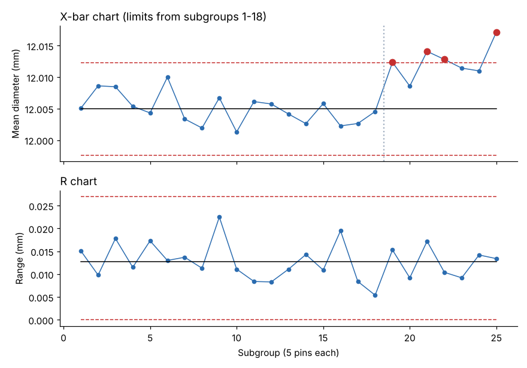

# Module 03 — Average and Range (X̄–R) Charts

## Objectives

- Construct X̄ and R charts for subgrouped measurement data.
- Use the constants A₂, D₃, D₄ and d₂ — and know where they come from.
- Interpret signals and act on them.

## Formulas

For k subgroups of size n:

- X̿ = average of the subgroup means; R̄ = average of the subgroup ranges
- **X̄ chart:** UCL = X̿ + A₂R̄; LCL = X̿ − A₂R̄
- **R chart:** UCL = D₄R̄; LCL = D₃R̄
- Estimate of process σ: σ̂ = R̄ / d₂

Where the constants come from: d₂ is the expected range of n standard-normal values; d₃ is the standard deviation of that range. Then A₂ = 3 / (d₂√n), D₃ = max(0, 1 − 3d₃/d₂), D₄ = 1 + 3d₃/d₂. The toolkit computes them by numerical integration:

| n | d₂ | d₃ | A₂ | D₃ | D₄ |
|---|---|---|---|---|---|
| 2 | 1.128 | 0.853 | 1.880 | 0 | 3.267 |
| 3 | 1.693 | 0.888 | 1.023 | 0 | 2.575 |
| 4 | 2.059 | 0.880 | 0.729 | 0 | 2.282 |
| 5 | 2.326 | 0.864 | 0.577 | 0 | 2.114 |
| 10 | 3.078 | 0.797 | 0.308 | 0.223 | 1.777 |

These match the values in standard published tables.

## Worked example: pin diameter

25 subgroups of 5 consecutive pins, sampled once an hour (`data/pin_diameter_subgroups.csv`). Limits are set from the first 18 subgroups (Phase I), then used to monitor subgroups 19–25 (Phase II).

| Statistic | Value |
|---|---|
| X̿ | 12.00494 mm |
| R̄ | 0.01274 mm |
| X̄ chart UCL / LCL | 12.01230 / 11.99759 mm |
| R chart UCL / LCL | 0.02695 / 0 mm |
| σ̂ = R̄ / d₂ | 0.00548 mm |

Check: UCL = 12.00494 + 0.577 × 0.01274 = 12.01229 ✓



**Reading the chart (always R first):**

- **R chart:** all points within limits — within-subgroup variation is stable, so the X̄ limits are trustworthy.
- **X̄ chart, subgroups 1–18:** stable.
- **From subgroup 19:** points 19, 21, 22 and 25 are beyond the UCL; run rules 2 and 3 also fire from 21 onward. The mean of subgroups 19–25 is 12.0125 mm vs 12.0049 mm before — a **shift of about +0.008 mm**.

**Action:** a special cause appeared around subgroup 19. Check what changed at that time (tool change, offset, material lot, temperature). Investigation (in the case) found a new insert with a different nose radius set without re-zeroing the offset. Correct it, record it on the chart, and verify the next subgroups return to the old level.

## Practical notes

- Collect 20–25 subgroups before setting limits; recompute when the process is deliberately changed.
- Typical subgroup size 4–5, consecutive parts.
- Use X̄–S charts (standard deviation) for subgroups larger than about 10.
- Write actions on the chart — it becomes the process log.

## In a spreadsheet

Columns for each piece, then `AVERAGE` and `MAX−MIN` per row; X̿ and R̄; limits with the constants; a line chart with limit series.

## Run it

```bash
python tools/sqckit.py xbar_r
```

## Check yourself

1. Why check the R chart before the X̄ chart?
2. Subgroups of 4 give X̿ = 25.00 and R̄ = 0.40. Compute the X̄ and R limits.
3. Spec is 12.000 ± 0.030 mm and all subgroup averages are within spec. Why still act on subgroup 19?

<details><summary>Answers</summary>

1. X̄ limits are built from R̄; if the range is unstable, R̄ — and the X̄ limits — are not meaningful.
2. X̄: 25.00 ± 0.729 × 0.40 → 24.708 to 25.292. R: UCL = 2.282 × 0.40 = 0.913; LCL = 0.
3. The process has changed. A shifted mean moves the whole distribution toward the USL, raising the defect risk (Module 07 shows Cpk would fall to 0.89); the cause may also get worse.

</details>
