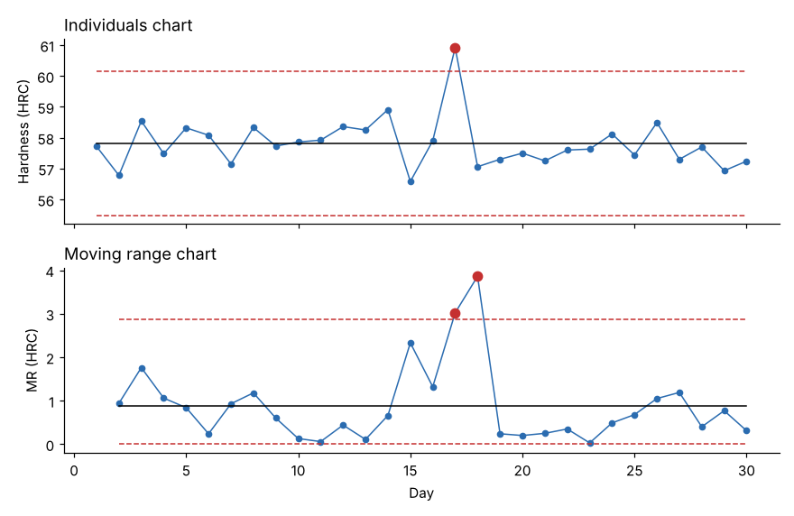

# Module 04 — Individuals and Moving Range (I–MR) Charts

## Objectives

- Use I–MR charts when data come one value at a time.
- Calculate limits from the average moving range.
- Interpret signals and revise limits correctly.

## When to use I–MR

- One measurement per batch, shift or day (heat-treat hardness, a lab assay, monthly scrap rate).
- Slow processes or expensive/destructive tests.
- Transactional data (lead time per order).

## Formulas

- Moving range MRᵢ = |xᵢ − xᵢ₋₁|; MR̄ = average of the moving ranges
- **Individuals chart:** center x̄; limits x̄ ± 2.66 MR̄
- **MR chart:** UCL = 3.267 MR̄; LCL = 0

Where they come from: each MR is a range of n = 2, so σ̂ = MR̄ / d₂(2) = MR̄ / 1.128, and 3σ̂ = 2.66 MR̄. 3.267 is D₄ for n = 2.

## Worked example: daily hardness

One hardness test (HRC) per heat-treat batch for 30 days (`data/daily_hardness.csv`).

| Statistic | Value |
|---|---|
| x̄ | 57.813 HRC |
| MR̄ | 0.877 HRC |
| Individuals UCL / LCL | 60.146 / 55.480 HRC |
| MR UCL | 2.866 HRC |



- **Day 17** is above the UCL on the individuals chart.
- The moving ranges ending on days 17 and 18 exceed the MR UCL — one unusual value produces two large moving ranges (into and out of it).

**Action:** the furnace log showed an over-temperature soak on day 17. After fixing the controller and confirming the cause, recompute the limits without day 17: center 57.706, limits **55.863 to 59.549 HRC**. Only remove points with a **found and fixed** cause; never delete points just because they are outside the limits.

## Cautions

- I–MR charts are more sensitive to non-normal data than X̄ charts. For strongly skewed data (e.g. cycle times), consider a transformation or a chart suited to the distribution.
- Watch for autocorrelation (each value depends on the last — common in chemical and thermal processes); it makes MR̄ small and limits too tight.

## Run it

```bash
python tools/sqckit.py imr
```

## Check yourself

1. Values: 10.2, 10.5, 10.1, 10.4, 10.3. Compute MR̄ and the individuals limits.
2. Why does one outlier create two large moving ranges?
3. Why not use the overall standard deviation of all 30 values for the limits?

<details><summary>Answers</summary>

1. MRs: 0.3, 0.4, 0.3, 0.1 → MR̄ = 0.275. x̄ = 10.30. Limits = 10.30 ± 2.66 × 0.275 = 9.57 to 11.03.
2. The jump to the outlier and the jump back each make a large difference.
3. The overall SD includes any shifts and special causes, inflating the limits so the chart misses them; the moving range captures short-term (common-cause) variation.

</details>
