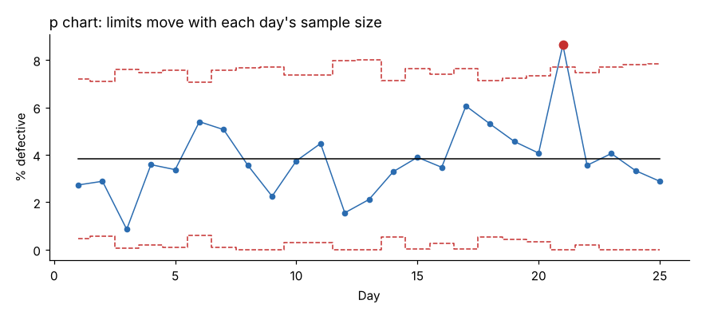
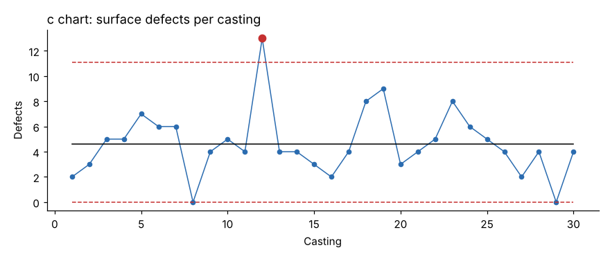

# Module 05 — Attribute Charts: P Chart and C Chart

## Objectives

- Choose between charts for defectives (p, np) and defects (c, u).
- Construct a p chart with varying sample sizes and a c chart.
- Interpret attribute charts and know their limitations.

## Defectives vs defects

| Data | Distribution assumed | Chart (sample size constant) | Chart (sample size varies) |
|---|---|---|---|
| **Defectives** — items that fail (pass/fail per item) | binomial | np chart | **p chart** |
| **Defects** — count of flaws on an item or area (an item can have many) | Poisson | **c chart** | u chart (defects per unit) |

## P chart

- p̄ = total defectives / total inspected
- Limits for a sample of size nᵢ: p̄ ± 3√[p̄(1 − p̄)/nᵢ] (LCL set to 0 if negative)

**Valve bodies, daily final inspection** (`data/valve_final_inspection.csv`, 25 days, 180–320 inspected per day):

| Statistic | Value |
|---|---|
| Total inspected / defective | 6,237 / 239 |
| p̄ | 3.832 % |
| UCL at n = 180 / n = 320 | 8.12 % / 7.05 % |



**Day 21**: 19 defectives in 220 = 8.64 %, above that day's UCL of 7.71 % → special cause. (The case: a new seal supplier's lot started that morning.)

Notice that the limits **move with sample size**: bigger samples give tighter limits. Comparing raw percentages across days without this adjustment can mislead.

## C chart

- c̄ = average count of defects per inspection unit (units must be the same size/opportunity)
- Limits: c̄ ± 3√c̄ (LCL set to 0 if negative)

**Surface defects per casting** (`data/casting_defects.csv`, 30 castings):

| Statistic | Value |
|---|---|
| c̄ | 4.633 |
| UCL / LCL | 11.09 / 0 |
| Beyond UCL | casting 12 (13 defects) |
| Revised c̄ and UCL after removing casting 12 (cause found: wet sand mold) | 4.345, 10.60 |



If the inspection area varies (castings of different sizes), use a **u chart**: u = defects per unit area, limits ū ± 3√(ū/nᵢ).

## Limitations of attribute charts

- They need **large samples** to detect changes when defect rates are low: a non-zero LCL needs n > 9(1 − p̄)/p̄, so with p̄ = 1 % you need about **900** items per sample. A common minimum rule is n·p̄ ≥ about 5 just to see a few defectives per sample.
- They tell you **that** something changed, not **what** — stratify defects by type (Pareto) to act.
- Measurement data (X̄–R, I–MR) carry more information per sample; use them where you can measure.
- When defect rates are very low (ppm), consider charts of time or count between defects.

## Run it

```bash
python tools/sqckit.py p_chart
python tools/sqckit.py c_chart
```

## Check yourself

1. Compute the p-chart UCL for a day with n = 250, using p̄ = 3.832 %.
2. A paint line counts blemishes per car body. p, np, c or u?
3. Why might a p chart show "in control" while customers complain?

<details><summary>Answers</summary>

1. 0.03832 + 3√(0.03832 × 0.96168 / 250) = 0.03832 + 3 × 0.01214 = 7.47 %.
2. c chart (same car body size), or u chart if body sizes differ.
3. The process may be stable at an unacceptable level (stable ≠ good), or inspection may not detect the defect customers see.

</details>
