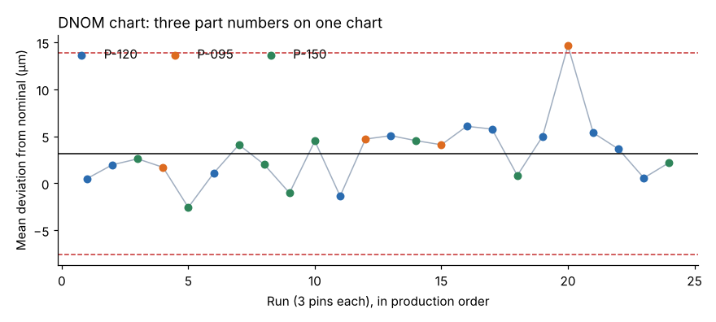

# Module 06 — Short-Run Control Charts

## Objectives

- Explain why standard charts struggle with short production runs and many part numbers.
- Build a deviation-from-nominal (DNOM) chart.
- Know when to use standardized (Z) charts instead.

## The problem

Job shops and high-mix lines run many part numbers in small lots. A separate chart per part number never collects the 20–25 subgroups needed for limits, and the operator faces dozens of charts. **Short-run charts** chart the **process** (the machine and setup) instead of each part number, by transforming the data so different parts can share one chart.

## Deviation from nominal (DNOM)

Plot **x − nominal** instead of x. Parts with different nominals then share a common scale; a single X̄–R chart on the deviations monitors the lathe.

**Assumptions:** the process variation (σ) is about the same for all part numbers, and nominal is the natural target. Check the first by comparing R̄/d₂ by part number.

## Worked example: one lathe, three pins

24 runs of three part numbers (P-120 at 12.000 mm, P-095 at 9.500 mm, P-150 at 15.000 mm), 3 pins measured per run (`data/short_run_lathe.csv`).

**Check σ is similar** (R̄/d₂ by part): P-095 0.00705, P-120 0.00577, P-150 0.00633 mm — similar enough to share one chart.

**DNOM X̄–R chart (n = 3):**

| Statistic | Value |
|---|---|
| Center (mean deviation) | +0.00316 mm |
| X̄ UCL / LCL | +0.01390 / −0.00757 mm |
| R̄ / R UCL | 0.01049 / 0.02700 mm |



**Run 20 (P-095)**: mean deviation +0.0146 mm, above the UCL. P-095 had only run three times before — a per-part chart would have had no limits at all. Investigation: after a tool change, the P-095 program's wear offset had not been reset.

Also visible: the center line is **+0.003 mm**, i.e. the lathe tends to run slightly large on all parts — a centering opportunity common to every part number.

(Here limits were computed from all 24 runs for simplicity; in practice, set them from runs without known special causes.)

## Standardized (Z) charts

When σ differs by part number (e.g. a 50 mm part varies more than a 5 mm part), standardize each subgroup:

Z = (x̄ − target_part) / (σ_part / √n)

and plot Z with limits ±3. Each part's σ comes from history or from its own R̄/d₂. The R chart is standardized similarly (R / R̄_part, with limits D₃ and D₄). Z charts handle different variation at the cost of needing a σ estimate per part.

## Practical tips

- Record the part number on every point so patterns by part are visible.
- If one part number consistently plots off-center, it may have a programming or fixture issue — or its nominal is not its natural target (e.g. one-sided tolerances).
- Setups are a common special cause in short runs: chart the first piece after setup separately if needed.

## Run it

```bash
python tools/sqckit.py short_run
```

## Check yourself

1. A 9.500 mm part measures 9.512, 9.509, 9.515. What is its DNOM subgroup mean?
2. One part has a ±0.005 tolerance and another ±0.100, made on different machines. DNOM or Z chart?
3. Why is a center line of +0.003 mm on a DNOM chart useful information?

<details><summary>Answers</summary>

1. Deviations +0.012, +0.009, +0.015 → mean +0.012 mm.
2. Neither as one chart — different machines are different processes. If on one machine with very different σ, use a Z chart.
3. It shows a systematic bias common to all part numbers (machine or measurement offset) that can be corrected once for everything.

</details>
