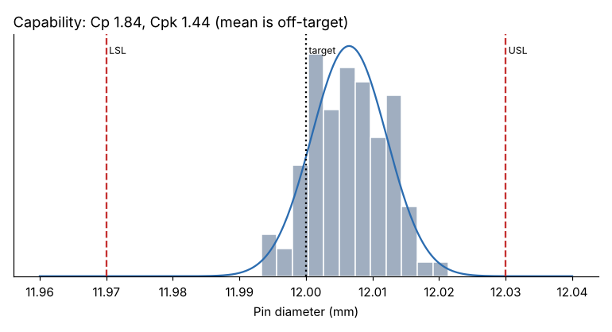

# Module 07 — Process Capability

## Objectives

- Estimate the proportion nonconforming from a stable process.
- Calculate and interpret Cp, Cpk, Pp and Ppk.
- Explain the prerequisites and pitfalls of capability indices.

## Prerequisites

Capability describes what a **stable** process produces. Before computing indices:

1. The process is in statistical control (control chart).
2. The measurement system is adequate (gauge R&R).
3. The distribution is reasonably normal — or you use a method for the actual distribution.
4. Enough data: at least about 100 values (25 subgroups of 4–5) for stable estimates.

## Indices

With specification limits LSL and USL:

| Index | Formula | Uses | Meaning |
|---|---|---|---|
| Cp | (USL − LSL) / 6σ_within | short-term σ | potential, if perfectly centered |
| Cpk | min(USL − μ, μ − LSL) / 3σ_within | short-term σ | actual, includes centering |
| Pp | (USL − LSL) / 6σ_overall | overall SD | long-term potential |
| Ppk | min(USL − μ, μ − LSL) / 3σ_overall | overall SD | long-term actual performance |

σ_within comes from R̄/d₂ or MR̄/d₂; σ_overall is the ordinary sample standard deviation. If Pp is much lower than Cp, the process drifts between subgroups.

Common targets: Cpk ≥ 1.33 for existing processes, ≥ 1.67 for new or critical characteristics (customer-specific — check your contract).

## Proportion nonconforming

For a normal process: P(out of spec) = P(Z > (USL − μ)/σ) + P(Z < (LSL − μ)/σ), often expressed in parts per million (ppm).

## Worked example: 100 pins

Spec 12.000 ± 0.030 mm (`data/capability_study.csv`; stable; normality not rejected, p = 0.89).

| Statistic | Value |
|---|---|
| Mean | 12.00647 mm |
| σ_within (MR̄ / 1.128) | 0.00544 mm |
| σ_overall | 0.00564 mm |
| **Cp** | **1.838** |
| **Cpk** | **1.442** |
| Pp / Ppk | 1.772 / 1.389 |
| Expected nonconforming | ≈ 15 ppm |
| Observed out of spec | 0 of 100 |



**Reading it:** Cp 1.84 says the spread uses only 54 % of the tolerance — the process **could** be very capable. Cpk 1.44 is lower because the mean is 0.0065 mm above target, closer to the USL. **Centering the process** would bring Cpk up to Cp and cut expected defects from about 15 ppm to about 0.1 ppm — a setting change, not a capital project.

And if the shift seen in Module 03 (+0.009 mm) persisted, Cpk would fall to **0.89** — that's why reacting to control-chart signals protects capability.

## Pitfalls

- **Unstable process:** indices are meaningless — they predict nothing.
- **Non-normal data:** tail estimates (ppm) can be far off; use a fitted distribution or percentile method.
- **Small samples:** a Cpk from 30 parts has a wide confidence interval.
- **One-sided specs:** use only the relevant side (Cpu or Cpl).
- **Gaming:** sorted or "selected" parts give flattering indices.
- **An index is not a defect rate** — always also report ppm and the histogram.

## Run it

```bash
python tools/sqckit.py capability
```

## Check yourself

1. Spec 50 ± 0.6, mean 50.2, σ 0.15. Compute Cp and Cpk.
2. Cp = 1.0 and Cpk = 1.0. What does that mean, and what is the expected defect rate?
3. Cp = 1.6, Pp = 1.0. What is happening?

<details><summary>Answers</summary>

1. Cp = 1.2 / 0.9 = 1.33; Cpk = min(50.6 − 50.2, 50.2 − 49.4) / 0.45 = 0.4 / 0.45 = 0.89.
2. Centered, with the ±3σ spread exactly filling the tolerance: about 0.27 % (2,700 ppm) out of spec.
3. Short-term variation is small, but the process drifts or shifts over time (between-subgroup variation). Look for the special causes and stabilize before claiming capability.

</details>
