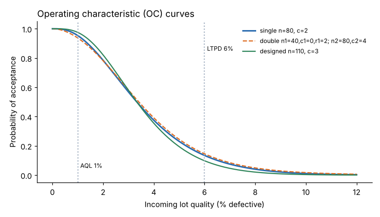

# Module 08 — Acceptance Sampling: Risks, OC Curves and Plan Design

## Objectives

- Describe how a single sampling plan works and when acceptance sampling is appropriate.
- Explain producer's and consumer's risk, AQL and LTPD.
- Draw and read an operating characteristic (OC) curve.
- Design a single sampling plan to meet stated risks.

## How a single sampling plan works

From a lot of N items, inspect a random sample of n. If the number of defectives d ≤ c (the **acceptance number**), accept the lot; otherwise reject it. Rejected lots are returned, scrapped or 100 % sorted (rectifying inspection, Module 09).

**Random sampling is essential** — taking the top layer of a box or the first 80 pieces of a run biases the result.

## Risks

| Term | Meaning |
|---|---|
| **AQL** (acceptable quality level) | a quality level the producer and consumer agree is acceptable as a process average |
| **Producer's risk α** | probability of rejecting a lot at AQL quality (typically about 5 %) |
| **LTPD** (lot tolerance percent defective) / RQL (rejectable quality level) | a poor quality level the consumer wants to reject |
| **Consumer's risk β** | probability of accepting a lot at LTPD quality (typically about 10 %) |

No sampling plan has zero risk at both ends; only 100 % (perfect) inspection does — and 100 % inspection is itself rarely perfect.

## The OC curve

P(accept) for each possible incoming quality p. For a large lot, d follows a binomial distribution:

P(accept) = Σ_{d=0}^{c} C(n, d) pᵈ (1 − p)ⁿ⁻ᵈ

(For small lots relative to n, the hypergeometric distribution is exact.)

**Harbor's incoming valve seats:** lot N = 2,000, plan **n = 80, c = 2**.

| Lot % defective | 0.5 | 1 | 2 | 3 | 4 | 5 | 6 | 8 | 10 |
|---|---|---|---|---|---|---|---|---|---|
| P(accept) | 0.992 | 0.953 | 0.784 | 0.568 | 0.375 | 0.231 | 0.134 | 0.040 | 0.011 |

- Producer's risk at AQL 1 %: 1 − 0.953 = **4.7 %**
- Consumer's risk at LTPD 6 %: **13.4 %**

The exact hypergeometric values (N = 2,000) at 2 % and 6 % are 0.787 and 0.129 — close to the binomial, as expected when n is small relative to N.



## Designing a plan for stated risks

**Requirement:** AQL 1 % with α ≤ 5 %; LTPD 6 % with β ≤ 10 %.

Search for the smallest n (and its c) satisfying both (`python tools/sqckit.py design`):

| Plan | P(accept) at 1 % | P(accept) at 6 % |
|---|---|---|
| **n = 110, c = 3** | 0.975 | 0.098 |

The current plan (80, 2) fails the consumer's-risk requirement (13.4 % > 10 %). Tightening LTPD to 4 % would require **n = 198, c = 4** — protection costs inspection.

**Rules of thumb visible on the OC curves:**

- Larger n → steeper curve → better discrimination between good and bad lots.
- For a fixed n, a larger c shifts the curve right (more lenient).
- Sampling a fixed **percentage** of each lot gives very different protection for different lot sizes — what matters is mainly n, not n/N.

## When to use acceptance sampling

Appropriate: destructive testing; 100 % inspection too costly or fatiguing; a new or unknown supplier; contractual requirement.

Better alternatives when available: supplier process control data (control charts and capability), supplier certification, skip-lot sampling for proven suppliers.

## Run it

```bash
python tools/sqckit.py oc
python tools/sqckit.py design
```

## Check yourself

1. For n = 50, c = 0, what is P(accept) at p = 2 %?
2. Why can't the plan (80, 2) meet both α ≤ 5 % at 1 % and β ≤ 10 % at 6 %?
3. A buyer insists on c = 0 plans. What is the trade-off?

<details><summary>Answers</summary>

1. (0.98)⁵⁰ = 0.364.
2. With n = 80 the OC curve isn't steep enough: at c = 2, P(accept) at 6 % is still 13.4 %. Lowering c to 1 meets β but then P(accept) at 1 % falls to about 0.81 (α ≈ 19 %). Only a larger n achieves both.
3. c = 0 plans give strong protection against bad lots per sample size but a high producer's risk at moderate quality levels: lots with even a small defect rate get rejected often (e.g. n = 50, c = 0 rejects 39.5 % of lots at 1 %).

</details>
