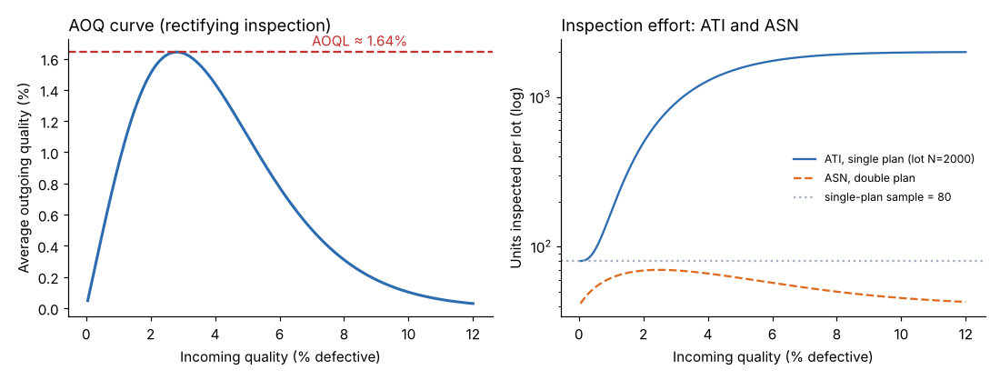

# Module 09 — AOQ, AOQL, ATI, ASN, Double Sampling and the ANSI Standard

## Objectives

- Calculate average outgoing quality (AOQ) and its limit (AOQL) under rectifying inspection.
- Calculate average total inspection (ATI) and average sample number (ASN).
- Compare single and double sampling plans.
- Explain how the ANSI/ASQ Z1.4 attribute sampling standard is used.

## Rectifying inspection

If rejected lots are **100 % inspected and defectives replaced**, outgoing quality improves. For a single plan with lot size N:

- **AOQ** = P(accept) × p × (N − n) / N — average defective fraction leaving inspection.
- **AOQL** = the maximum AOQ over all incoming qualities — the worst average outgoing quality, whatever comes in.
- **ATI** = n + (1 − P(accept)) × (N − n) — average units inspected per lot.

**Plan n = 80, c = 2, N = 2,000:**

| Incoming % defective | 1 | 2 | 4 |
|---|---|---|---|
| AOQ (%) | 0.915 | 1.506 | 1.439 |
| ATI (units per lot) | 169 | 494 | 1,280 |

**AOQL ≈ 1.64 %**, reached when incoming quality is about 2.8 %.



Why the AOQ curve rises then falls: good lots pass with few defects; very bad lots get rejected and sorted, so they leave clean. The worst outgoing quality comes from **moderately bad** lots that are often accepted. The AOQL guarantee holds only **on average** and only if rejected lots really are sorted perfectly.

The ATI curve shows the cost side: as incoming quality worsens, more lots are sorted and inspection effort climbs toward the full 2,000 per lot.

## Double sampling

Take a first sample n₁; accept if d₁ ≤ c₁, reject if d₁ ≥ r₁; otherwise take a second sample n₂ and accept if d₁ + d₂ ≤ c₂.

**Double plan:** n₁ = 40, c₁ = 0, r₁ = 2; n₂ = 80, c₂ = 4 — chosen so its OC curve nearly matches the single plan (80, 2):

| Incoming % defective | 0.5 | 1 | 2 | 4 | 6 | 10 |
|---|---|---|---|---|---|---|
| P(accept), double | 0.983 | 0.937 | 0.782 | 0.391 | 0.146 | 0.017 |
| P(accept), single (80, 2) | 0.992 | 0.953 | 0.784 | 0.375 | 0.134 | 0.011 |
| **ASN**, double | 53.2 | 61.6 | 69.1 | 66.0 | 57.2 | 45.3 |

**ASN** (average sample number) = n₁ + n₂ × P(second sample needed). For roughly the same protection, the double plan inspects **45–69 units on average instead of 80** — because very good and very bad lots are decided on the first sample. The cost: more complex administration and a variable workload (sometimes 120 units).

**Multiple** and **sequential** sampling extend the idea further, with still lower average sample numbers.

## The ANSI/ASQ Z1.4 standard

ANSI/ASQ Z1.4 (attribute sampling; its predecessor was the US military standard MIL-STD-105) is a **system of plans** indexed by AQL, not a single plan. Its tables are copyrighted and are not reproduced here; obtain the current edition. How it is used, in outline:

1. Agree the **AQL** for each characteristic or defect class (e.g. lower AQL for critical defects).
2. Choose the **inspection level** — general levels I, II (the usual default) and III, or special levels S-1 to S-4 for small samples/destructive tests.
3. From the **lot size** and inspection level, find the **sample size code letter**.
4. From the code letter and AQL, read the **sample size and accept/reject numbers** for single, double or multiple sampling.
5. Apply the **switching rules**: start at **normal** inspection; switch to **tightened** after poor results (e.g. a set number of rejected lots in a run of lots); return to normal after consistent acceptance; allow **reduced** inspection after a sustained good record with stable production. The protection of the system depends on using the switching rules.

Key points:

- The AQL in the standard is a **process-average** concept, not a guarantee for each lot; individual lots worse than the AQL can be accepted.
- Check the OC curve of the plan you are given — published OC curves accompany the plans.
- For **variables** (measurement) data, the companion standard ANSI/ASQ Z1.9 gives plans that need smaller samples for the same protection, assuming normality.

(The description above is from general knowledge of the standards and was not checked against the current editions — verify details such as switching-rule counts in the standard itself.)

## Run it

```bash
python tools/sqckit.py aoq
python tools/sqckit.py double
```

## Check yourself

1. Compute AOQ at 3 % for the plan (80, 2), N = 2,000. P(accept) = 0.568.
2. Why doesn't the AOQL apply when rejected lots are returned to the supplier instead of sorted?
3. A lot of 5,000 is inspected with a double plan whose ASN is 62. Does that mean every lot gets 62 units inspected?

<details><summary>Answers</summary>

1. 0.568 × 0.03 × 1,920 / 2,000 = 1.636 %.
2. AOQ assumes rejected lots are sorted and their defectives replaced; returned lots may come back unchanged or mixed into later shipments, so outgoing quality isn't improved in the same way.
3. No — ASN is an average: some lots are decided after 40 units, others need 120.

</details>
