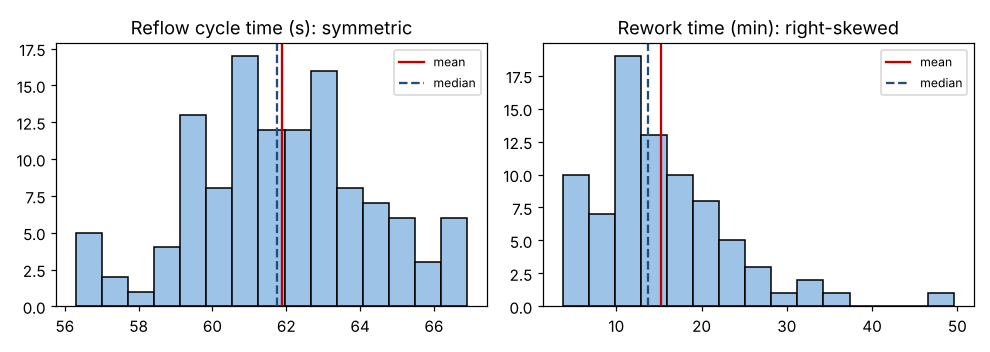

# Module 1 — Descriptive Statistics

**Time:** 75 min

## Learning objectives

1. Summarize data with histograms and measures of center, spread and shape.
2. Interpret skewness and kurtosis.

## 1. Graph first



Cycle time is symmetric and mound-shaped; rework time has a long right tail (a few repairs take 40+ minutes).

## 2. Summary statistics

```bash
python tools/statkit.py describe
```

| Statistic | Reflow cycle time (s, n = 120) | Rework time (min, n = 80) |
|---|---|---|
| Mean | 61.89 | 15.22 |
| Median | 61.75 | 13.75 |
| Mode (rounded) | 61 | 11 |
| Standard deviation | 2.35 | 8.20 |
| Range | 10.6 | 45.9 |
| IQR | 2.92 | 9.12 |
| Skewness | −0.07 | **1.38** |
| Excess kurtosis | −0.17 | **3.24** |

## 3. Center

- **Mean** uses every value; pulled by the tail.
- **Median** is robust; for skewed data it describes the "typical" case better.
- **Mode** — most common value; useful for discrete data.

Cycle time: mean ≈ median → symmetric. Rework: mean > median → right skew.

## 4. Spread

- **Standard deviation** s = √[Σ(x − x̄)² / (n − 1)].
- **Range** depends on the two extremes only.
- **IQR** = Q3 − Q1: the middle 50%, robust to outliers.

## 5. Shape

| Measure | Meaning | Normal value | Rework time |
|---|---|---|---|
| **Skewness** | Asymmetry: > 0 long right tail, < 0 long left tail | 0 | 1.38 (strong right skew) |
| **Excess kurtosis** | Tail heaviness relative to normal | 0 | 3.24 (heavy tails, more extremes) |

Rough guides: |skew| < 0.5 ≈ symmetric; 0.5–1 moderate; > 1 strong. Sample skewness and kurtosis are themselves noisy with small n — look at the histogram too.

**Why shape matters:** normal-based predictions (Module 3) and some tests (Module 6) assume symmetry and normal tails. Rework time will need different handling (Module 7).

## Check yourself

A dataset has mean 20, median 14. What shape do you expect, and which center would you report for "a typical case"?

<details><summary>Answer</summary>

Right-skewed; report the median for a typical case (and the mean for totals or costs).
</details>
