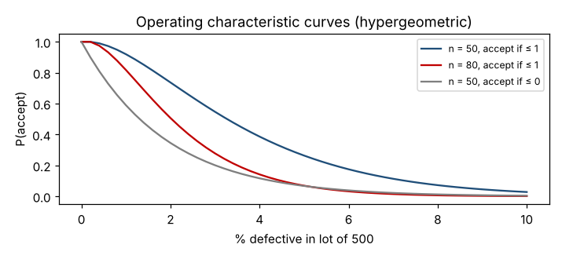
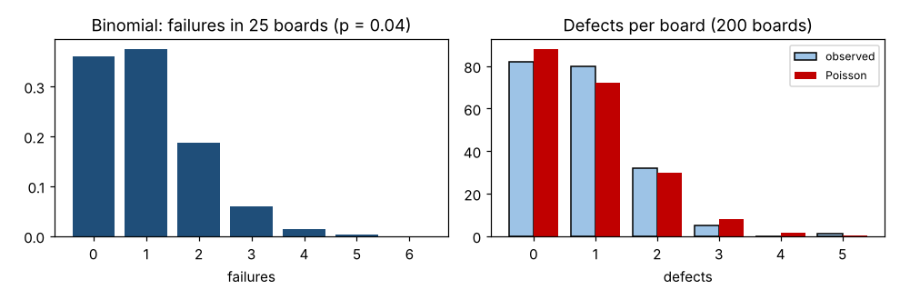

# Module 2 — Probability and Discrete Distributions: Hypergeometric, Binomial, Poisson

**Time:** 90 min

## Learning objectives

1. Choose the right discrete distribution for a counting problem.
2. Use it to forecast process performance and evaluate sampling plans.

## 1. Which distribution?

| Distribution | Counts… | Conditions | PCB example |
|---|---|---|---|
| **Hypergeometric** | Defectives in a sample drawn **without replacement** from a finite lot | Lot size N, defectives K, sample n | Incoming inspection of a lot of 500 |
| **Binomial** | Successes/failures in n independent trials, constant p | Fixed n, two outcomes | Failures in a batch of 25 boards |
| **Poisson** | Events in a fixed area/time/unit when they're rare and independent | Rate λ | Solder defects per board |

When the sample is under ~10% of the lot, the binomial approximates the hypergeometric well.

## 2. Hypergeometric — acceptance sampling

A lot of 500 boards contains 10 defective. Sample 50; accept the lot if ≤ 1 defective.

  P(X = x) = C(K, x) · C(N − K, n − x) / C(N, n)

```bash
python tools/statkit.py hypergeom
```

| | Value |
|---|---|
| P(0 defective in sample) | 0.345 |
| P(accept, ≤ 1 defective) | **0.737** |
| Binomial approximation | 0.736 |

**Operating characteristic (OC) curve** — probability of accepting lots of different quality:

| Defectives in lot (of 500) | 0 | 5 | 10 | 20 | 30 |
|---|---|---|---|---|---|
| P(accept) | 1.00 | 0.92 | 0.74 | 0.39 | 0.18 |



**Reading:** a lot that's 2% defective is accepted 3 times in 4 — this plan protects poorly. Larger samples or c = 0 give steeper curves.

## 3. Binomial — first-pass yield

First-pass yield 96% (p = 0.04 failure). In a batch of 25 boards:

  P(X = k) = C(n, k) p^k (1 − p)^(n − k), mean np, sd √[np(1 − p)]

| Failures | 0 | 1 | 2 | 3 | 4 |
|---|---|---|---|---|---|
| Probability | 0.360 | 0.375 | 0.188 | 0.060 | 0.014 |

Mean 1.0, sd 0.98. P(≥ 3 failures) = **0.077** — about 1 batch in 13. If 3+ failures happen much more often than that, the process has changed.

## 4. Poisson — defects per board

200 boards; mean 0.82 defects per board (variance 0.72 — close to the mean, as Poisson predicts).

  P(X = k) = e^(−λ) λ^k / k!

| Defects | 0 | 1 | 2 | 3 | 4 | ≥ 5 |
|---|---|---|---|---|---|---|
| Observed | 82 | 80 | 32 | 5 | 0 | 1 |
| Poisson expected | 88.1 | 72.2 | 29.6 | 8.1 | 1.7 | 0.3 |



**Forecasts:** P(defect-free board) = e^(−0.82) = **0.44** — the "rolled yield" from defects per unit (DPU). P(≥ 3 defects) = 0.050.

## Check yourself

Why does acceptance sampling for small lots use the hypergeometric rather than the binomial?

<details><summary>Answer</summary>

Each board drawn changes the composition of the remaining lot (sampling without replacement); when the sample is a large share of a small lot, the binomial's constant-p assumption fails.
</details>
