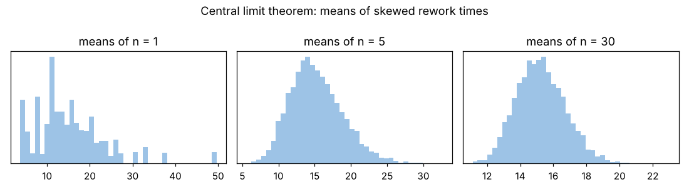

# Module 4 — Sampling Distributions: Central Limit Theorem, t, Chi-Square and F

**Time:** 60 min · **Day 2**

## Learning objectives

1. Explain why sample means are approximately normal (central limit theorem).
2. Know when to use the t, chi-square and F distributions.

## 1. The central limit theorem (CLT)

Averages of independent samples tend toward a normal distribution as n grows — even when individual values are skewed. Their standard deviation (the **standard error**) is σ/√n.

Demonstration with the skewed rework times (5,000 samples of each size):

```bash
python tools/statkit.py sampling
```

| Sample size n | SD of sample means | Theory s/√n | Skewness of means |
|---|---|---|---|
| 2 | 5.79 | 5.76 | 0.95 |
| 5 | 3.64 | 3.64 | 0.57 |
| 30 | 1.50 | 1.49 | **0.24** |



Means of 30 are nearly symmetric; this is why confidence intervals and tests for **means** are robust to moderate non-normality.

## 2. The sampling distributions you'll use

| Distribution | Arises from | Used for | Shape |
|---|---|---|---|
| **Student's t** | (x̄ − μ) / (s/√n) when σ is estimated by s | CIs and tests for means | Like the normal, fatter tails; → normal as df grows |
| **Chi-square** | (n − 1)s² / σ² for normal data | CIs and tests for one standard deviation; goodness of fit; contingency tables | Right-skewed, ≥ 0 |
| **F** | Ratio of two independent variances (s₁²/s₂²) | Comparing two variances; ANOVA; regression | Right-skewed, ≥ 0 |

### Critical values (95%)

| t (df 4) | t (df 9) | t (df 29) | z (∞) |
|---|---|---|---|
| 2.776 | 2.262 | 2.045 | 1.960 |

Chi-square with 24 df: 2.5th percentile 12.40, 97.5th 39.36. F(24, 24) 97.5th percentile: 2.27.

**Caution:** the chi-square and F procedures for variances depend strongly on the data being normal — unlike t procedures for means, the CLT doesn't rescue them.

## Check yourself

Why does a 95% CI for a mean use t = 2.262 with 10 observations instead of 1.96?

<details><summary>Answer</summary>

σ is unknown and estimated by s from only 10 values; the t distribution (df 9) accounts for that extra uncertainty with fatter tails.
</details>
