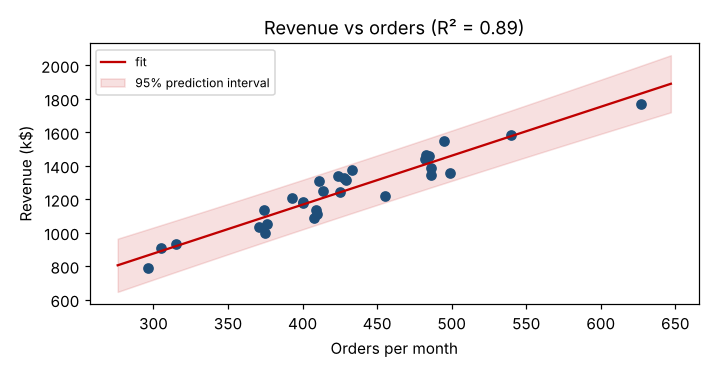

# Module 9 — Simple Linear Regression

**Time:** 60 min

## Learning objectives

1. Fit and interpret a straight-line model.
2. Make predictions with prediction intervals.

## 1. Model

  y = b₀ + b₁x + error; least squares minimizes Σ(y − ŷ)²

## 2. Revenue vs orders

```bash
python tools/statkit.py regression
```

  **Revenue (k$) = −2.1 + 2.924 × orders**

| Output | Value | Meaning |
|---|---|---|
| Slope | 2.924 k$ per order | Each extra order adds about $2.9k revenue |
| R² | 0.895 | Orders explain ~90% of month-to-month revenue variation |
| Slope p | < 0.001 | Real relationship |
| s | 70.9 k$ | Typical miss of a prediction |



## 3. Prediction

Next month's forecast: 500 orders → **1,460 k$**, 95% **prediction interval 1,310 to 1,610 k$**.

- A **confidence interval** for the mean response (average revenue of all months with 500 orders) is narrow.
- A **prediction interval** for one month adds individual scatter — use it for budgets.
- Don't extrapolate beyond the range of the data (≈ 300–630 orders here).

## 4. Check the model

Plot residuals vs fitted values and in time order: look for curvature, funnel shapes or trends. Independence matters for monthly data — seasonality would show as patterns in time.

## Check yourself

Why is the prediction interval wider than the confidence interval for the mean?

<details><summary>Answer</summary>

It includes both uncertainty in the fitted line and the natural month-to-month scatter around it.
</details>
