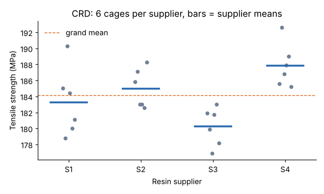

# Module 01: Single-Factor Design (Completely Randomized Design)

## Objectives

- Set up a completely randomized design (CRD) for one factor at *k* levels.
- Build the one-way ANOVA table by hand and read the F-test.
- Use Tukey's HSD to find which means differ, and check the equal-variance assumption.

## Concept

In a CRD, every experimental unit is assigned to a treatment at random, and runs happen in random order. The model is

y_ij = μ + τ_i + ε_ij,  with ε_ij ~ N(0, σ²)

where τ_i is the effect of level *i*. ANOVA splits the total variation into two parts:

- **Between treatments:** SS_B = Σ n_i (ȳ_i − ȳ)²
- **Within treatments (error):** SS_W = Σ Σ (y_ij − ȳ_i)²
- SS_T = SS_B + SS_W

Divide each SS by its degrees of freedom to get mean squares. Then F = MS_B / MS_W. A large F means the treatment means spread more than random error explains.

## Worked example: resin suppliers

The plant buys glass-filled nylon from four suppliers. It molds six cages from each supplier's resin, 24 in all, in a random order (`data/crd_suppliers.csv`), and measures tensile strength.

| Supplier | n | Mean (MPa) | SD |
|---|---|---|---|
| S1 | 6 | 183.27 | 4.22 |
| S2 | 6 | 184.97 | 2.44 |
| S3 | 6 | 180.27 | 2.36 |
| S4 | 6 | 187.85 | 2.72 |
| All | 24 | 184.09 | |



**Step 1: SS between.** 6 × [(183.27−184.09)² + (184.97−184.09)² + (180.27−184.09)² + (187.85−184.09)²] = 6 × 30.20 ≈ **181.2**

**Step 2: SS within.** Pool the deviations inside each group: Σ (n_i − 1) s_i² = 5 × (4.22² + 2.44² + 2.36² + 2.72²) ≈ **183.8**

**Step 3: the table.**

| Source | SS | df | MS | F | p |
|---|---|---|---|---|---|
| Supplier | 181.21 | 3 | 60.40 | 6.57 | 0.0029 |
| Error | 183.77 | 20 | 9.19 | | |
| Total | 364.99 | 23 | | | |

F(3, 20) at α = 0.05 is 3.10. Since 6.57 > 3.10, at least one supplier mean differs.

**Step 4: which ones?** ANOVA does not say which means differ. Tukey's HSD compares every pair while holding the family-wise error rate at 5 %:

HSD = q(0.05; 4, 20) × √(MS_W / n) = 3.958 × √(9.19 / 6) ≈ **4.90 MPa**

| Pair | Difference | Tukey p |
|---|---|---|
| S4 − S3 | 7.58 | 0.0017 |
| S4 − S1 | 4.58 | 0.072 |
| S3 − S2 | −4.70 | 0.063 |
| others | < 3.0 | > 0.34 |

Only S4 − S3 exceeds 4.90. The honest conclusion: **S4 is stronger than S3**. The other gaps may be real, but six cages per supplier cannot show them.

**Step 5: check the assumptions.**

- Equal variances: Levene's test gives p = 0.43, so there is no evidence of unequal spread. S1's SD of 4.2 looks larger, but that is within chance for n = 6.
- Normality: check a normal plot of the residuals.
- Independence: comes from the random run order.

## Run it

```bash
python tools/doekit.py crd
```

## Check yourself

1. Why does the error term have 20 degrees of freedom?
2. Purchasing wants to drop S3. Does the data support it?
3. With p = 0.072 for S4 − S1, should you report "no difference"?

<details><summary>Answers</summary>

1. N − k = 24 − 4. Each group spends one df on its own mean.
2. Partly. S3 is significantly weaker than S4 only. If the strength spec has margin, the cost and delivery of S3 may still matter more. Strength alone is not a supplier decision.
3. No. Report "not shown at this sample size". The interval for S4 − S1 runs from about −0.3 to 9.5 MPa. Module 06 shows how to size the experiment so a gap that matters would be detected.

</details>
