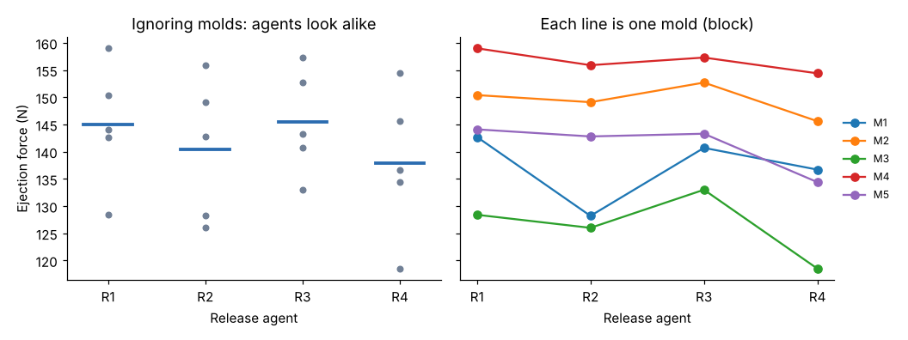

# Module 02: Randomized Block Design

## Objectives

- Recognize when a nuisance source should become a block.
- Build the randomized complete block design (RCBD) ANOVA.
- See how blocking shrinks the error term, and with it the effect you can detect.

## Concept

A **block** is a group of experimental units expected to be alike, such as one mold, one shift or one resin lot. In an RCBD, every treatment appears once in every block, and the run order is randomized *within* each block. The model adds a block term:

y_ij = μ + τ_i + β_j + ε_ij

The block term soaks up block-to-block variation that would otherwise sit in the error. You usually do not test blocks; you include them to clean up the error. The cost is degrees of freedom: b − 1 df move from error to blocks.

This is the "two-factor design without interaction" in many syllabi. There is one observation per treatment-block cell, so treatment × block interaction cannot be separated from error. The design assumes that interaction is negligible.

## Worked example: mold-release agents

Four release agents (R1 to R4) are tried on five production molds (M1 to M5). Molds differ a lot in surface finish and draft, so each mold is a block. Each mold runs all four agents in random order (`data/rbd_release_agent.csv`). The response is ejection force, in newtons.

| Mold | R1 | R2 | R3 | R4 | Mold mean |
|---|---|---|---|---|---|
| M1 | 142.7 | 128.2 | 140.7 | 136.7 | 137.07 |
| M2 | 150.4 | 149.1 | 152.7 | 145.6 | 149.45 |
| M3 | 128.4 | 126.0 | 133.0 | 118.5 | 126.48 |
| M4 | 159.0 | 155.9 | 157.3 | 154.4 | 156.65 |
| M5 | 144.1 | 142.8 | 143.3 | 134.4 | 141.15 |
| **Agent mean** | 144.92 | 140.40 | 145.40 | 137.92 | 142.16 |



**Analysis with blocks:**

| Source | SS | df | MS | F | p |
|---|---|---|---|---|---|
| Agent | 195.95 | 3 | 65.32 | 5.70 | 0.012 |
| Mold (block) | 2144.00 | 4 | 536.0 | 46.8 | < 0.001 |
| Error | 137.43 | 12 | 11.45 | | |
| Total | 2477.39 | 19 | | | |

**The same data analyzed as if it were a CRD (ignoring molds):**

| Source | SS | df | MS | F | p |
|---|---|---|---|---|---|
| Agent | 195.95 | 3 | 65.32 | 0.46 | 0.72 |
| Error | 2281.44 | 16 | 142.6 | | |

The agent SS is identical in both. What changed is the error: the mold variation (2144) moved out of it, so MS_error fell from 142.6 to 11.45. **Without blocking, the agent effect is invisible. With blocking, it is clear.** R4 gives the lowest ejection force on four of the five molds; the right panel of the figure shows the lines running roughly parallel.

## Hand calculation pattern

With *a* treatments and *b* blocks:

- SS_treatment = b Σ (ȳ_i· − ȳ)²
- SS_block = a Σ (ȳ_·j − ȳ)²
- SS_error = SS_total − SS_treatment − SS_block, with df (a − 1)(b − 1)

Check: SS_agent = 5 × [(144.92−142.16)² + (140.40−142.16)² + (145.40−142.16)² + (137.92−142.16)²] ≈ 5 × 39.2 ≈ 196 ✓

## Run it

```bash
python tools/doekit.py rbd
```

## Check yourself

1. Why must every agent appear in every mold?
2. When would blocking *hurt* rather than help?
3. Could you test whether R4 works better on some molds than others?

<details><summary>Answers</summary>

1. Then every agent comparison happens inside the same block, so mold differences cancel. If a mold misses an agent, the design is incomplete and needs a different analysis (balanced incomplete block designs).
2. When blocks do not differ. You spend b − 1 error df and gain nothing, so F-tests get slightly less sensitive. With 12 vs 16 error df, the loss is small; with very few runs it matters.
3. Not with one observation per cell, because the interaction is confounded with error. You would need replicates inside each mold, which turns this into a two-factor factorial (Module 04).

</details>
