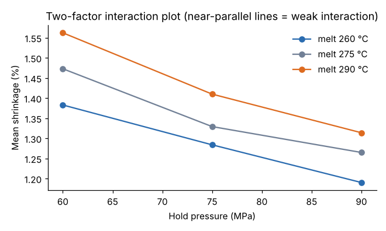

# Module 04: Two-Factor Factorial with Interaction

## Objectives

- Lay out a replicated a × b factorial.
- Compute the two-factor ANOVA table by hand from a table of cell means.
- Read an interaction plot and say what a significant (or non-significant) interaction means for the process.

## Concept

In a **factorial** design, every level of factor A is run with every level of factor B. With *n* replicates per cell there are a·b·n runs. Because each cell is replicated, we can separate the **interaction** from error:

y_ijk = μ + τ_i + β_j + (τβ)_ij + ε_ijk

**Interaction** means the effect of A changes with the level of B. On an interaction plot, parallel lines mean no interaction, and lines that converge, diverge or cross mean there is one. If the interaction is significant, do not interpret main effects alone; compare cell means instead.

## Worked example: shrinkage vs melt temperature and hold pressure

Melt temperature (260, 275, 290 °C) × hold pressure (60, 75, 90 MPa), 3 replicates per cell, 27 runs in random order (`data/twofactor_shrinkage.csv`). The response is linear shrinkage, in %.

**Cell means (%)**

| Melt \ Hold | 60 | 75 | 90 | Row mean |
|---|---|---|---|---|
| 260 | 1.383 | 1.284 | 1.190 | 1.2858 |
| 275 | 1.473 | 1.329 | 1.265 | 1.3558 |
| 290 | 1.562 | 1.410 | 1.314 | 1.4288 |
| **Column mean** | 1.4728 | 1.3411 | 1.2564 | **1.3568** |



### Calculations for two-factor tables

Here a = 3, b = 3, n = 3, N = 27, and ȳ = 1.3568.

1. **SS_A (melt temp)** = b·n Σ (row mean − ȳ)²
   = 9 × [(1.2858 − 1.3568)² + (1.3558 − 1.3568)² + (1.4288 − 1.3568)²]
   = 9 × [0.005041 + 0.000001 + 0.005184] ≈ **0.0920**
2. **SS_B (hold pressure)** = a·n Σ (column mean − ȳ)²
   = 9 × [(0.1160)² + (−0.0157)² + (−0.1004)²] ≈ **0.2139**
3. **SS_cells** = n Σ (cell mean − ȳ)², computed from the nine cells; this gives ≈ 0.30985.
4. **SS_AB** = SS_cells − SS_A − SS_B ≈ 0.30985 − 0.09203 − 0.21391 = **0.0039**
5. **SS_T** = Σ (y − ȳ)² over all 27 runs = **0.3245**
6. **SS_E** = SS_T − SS_cells = **0.0146**, with ab(n − 1) = 18 df

| Source | SS | df | MS | F | p |
|---|---|---|---|---|---|
| Melt temp (A) | 0.09203 | 2 | 0.04602 | 56.5 | < 0.001 |
| Hold pressure (B) | 0.21391 | 2 | 0.10696 | 131.4 | < 0.001 |
| A × B | 0.00391 | 4 | 0.00098 | 1.20 | 0.34 |
| Error | 0.01465 | 18 | 0.00081 | | |
| Total | 0.32451 | 26 | | | |

Critical values: F(2, 18) = 3.55 and F(4, 18) = 2.93.

### Interpretation

- Both main effects are strong. Raising hold pressure from 60 to 90 MPa cuts shrinkage by about 0.22 points. Raising melt temperature from 260 to 290 °C adds about 0.14 points.
- The interaction is **not** significant (p = 0.34), and the lines on the plot are close to parallel. So the main effects can be read on their own: the best pressure is the same at every temperature.
- Lowest-shrinkage cell: 260 °C / 90 MPa at 1.190 %. Do not adopt it on shrinkage alone. Low melt temperature can hurt fill and weld-line strength, so check those responses first.

## Computer application

```python
import statsmodels.formula.api as smf, statsmodels.api as sm
m = smf.ols("shrinkage ~ C(melt_temp) * C(hold_pressure)", data=df).fit()
print(sm.stats.anova_lm(m, typ=2))
```

or run `python tools/doekit.py twofactor`, which also prints the hand-calculated SS for comparison.

## Check yourself

1. Why can't Module 02's design (one run per cell) estimate the interaction?
2. What would the interaction plot look like if hold pressure helped at 260 °C but did nothing at 290 °C?
3. The interaction p-value is 0.34. Does that prove there is no interaction?

<details><summary>Answers</summary>

1. With n = 1, SS_cells equals SS_total, so there is nothing left to estimate error. The interaction and error are the same quantity.
2. The 260 °C line would slope down while the 290 °C line stayed flat. The lines diverge, which is a clear interaction.
3. No. It means any interaction is small compared with the noise at this sample size. Here the estimated interaction SS is about 1 % of the total, so it is also small in practical terms.

</details>
