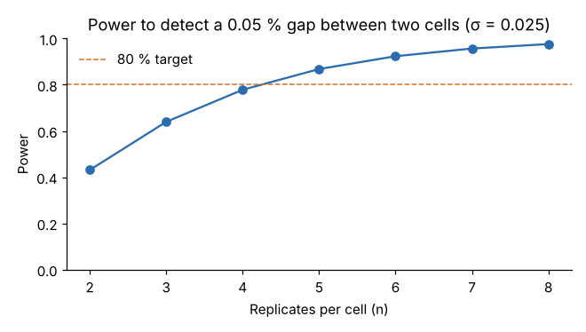

# Module 06: Replications and Sample Size

## Objectives

- Explain what replication buys: an error estimate and detection power.
- Compute the power of a factorial to detect a stated difference.
- Choose the number of replicates before running anything.

## Concept

Replicates do two jobs:

1. **Estimate error.** Error df = N − (number of cells) in a full factorial. With too few df, the F critical value is large and the estimate of σ is shaky.
2. **Shrink the standard error of means.** A cell mean from n replicates has SE = σ/√n, and a difference of two cell means has SE = σ√(2/n).

**Power** is the probability that the experiment flags a difference of size Δ when Δ really exists. It depends on Δ, σ, α and n. Settle the question *before* running: "What is the smallest difference worth finding, and how sure do we want to be of finding it?" The usual target is power ≥ 0.80.

For comparing two cell means with a t-test that uses the pooled ANOVA error:

- noncentrality δ = Δ / (σ √(2/n))
- power = P(|T'| > t_crit), where T' follows a noncentral t distribution with df_E degrees of freedom and noncentrality δ

## Worked example: how many replicates for the shrinkage study?

Planning values:

- From earlier runs, σ ≈ 0.025 % shrinkage.
- A 0.05-point gap between two cells would move parts out of the tolerance band, so Δ = 0.05.
- The design is 3 × 3 (9 cells) and α = 0.05.

| Replicates per cell (n) | Total runs | Error df | Power |
|---|---|---|---|
| 2 | 18 | 9 | 0.43 |
| 3 | 27 | 18 | 0.64 |
| 4 | 36 | 27 | 0.78 |
| 5 | 45 | 36 | 0.87 |
| 6 | 54 | 45 | 0.92 |



Module 04 used n = 3, which gives only a 64 % chance of detecting a 0.05-point gap between two particular cells. That was enough for the main effects, which pool 9 runs per level and were large. It was **not** enough to rule out modest cell-to-cell differences. To reach 80 % power for that comparison, plan **n = 5** (45 runs).

Power for a **main effect** is much higher than for a single-cell comparison, because each level mean averages b·n runs. This is a second reason factorials are efficient.

## Where σ comes from

- a previous experiment's MS_error (√MS_E);
- process capability data, taken *within* a short time window, not long-term σ;
- a small pilot run.

If σ is uncertain, compute power for a pessimistic σ as well. When in doubt, plan more replicates, or plan a sequential approach: screen first, then confirm.

## Run it

```bash
python tools/doekit.py reps
```

## Check yourself

1. Doubling n from 3 to 6 does not double the power. Why?
2. What happens to the needed n if σ is really 0.035 instead of 0.025?
3. Is it acceptable to keep adding replicates until p < 0.05?

<details><summary>Answers</summary>

1. Power depends on δ, which grows with √n, and power is capped at 1. Going from 3 to 6 raises δ by √2 ≈ 1.41 and power from 0.64 to 0.92.
2. δ falls by a factor of 0.025/0.035 ≈ 0.71, so n must grow by about (0.035/0.025)² ≈ 2 times to keep the same δ. The exact calculation gives n = 8 per cell (power 0.80, 72 runs). Since n = 5 already slightly overshoots 0.80 at σ = 0.025, the exact factor is a little under 2.
3. No. That is optional stopping, and it inflates the false-alarm rate well above 5 %. Fix n in advance, or use a formal sequential design.

</details>
